<!-- Generato da scripts/gen-catalog.ts (npm run gen:catalog): non modificare a mano. -->

# Catalogo dei blocchi

**site-starter — libreria di blocchi per siti vetrina**, versione **v0.0.5** (`library.manifest.json`). Le fixture usano attività di esempio di settori diversi (artigiano, negozio, ristorante, studio professionale) con recapiti finti. Tutto quello che segue è generato da `npm run gen:catalog` a partire da schemi, schede e fixture; gli screenshot da `npm run screenshots`; gli stessi dati per le macchine sono in [`catalogo.json`](catalogo.json). `npm run check` fallisce se questa cartella non corrisponde agli schemi.

Dal vivo: `/catalogo` (indice a schede con le miniature e il pannello «Tema» per palette, font, forma, decoro e texture), `/catalogo/<tipo>/` (un blocco con tutte le fixture e «Copia JSON» per ogni variante), `/catalogo/<tipo>/<variante>/` (una variante da sola), `/catalogo/tutti` (tutti i blocchi dal vivo insieme), `/catalogo/temi` (palette, font e forme a confronto), `/catalogo/sfondi` (gli effetti di sfondo sui tre toni), `/catalogo/bottoni`, `/catalogo/ui`, `/catalogo/icone`.

Per consultazioni mirate: `npm run catalog:query` (indice breve), `-- hero` (scheda), `-- --cerca foto`, `-- --temi artigiano`, `-- --icone telefono`, `-- --regole`. Il comando legge solo questo catalogo locale e funziona anche nei siti cliente; non richiede Astro acceso.

## Regole d’oro delle ricette

1. Un solo hero per pagina, come prima sezione: contiene l’unico h1. *(controllo recipes)*
2. Di norma una cta, verso la fine, dopo i blocchi che convincono (servizi, lavori, domande); non nelle pagine legali ("kind": "legale"). *(controllo recipes)*
3. Due sezioni vicine non hanno lo stesso tone (default, muted, primary). *(controllo recipes)*
4. Effetto dello sfondo (background) su poche sezioni: al massimo 3 per pagina, mai in due sezioni vicine. *(controllo recipes)*
5. Bordo in alto (edge) al massimo su 2 sezioni per pagina, mai sulla prima e solo dopo una sezione di tone diverso, altrimenti non si vede. *(controllo recipes)*
6. Ogni blocco ammette solo gli effetti di sfondo della sua scheda: aurora solo in hero e cta, moduli, domande, schede e contatti solo pieno o sfumato. *(build)*
7. Al massimo 12 sezioni: oltre, meglio dividere la pagina. *(controllo recipes)*
8. Al massimo un accordion faq per pagina: i dati strutturati FAQPage per Google sono uno solo. *(controllo recipes)*
9. Solo blocchi e varianti del catalogo; header e footer non sono sezioni ma stanno in layout.json. *(build)*
10. Recapiti mai nei testi: nei pulsanti i link speciali (@telefono, @whatsapp, @email, @mappa), nelle cta showContacts. *(controllo recipes)*
11. Link interni solo a pagine e ancore che esistono; ogni id di sezione è in kebab-case e unico nella pagina. *(controllo recipes)*
12. Ogni foto ha un alt che dice cosa mostra, non il nome del file. *(controllo recipes)*
13. Testi entro i limiti dei campi (titoli 70 caratteri, pulsanti 25...): sono nelle schede dei blocchi. *(build)*
14. Niente segnaposto (DA-COMPILARE, lorem, TODO) in una pagina pubblicata. *(controllo release)*

<!-- regole-di-composizione:inizio -->
## Regole di composizione

<!-- Scritta a mano: npm run gen:catalog ricopia questa sezione com'è. Le regole verificate dai controlli sono le «Regole d'oro» qui sopra (src/core/recipe-rules.ts); qui le scelte di composizione, le stesse della skill composizione (.agents/skills/composizione/SKILL.md). -->

Oltre alle regole d'oro, che i controlli verificano, le scelte di composizione:

1. **Il materiale decide le varianti.** Prima di scegliere i blocchi si guarda cosa c'è: foto, recensioni, numeri con la fonte, recapiti di `site.json`. Hero `split`/`full`, servizi `cards-immagine`/`alternato`, about `immagine-testo`, gallery, schede `testo-immagine` e carosello vogliono foto vere dell'attività; senza, si usa la variante senza foto (hero `centered`, servizi `cards-icone`) o si toglie la sezione. Recensioni e numeri solo reali e con la fonte, altrimenti il blocco non c'è.
2. **Una sezione senza contenuto si toglie, non si riempie.** Meglio una home di 6 sezioni piene che di 10 con testi generici.
3. **Informazioni importanti in vista.** Prezzi, garanzie e ciò che tutti devono leggere non vanno dentro voci chiuse (accordion, schede): meglio un testo aperto.
4. **Il tono più forte con misura.** `primary` una o due volte per pagina, di solito per la cta; se la pagina chiude con una cta, nel footer la fascia di contatto (`ctaBand`) resta spenta.
5. **Un invito alla volta.** Mai più di due cta per pagina, e al massimo una `banner`; ogni pagina non legale ne ha almeno una, verso la fine.
6. **Effetti e bordi dove servono.** Gli effetti di sfondo vanno all'apertura, a un punto chiave e all'invito finale; sotto una hero `full` non si vedono. Un solo tipo di bordo (`edge`) per sito, scelto col carattere del tema: `onda` morbido, `diagonale` deciso, `curva` per l'invito finale.
7. **Ritmo vario.** Sezioni dense (griglie di card) e leggere (un testo, una recensione, un invito) si alternano: mai tre griglie di card di fila. La home ha di solito da 6 a 9 sezioni, le pagine interne da 4 a 6.
8. **Strutture di partenza.** Per tipo di pagina e settore (lavori a domicilio, locali, studi professionali, ospitalità) in `.agents/skills/composizione/strutture.md`; pagine pronte in `ricette-tipo/`.
<!-- regole-di-composizione:fine -->

## Blocchi

Sezioni delle ricette di pagina (`scope: "page"`), nell’ordine in cui compaiono di solito in una pagina.

| Blocco | Categoria | Varianti | Quando usarlo |
| --- | --- | --- | --- |
| [hero — Hero](blocchi/hero.md) | apertura | `split`, `full`, `slider`, `centered` | Come primo blocco di una pagina, per dire subito cosa fa l’attività e cosa può fare chi visita (chiedere un preventivo, prenotare, chiamare). |
| [accordion — Accordion](blocchi/accordion.md) | contenuti | `faq`, `contenuti` | Per le domande frequenti (variante faq, che Google può mostrare nei risultati) o per informazioni di dettaglio che solo alcuni cercano: condizioni, tempi, cosa preparare prima di un appuntamento. |
| [carousel — Carosello](blocchi/carousel.md) | contenuti | `immagini`, `immagini-testo` | Per una serie di elementi dello stesso tipo che si sfogliano: foto dei lavori finiti, prima e dopo, progetti, recensioni con foto. |
| [about — Chi siamo](blocchi/about.md) | contenuti | `immagine-testo`, `con-numeri` | Nella pagina «Chi siamo» o come sezione di presentazione in home. Con i numeri solo se il cliente li ha forniti e sa dire da dove vengono. |
| [process — Come lavoriamo](blocchi/process.md) | contenuti | `passi-numerati`, `timeline` | Quando il cliente deve sapere cosa succede dopo averti contattato: preventivo, sopralluogo, lavoro, consegna. |
| [gallery — Galleria](blocchi/gallery.md) | contenuti | `griglia-popup`, `prima-dopo`, `slider` | Per mostrare lavori, locali o prodotti veri, quando le foto parlano da sole. Solo foto reali fornite dal cliente. |
| [features — Punti di forza](blocchi/features.md) | contenuti | `3-colonne`, `lista` | Per dire perché scegliere l’attività: garanzie, modo di lavorare, cosa la distingue. Di solito dopo i servizi o prima della cta. |
| [testimonials — Recensioni](blocchi/testimonials.md) | contenuti | `cards`, `singola`, `slider` | Quando il cliente ha recensioni reali (Google, Facebook, messaggi) e può dire dove sono state scritte. |
| [tabs — Schede](blocchi/tabs.md) | contenuti | `testo`, `testo-immagine` | Quando chi visita sceglie una strada tra poche alternative parallele dello stesso tipo: pranzo o cena, privati o imprese, servizi di base o completi. |
| [services — Servizi](blocchi/services.md) | contenuti | `cards-icone`, `cards-immagine`, `alternato`, `schede` | Per dire cosa fa l’attività, di solito subito dopo l’hero. Nella pagina dei servizi, con la variante alternato, per dare più spazio a ciascuno. |
| [contact — Contatti](blocchi/contact.md) | contatti | `info-mappa`, `info-cta` | Nella pagina contatti, o in fondo a una pagina che deve far trovare l’attività. Telefono, WhatsApp, email, indirizzo e orari non si scrivono nel blocco: arrivano da site.json. |
| [cta — Invito all’azione](blocchi/cta.md) | contatti | `banner`, `split-contatto` | Dopo i blocchi che convincono (servizi, lavori, recensioni) e in fondo alla pagina, prima del footer. Con showContacts mostra telefono e WhatsApp dell’attività presi da site.json. |
| [form — Modulo di contatto](blocchi/form.md) | contatti | `contatto`, `preventivo` | Quando chi visita deve inviare una richiesta scritta. Configura Resend secondo docs/form.md; il destinatario è l’email di site.json. Il catalogo simula l’invio senza spedire email. |
| [areas — Zone servite](blocchi/areas.md) | contatti | `elenco-zone`, `mappa-link` | Per rendere chiara la copertura locale di un servizio a domicilio o di un’attività. Usa nomi di comuni e quartieri realmente serviti. |

## Blocchi di layout

Header e footer sono uguali su tutte le pagine: non stanno nelle ricette ma in `src/content/settings/layout.json`, una chiave per blocco, e li disegna BaseLayout. Le opzioni:

### [header — Header](blocchi/header.md)

| Opzione | Valori | Obbl. | Note |
| --- | --- | --- | --- |
| `variant` | `semplice` · `con-cta` | sì | semplice: logo e menu · con-cta: aggiunge il pulsante in evidenza del «Menu» · con-cta richiede la cta in navigation.json. |
| `sticky` | sì/no | sì | L’intestazione resta visibile mentre si scorre la pagina |
| `logo` | `testo` · `immagine` | no | testo: il nome dell’attività · immagine: il logo caricato in «Dati attività». Vuoto: il logo se c’è, altrimenti il nome · immagine richiede il logo in site.json. |

### [footer — Footer](blocchi/footer.md)

| Opzione | Valori | Obbl. | Note |
| --- | --- | --- | --- |
| `variant` | `colonne` · `minimale` | sì | colonne: logo, link, contatti, orari e social · minimale: una riga con nome, P.IVA, link legali e social |
| `ctaBand` | sì/no | sì | Sopra il footer, un titolo con i pulsanti per chiamare e scrivere su WhatsApp |
| `ctaBandTitle` | max 70 | no | Al massimo 70 caratteri; vuoto: «Parliamo del tuo progetto» · Usato solo con ctaBand attivo. |

Esempio di `layout.json` (dalle fixture):

```json
{
	"header": {
		"variant": "semplice",
		"sticky": false,
		"logo": "testo"
	},
	"footer": {
		"variant": "colonne",
		"ctaBand": false
	}
}
```

## Link speciali

Nei link dei pulsanti (`href` delle cta e del menu) i recapiti non si scrivono: si usano questi valori, che la build risolve con i dati di `src/content/settings/site.json` (e si ferma se il dato manca).

| Link | Diventa | Dato di site.json |
| --- | --- | --- |
| `@telefono` | `tel:` col numero senza spazi | `phone` |
| `@whatsapp` | chat `https://wa.me/` | `whatsapp` |
| `@email` | `mailto:` | `email` |
| `@mappa` | ricerca dell’indirizzo su Google Maps | `address` |

## Effetti di sfondo

Accanto a `tone`, ogni sezione può avere `background`: un effetto dipinto sopra il colore del tono, con i colori della palette (CSS in `src/themes/backgrounds.css`). Il valore di partenza è `pieno`; gli altri servono a far notare poche sezioni: al massimo 3 per pagina, mai due vicine (controllo recipes). Ogni blocco ammette solo gli effetti della sua scheda (build). Il contrasto dei testi nel punto più carico è verificato su ogni palette e tono (controllo contrast). L’intensità dei veli dipende dalla palette (`--fx-default`, `--fx-muted`): la più alta che lascia i testi AA, quindi le palette con più margine di contrasto hanno effetti più visibili, terracotta i più tenui. Gli screenshot qui sotto, e quelli di decori, texture e bordi, usano la palette `laguna`, di intensità tipica. Sotto una foto a tutta sezione l’effetto non si vede. Dal vivo su `/catalogo/sfondi`, ogni effetto da solo su `/catalogo/sfondi/<effetto>/`.

| Effetto | Nome | Com’è | Quando usarlo | Blocchi |
| --- | --- | --- | --- | --- |
| `pieno` | Pieno | Solo il colore del tono, senza effetti. | La maggior parte delle sezioni: è il valore di partenza. | `hero`, `accordion`, `carousel`, `about`, `process`, `gallery`, `features`, `testimonials`, `tabs`, `services`, `contact`, `cta`, `form`, `areas` |
| `sfumato` | Sfumato | Sfumatura leggera in diagonale verso un velo di primary; sul tono primary verso primary-hover. | Per dare profondità a una sezione senza farla notare; va bene anche dietro a moduli e domande. | `hero`, `accordion`, `carousel`, `about`, `process`, `gallery`, `features`, `testimonials`, `tabs`, `services`, `contact`, `cta`, `form`, `areas` |
| `alone` | Alone | Due luci morbide in angoli opposti, in alto a destra e in basso a sinistra, con primary e accent molto diluiti. | Per scaldare una sezione da far notare: chi siamo, recensioni, invito finale. | `hero`, `carousel`, `about`, `process`, `gallery`, `features`, `testimonials`, `services`, `cta`, `areas` |
| `aurora` | Aurora | Tre aloni morbidi di primary, accent e del tono vicino, sparsi nella sezione (mesh gradient): l’effetto più scenografico. | Solo per l’apertura (hero) o l’invito finale (cta), una volta per pagina. | `hero`, `cta` |
| `decoro` | Decoro | Il motivo del sito (pattern di theme.json: punti, griglia, righe, onde, cerchi o arco) che sfuma verso il centro della sezione. | Per dare carattere a una o due sezioni con lo stesso segno in tutto il sito; con pattern «nessuno» la sezione resta piena. | `hero`, `carousel`, `about`, `process`, `gallery`, `features`, `testimonials`, `services`, `cta`, `areas` |

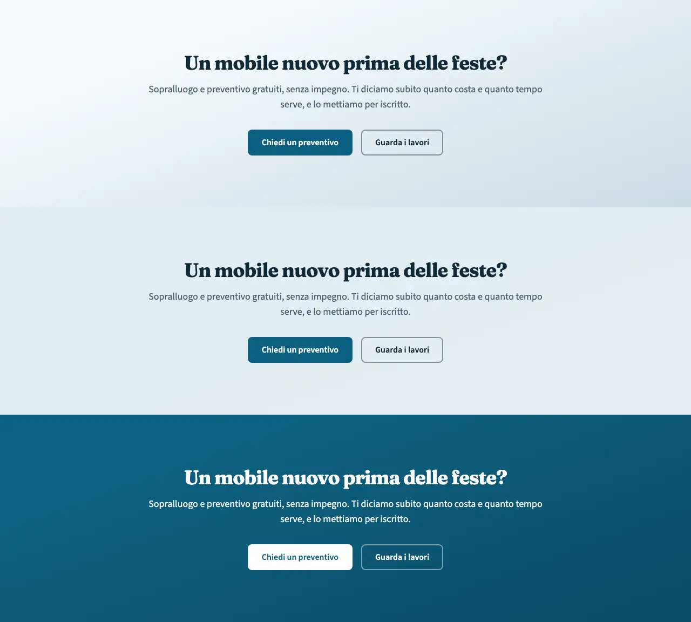
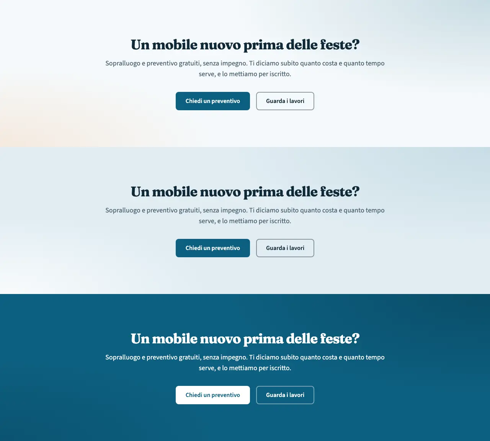
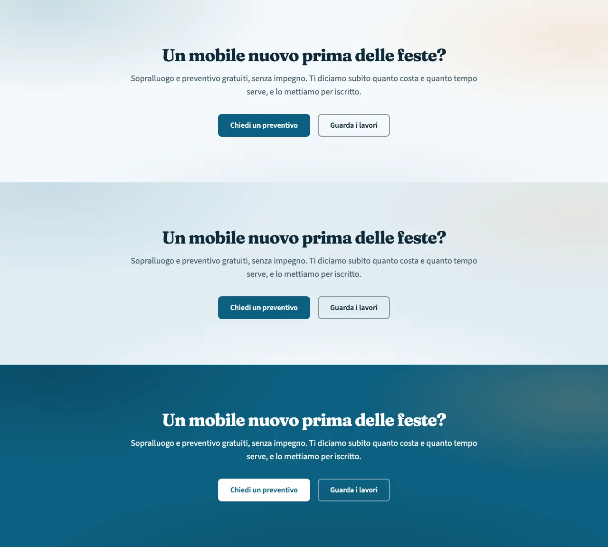

## Bordi tra sezioni

Accanto a `tone` e `background`, ogni sezione può avere `edge`: il bordo in alto prende una forma nel colore della sezione e copre il fondo della sezione precedente (CSS in `src/themes/edges.css`, nessun colore nuovo). Il valore di partenza è `dritto`. Si vede solo dopo una sezione di tone diverso, non si applica alla prima sezione; al massimo 2 per pagina (controllo recipes). Dal vivo in fondo a `/catalogo/sfondi` e su `/catalogo/sfondi/bordi/`.

| Bordo | Nome | Com’è | Quando usarlo |
| --- | --- | --- | --- |
| `dritto` | Dritto | Il bordo in alto è una linea dritta, come sempre. | La maggior parte delle sezioni: è il valore di partenza. |
| `onda` | Onda | Il bordo in alto è un’onda morbida, nel colore della sezione. | Siti dal tono morbido o naturale: benessere, mare, natura, bambini. |
| `diagonale` | Diagonale | Il bordo in alto sale in diagonale da sinistra a destra. | Siti dal tono deciso o tecnico: officine, edilizia, sport. |
| `curva` | Curva | Il bordo in alto è un arco largo e basso, più alto al centro. | Per far risaltare una sezione di chiusura, come l’invito finale. |

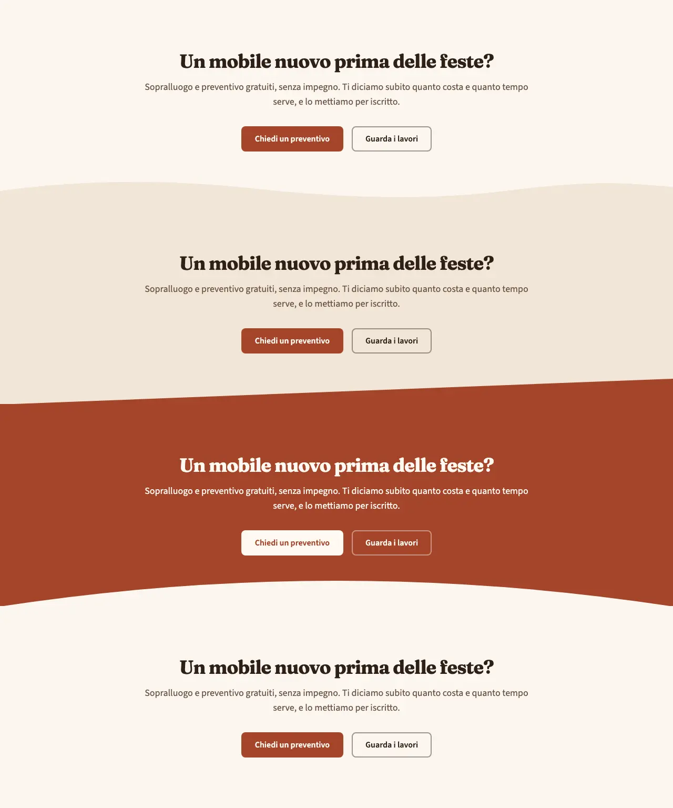

## Temi

L’aspetto si sceglie in `src/content/settings/theme.json` con cinque preset (`palette`, `fonts`, `shape`, `pattern`, `texture`), ciascuno con la sua scheda `<nome>.meta.ts` accanto al CSS in `src/themes/`. `pattern` e `texture` hanno un valore di partenza (`nessuno`, `liscia`). Una variante da sola accetta `?palette=…&fonts=…&shape=…&pattern=…&texture=…`.

| Chiave | Valori | Note |
| --- | --- | --- |
| `palette` | `terracotta` · `ardesia` · `salvia` · `cipria` · `laguna` · `bordeaux` · `cobalto` · `antracite` · `prugna` · `notte` | «Palette» I colori del sito: ogni palette ha il contrasto AA verificato (check contrast) |
| `fonts` | `moderno` · `classico` · `elegante` · `autorevole` · `fresco` · `amichevole` · `carattere` · `robusto` · `gourmet` · `preciso` | «Caratteri» La coppia di font per titoli (font-heading) e testo (font-body) |
| `shape` | `squadrato` · `morbido` · `arrotondato` | «Forma» Il raggio degli angoli di card e riquadri (rounded-box) e dei pulsanti (rounded-button) |
| `pattern` | `nessuno` · `punti` · `griglia` · `righe` · `onde` · `cerchi` · `arco` | «Decoro» Il motivo delle sezioni con background "decoro", uno per sito; con «nessuno» quelle sezioni restano piene |
| `texture` | `liscia` · `grana` · `carta` | «Texture» La grana sopra lo sfondo di ogni sezione, mai sopra il testo: liscia (nessuna), grana, carta |

### Palette

| Preset | Nome | Mood | Adatta a | Colori |
| --- | --- | --- | --- | --- |
| `terracotta` | Terracotta | caldo, accogliente, artigianale | ristoranti e trattorie, agriturismi, botteghe artigiane, negozi di prodotti tipici, artigiani della casa e delle finiture | bg `#fbf6ef` · surface `#f2e6d7` · fg `#2e1f17` · primary `#a5452a` · accent `#56652b` |
| `ardesia` | Ardesia | sobrio, moderno, professionale | impiantisti ed elettricisti, studi tecnici e professionali, officine e carrozzerie, pulizie e manutenzioni, servizi alle imprese | bg `#f8fafb` · surface `#eaeef1` · fg `#1b2228` · primary `#2d4a5e` · accent `#e5a13a` |
| `salvia` | Salvia | fresco, naturale, rassicurante | studi medici e fisioterapisti, erboristerie e farmacie, centri benessere e yoga, vivai e giardinieri, prodotti biologici | bg `#f6f8f4` · surface `#e5ece3` · fg `#1b2a21` · primary `#3a6649` · accent `#c9a66b` |
| `cipria` | Cipria | delicato, elegante, curato | estetiste e centri estetici, parrucchieri, fioristi, wedding planner e atelier sposa, negozi di abbigliamento | bg `#fcf7f6` · surface `#f4e5e4` · fg `#2b1d22` · primary `#94405b` · accent `#4a6766` |
| `laguna` | Laguna | fresco, luminoso, solare | B&B e case vacanza, stabilimenti balneari, noleggi e nautica, pescherie e ristoranti di pesce, scuole di vela e sub | bg `#f5f9fb` · surface `#e1edf3` · fg `#0f2938` · primary `#0d5f80` · accent `#f2a65e` |
| `bordeaux` | Bordeaux | raffinato, classico, caldo | enoteche e cantine, ristoranti gastronomici, hotel e dimore storiche, gioiellerie, notai e studi legali | bg `#faf7f4` · surface `#efe6df` · fg `#24171a` · primary `#7a1f33` · accent `#c49a45` |
| `cobalto` | Cobalto | affidabile, nitido, dinamico | commercialisti e consulenti, assicurazioni, informatica e assistenza tecnica, ottici, autoscuole e scuole | bg `#f7f9fc` · surface `#e6ecf6` · fg `#141c2b` · primary `#1e48a6` · accent `#0d7a70` |
| `antracite` | Antracite | solido, concreto, energico | imprese edili, serramentisti e fabbri, traslochi e logistica, noleggio attrezzature, ferramenta e colorifici | bg `#fafaf7` · surface `#ebeae3` · fg `#1e1f1c` · primary `#2e3336` · accent `#f2b705` |
| `prugna` | Prugna | creativo, morbido, originale | fotografi e studi creativi, scuole di danza e musica, librerie e cartolerie, psicologi e counselor, negozi per bambini | bg `#faf8fc` · surface `#eee8f4` · fg `#221a2d` · primary `#5a3889` · accent `#e48a6a` |
| `notte` | Notte | notturno, deciso, d’atmosfera | cocktail bar e locali serali, barbieri, tatuatori, palestre e box di crossfit, studi di registrazione | bg `#14161a` · surface `#1f2228` · fg `#eceae6` · primary `#e3b04b` · accent `#6cbfb3` |


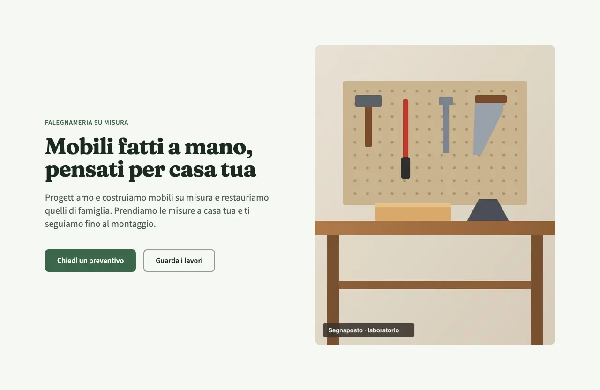
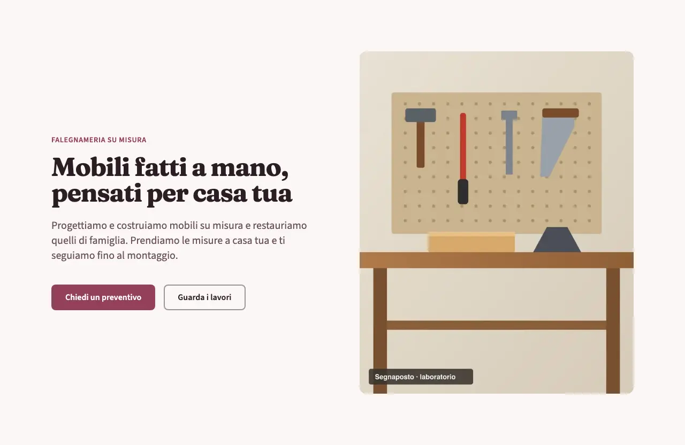
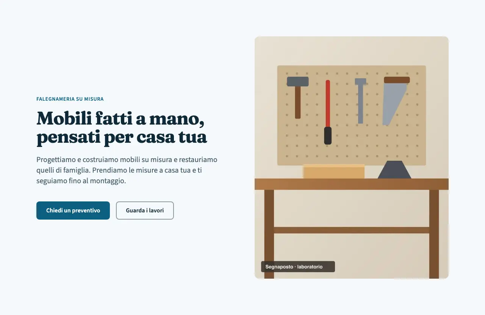
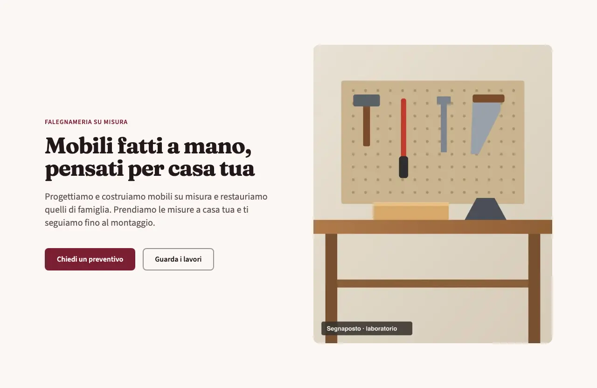
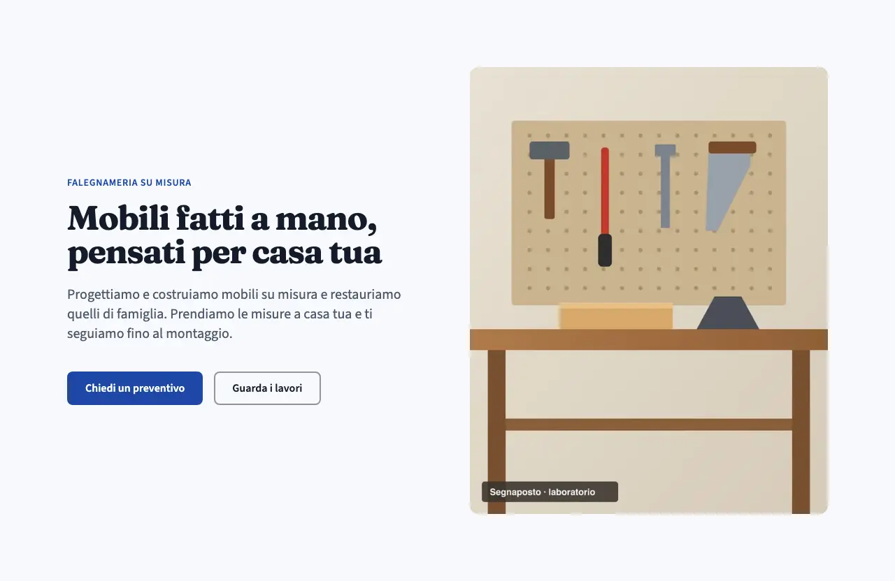
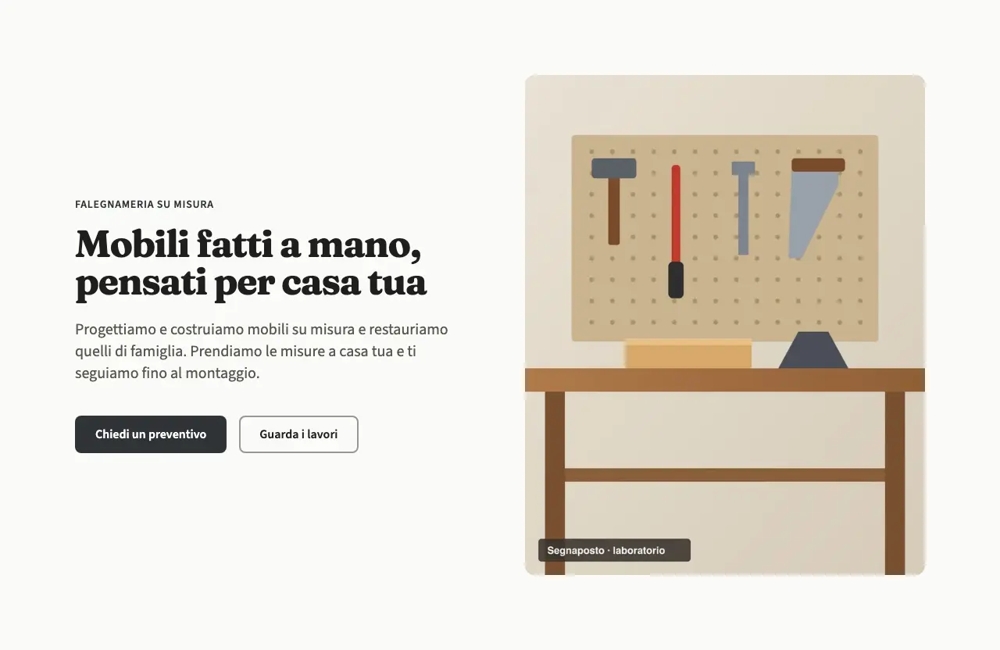
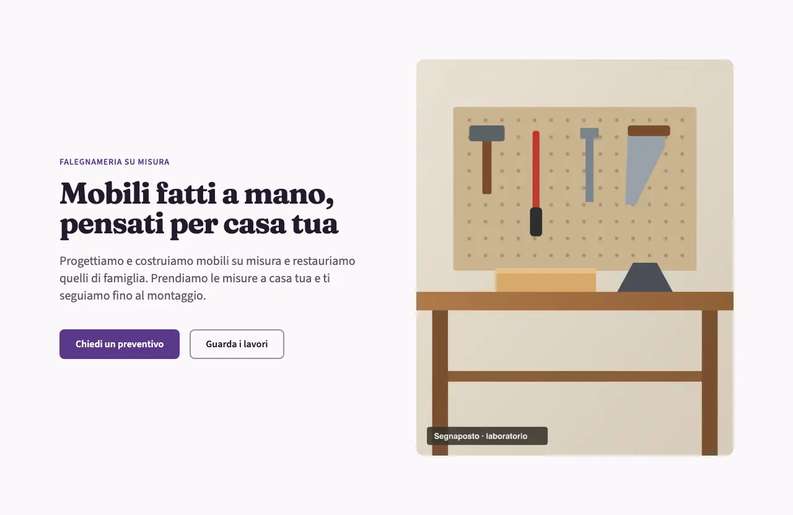
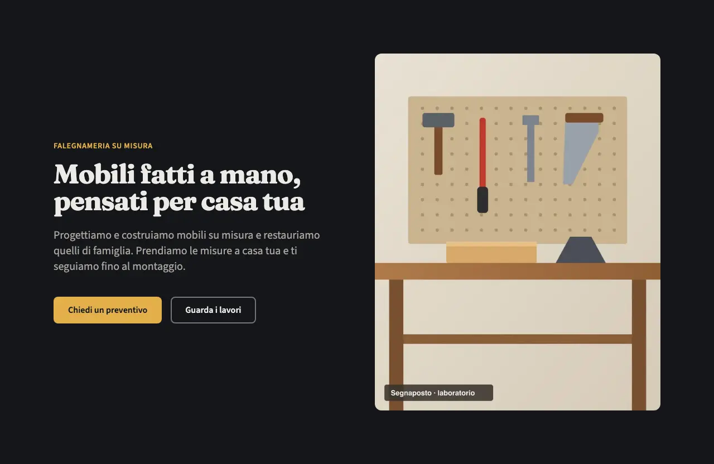

### Font

| Preset | Nome | Mood | Adatta a | Titoli | Testo |
| --- | --- | --- | --- | --- | --- |
| `moderno` | Moderno | pulito, tecnico, contemporaneo | impiantisti e servizi tecnici, studi professionali, officine, attività giovani | Manrope | Inter |
| `classico` | Classico | caldo, tradizionale, leggibile | artigiani e botteghe, ristorazione, turismo e ospitalità, attività di tradizione | Fraunces | Source Sans 3 |
| `elegante` | Elegante | raffinato, lussuoso, discreto | hotel e dimore storiche, matrimoni ed eventi, gioiellerie e boutique, centri estetici e spa | Cormorant | Jost |
| `autorevole` | Autorevole | sobrio, affidabile, istituzionale | studi legali e notarili, commercialisti e consulenti, studi medici e dentistici, agenzie immobiliari | Newsreader | Public Sans |
| `fresco` | Fresco | giovane, dinamico, diretto | palestre e personal trainer, scuole di danza e sport, eventi e intrattenimento, servizi digitali | Outfit | Figtree |
| `amichevole` | Amichevole | morbido, rassicurante, gentile | asili e ludoteche, pediatri e logopedisti, veterinari e toelettature, negozi per bambini | Nunito | Nunito Sans |
| `carattere` | Carattere | personale, vivace, contemporaneo | caffetterie e bistrot, birrifici e pub, barbieri e tatuatori, studi creativi | Bricolage Grotesque | Hanken Grotesk |
| `robusto` | Robusto | deciso, industriale, solido | officine e carrozzerie, imprese edili, carpenterie e fabbri, traslochi e logistica | Big Shoulders | Archivo |
| `gourmet` | Gourmet | ricercato, goloso, scenografico | ristoranti, enoteche e cantine, pasticcerie e gelaterie, gastronomie | Playfair Display | Work Sans |
| `preciso` | Preciso | essenziale, tecnico, nitido | architetti e geometri, ingegneri e progettisti, fotografi, studi di design | Sora | Instrument Sans |

### Forme

| Preset | Nome | Mood | Adatta a | Raggi |
| --- | --- | --- | --- | --- |
| `squadrato` | Squadrato | rigoroso, tecnico, essenziale | studi tecnici e professionali, imprese edili e impiantisti, officine e carrozzerie, negozi di elettronica e ferramenta | card `0` · pulsanti `0` |
| `morbido` | Morbido | equilibrato, cordiale | artigiani e imprese di servizi, negozi e botteghe, la maggior parte delle attività | card `0.75rem` · pulsanti `0.5rem` |
| `arrotondato` | Arrotondato | amichevole, informale, giocoso | bar e pasticcerie, servizi alla persona (parrucchieri, estetica), attività per famiglie e bambini | card `1.5rem` · pulsanti `9999px` |

### Decori

Il motivo delle sezioni con `"background": "decoro"`, uno per sito: sfuma verso il centro della sezione, nei colori del tono (`--decor-ink`, `--decor-fill` in `src/themes/backgrounds.css`, contrasto verificato). Con `nessuno` quelle sezioni restano piene. Gli screenshot mostrano una cta con il decoro sui tre toni.

| Preset | Nome | Mood | Adatta a |
| --- | --- | --- | --- |
| `nessuno` | Nessuno | pulito, essenziale | tutti i siti: le sezioni con background "decoro" restano piene |
| `punti` | Punti | ordinato, moderno | studi professionali, consulenti, servizi tecnici |
| `griglia` | Griglia | tecnico, progettuale | architetti e geometri, impiantisti, imprese edili |
| `righe` | Righe | deciso, artigianale | officine, carpenterie e falegnamerie, barbieri |
| `onde` | Onde | rilassante, marino | stabilimenti balneari, piscine, centri benessere, case vacanza al mare |
| `cerchi` | Cerchi | morbido, dinamico | idraulici, lavanderie, scuole, associazioni sportive |
| `arco` | Arco | mediterraneo, accogliente | agriturismi, ristoranti, case vacanza, matrimoni |

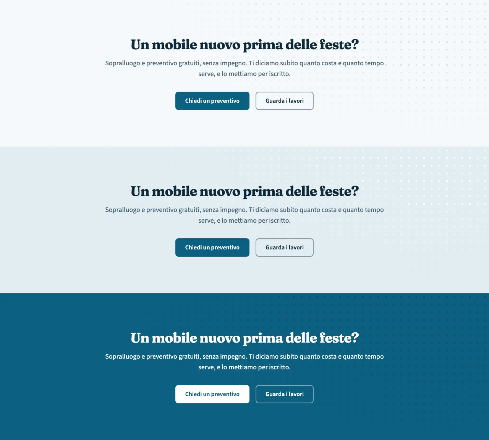

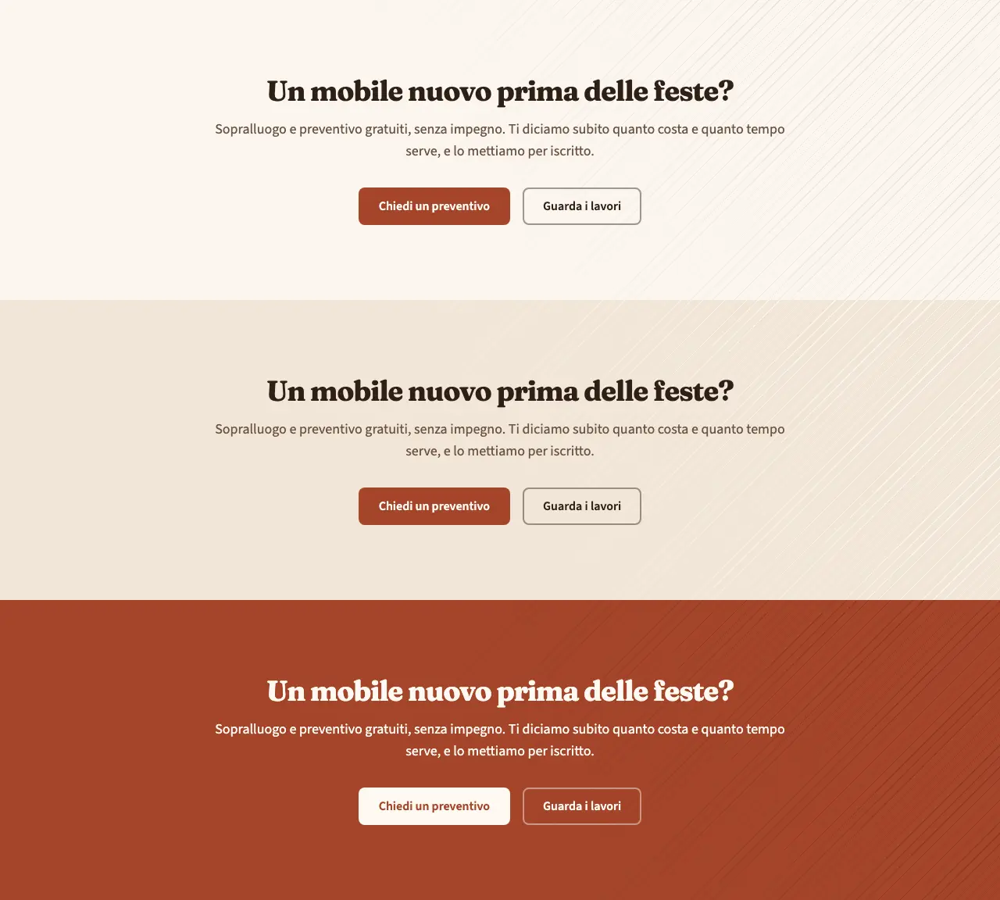
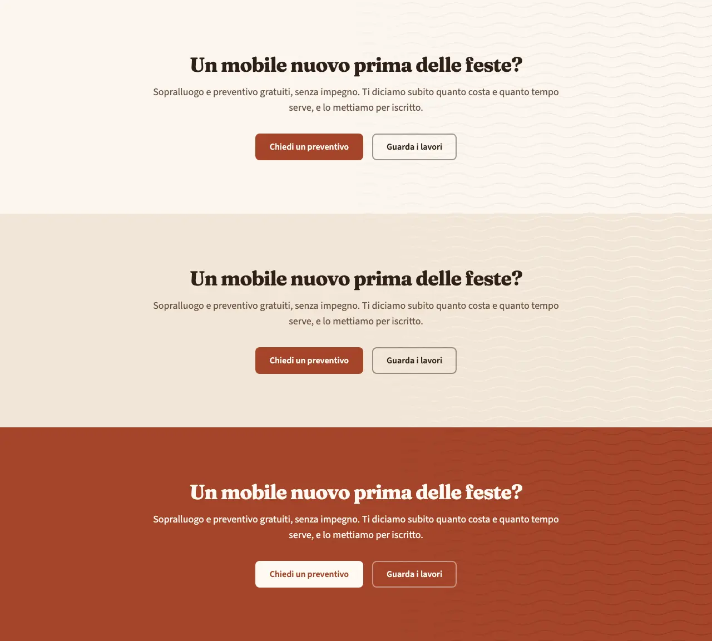
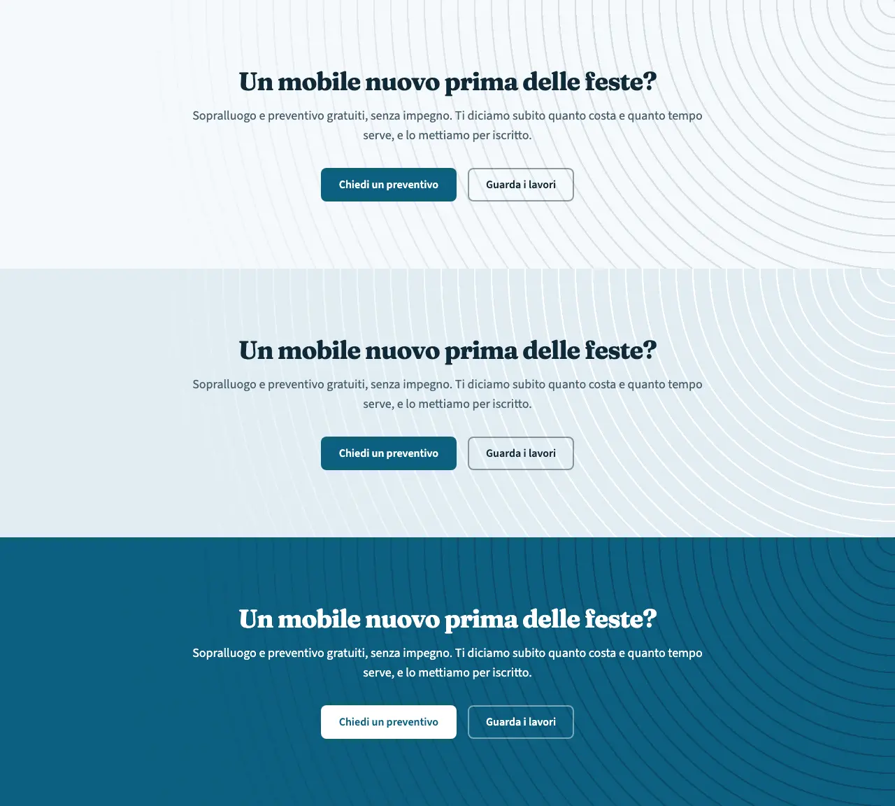
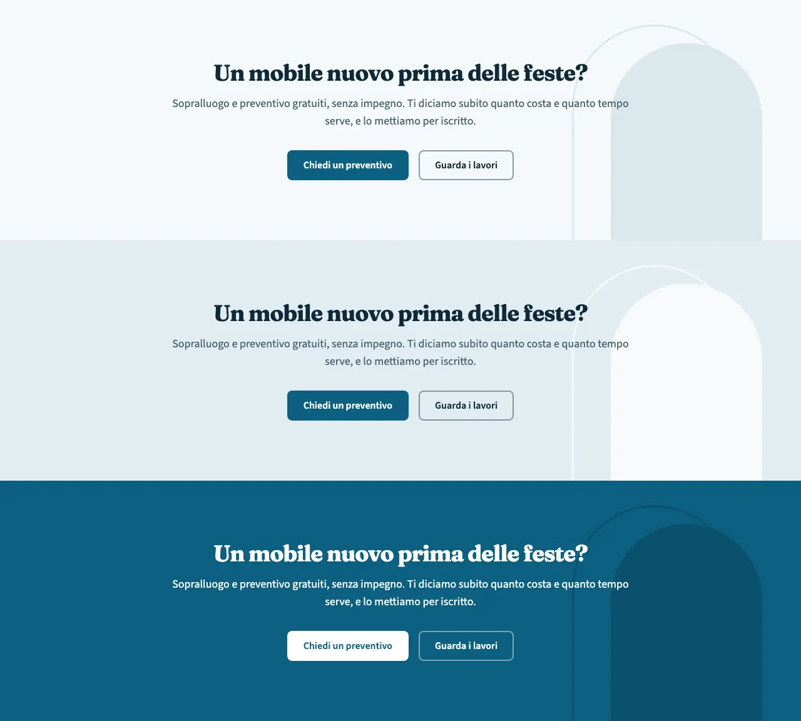

### Texture

Una grana sopra lo sfondo di ogni sezione, header e footer compresi, mai sopra il testo né sulle foto. Si vede soprattutto sui toni colorati (primary) e sulle sfumature, a cui toglie le bande; sui fondi chiari è appena percettibile, perché il contrasto dei testi è verificato anche sui punti schiariti e scuriti dalla grana. Gli screenshot mostrano una cta con l’effetto aurora sui tre toni.

| Preset | Nome | Mood | Adatta a |
| --- | --- | --- | --- |
| `liscia` | Liscia | pulito, nitido | tutti i siti: colori pieni, come senza texture |
| `grana` | Grana | materico, fotografico | fotografi, studi creativi, caffetterie, negozi |
| `carta` | Carta | artigianale, caldo, naturale | botteghe artigiane, agriturismi, ristoranti e trattorie, prodotti tipici |

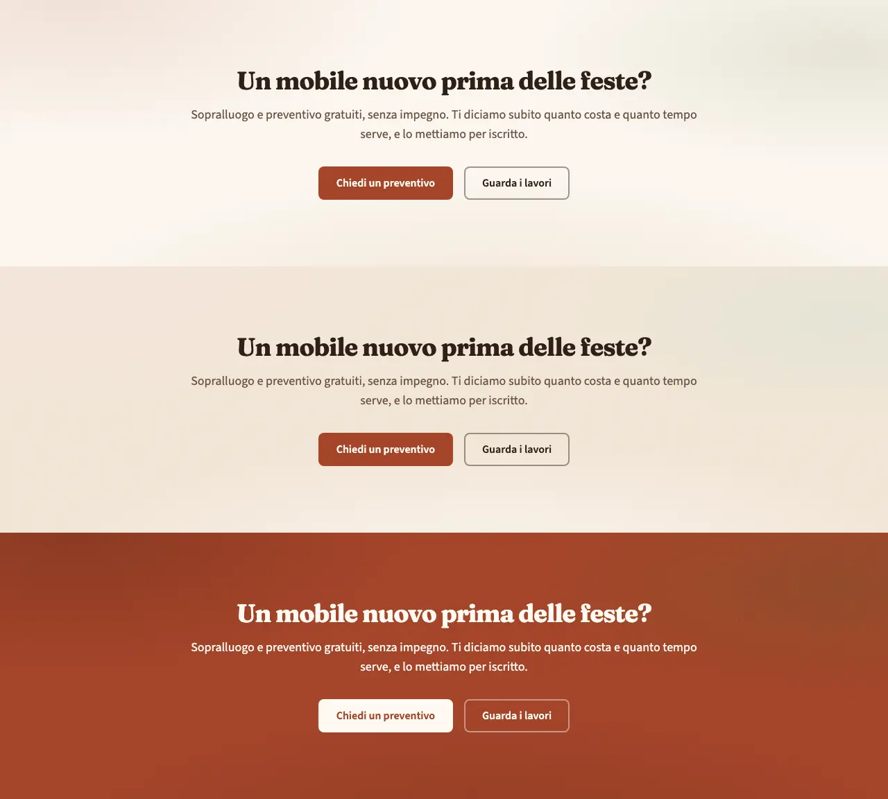
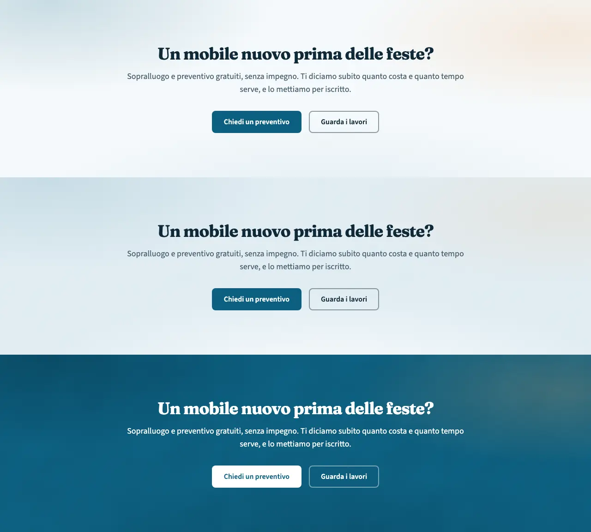

## Icone

164 alias in 21 categorie, in `src/core/icons.ts`: nei componenti `<Icon name="casa" />`, negli schemi `iconSchema()`. Il colore è quello del testo intorno. Dal vivo, con la ricerca, su `/catalogo/icone`. Licenze in `docs/THIRD_PARTY_LICENSES.md`.

| Categoria | Icone |
| --- | --- |
| Casa e cantiere | 12 |
| Attrezzi | 6 |
| Impianti: acqua, luce, gas, clima | 9 |
| Giardino e natura | 6 |
| Cibo e bevande | 10 |
| Salute e benessere | 6 |
| Bellezza | 4 |
| Auto e trasporti | 8 |
| Negozio e pagamenti | 10 |
| Ufficio e servizi professionali | 9 |
| Persone e famiglia | 5 |
| Tempo e calendario | 5 |
| Contatti e luoghi | 7 |
| Fiducia e qualità | 8 |
| Comunicazione | 7 |
| Frecce e interfaccia | 12 |
| File e documenti | 7 |
| Meteo e stagioni | 6 |
| Animali | 5 |
| Sport e tempo libero | 8 |
| Marchi | 14 |

**Casa e cantiere** (12, Lucide)

| Alias | Icona | Note |
| --- | --- | --- |
| `casa` | `lucide:house` |  |
| `edificio` | `lucide:building` |  |
| `fabbrica` | `lucide:factory` |  |
| `scale` | `lucide:door-stairwell` | Scale di casa o vano scala. Lucide non ha una scala a pioli. |
| `muro` | `lucide:brick-wall` |  |
| `porta` | `lucide:door-open` |  |
| `chiavi` | `lucide:key-round` |  |
| `cantiere` | `lucide:construction` |  |
| `pennello` | `lucide:paintbrush` |  |
| `rullo` | `lucide:paint-roller` |  |
| `bagno` | `lucide:bath` |  |
| `pulizie` | `lucide:brush-cleaning` |  |

**Attrezzi** (6, Lucide)

| Alias | Icona | Note |
| --- | --- | --- |
| `martello` | `lucide:hammer` |  |
| `chiave-inglese` | `lucide:wrench` |  |
| `trapano` | `lucide:drill` |  |
| `cassetta-attrezzi` | `lucide:toolbox` |  |
| `pala` | `lucide:shovel` |  |
| `righello` | `lucide:ruler` |  |

**Impianti: acqua, luce, gas, clima** (9, Lucide)

| Alias | Icona | Note |
| --- | --- | --- |
| `goccia` | `lucide:droplet` | Acqua, impermeabilizzazione. |
| `rubinetto` | `lucide:faucet` |  |
| `lampadina` | `lucide:lightbulb` |  |
| `fulmine` | `lucide:zap` | Elettricità. |
| `spina` | `lucide:plug` |  |
| `fiamma` | `lucide:flame` | Gas, caldaie, camini. |
| `stufa` | `lucide:heater` |  |
| `aria-condizionata` | `lucide:air-vent` |  |
| `pannello-solare` | `lucide:solar-panel` |  |

**Giardino e natura** (6, Lucide)

| Alias | Icona | Note |
| --- | --- | --- |
| `foglia` | `lucide:leaf` |  |
| `albero` | `lucide:tree-deciduous` |  |
| `fiore` | `lucide:flower-2` |  |
| `germoglio` | `lucide:sprout` |  |
| `recinto` | `lucide:fence` |  |
| `riciclo` | `lucide:recycle` |  |

**Cibo e bevande** (10, Lucide)

| Alias | Icona | Note |
| --- | --- | --- |
| `posate` | `lucide:utensils` |  |
| `cuoco` | `lucide:chef-hat` |  |
| `caffe` | `lucide:coffee` |  |
| `vino` | `lucide:wine` |  |
| `birra` | `lucide:beer` |  |
| `pizza` | `lucide:pizza` |  |
| `torta` | `lucide:cake-slice` |  |
| `gelato` | `lucide:ice-cream-cone` |  |
| `cornetto` | `lucide:croissant` |  |
| `grano` | `lucide:wheat` |  |

**Salute e benessere** (6, Lucide)

| Alias | Icona | Note |
| --- | --- | --- |
| `cuore` | `lucide:heart` |  |
| `battito` | `lucide:heart-pulse` |  |
| `stetoscopio` | `lucide:stethoscope` |  |
| `farmaco` | `lucide:pill` |  |
| `dentista` | `lucide:toothbrush` |  |
| `occhiali` | `lucide:glasses` |  |

**Bellezza** (4, Lucide)

| Alias | Icona | Note |
| --- | --- | --- |
| `forbici` | `lucide:scissors` |  |
| `brillantini` | `lucide:sparkles` |  |
| `profumo` | `lucide:perfume-bottle` |  |
| `gioiello` | `lucide:gem` |  |

**Auto e trasporti** (8, Lucide)

| Alias | Icona | Note |
| --- | --- | --- |
| `auto` | `lucide:car` |  |
| `furgone` | `lucide:van` |  |
| `camion` | `lucide:truck` |  |
| `moto` | `lucide:motorbike` |  |
| `bici` | `lucide:bike` |  |
| `parcheggio` | `lucide:square-parking` |  |
| `carburante` | `lucide:fuel` |  |
| `ricarica` | `lucide:plug-zap` | Ricarica dei veicoli elettrici. |

**Negozio e pagamenti** (10, Lucide)

| Alias | Icona | Note |
| --- | --- | --- |
| `negozio` | `lucide:store` |  |
| `carrello` | `lucide:shopping-cart` |  |
| `borsa` | `lucide:shopping-bag` |  |
| `etichetta` | `lucide:tag` |  |
| `sconto` | `lucide:badge-percent` |  |
| `regalo` | `lucide:gift` |  |
| `pacco` | `lucide:package` |  |
| `carta-di-credito` | `lucide:credit-card` |  |
| `contanti` | `lucide:banknote` |  |
| `euro` | `lucide:euro` |  |

**Ufficio e servizi professionali** (9, Lucide)

| Alias | Icona | Note |
| --- | --- | --- |
| `valigetta` | `lucide:briefcase` |  |
| `computer` | `lucide:laptop` |  |
| `calcolatrice` | `lucide:calculator` |  |
| `grafico` | `lucide:chart-column` |  |
| `bilancia` | `lucide:scale` | Studi legali, giustizia. |
| `penna` | `lucide:pen-line` |  |
| `laurea` | `lucide:graduation-cap` |  |
| `stretta-di-mano` | `lucide:handshake` |  |
| `wifi` | `lucide:wifi` |  |

**Persone e famiglia** (5, Lucide)

| Alias | Icona | Note |
| --- | --- | --- |
| `utente` | `lucide:user` |  |
| `utenti` | `lucide:users` |  |
| `bambino` | `lucide:baby` |  |
| `accessibilita` | `lucide:accessibility` |  |
| `sorriso` | `lucide:smile` |  |

**Tempo e calendario** (5, Lucide)

| Alias | Icona | Note |
| --- | --- | --- |
| `orologio` | `lucide:clock` |  |
| `calendario` | `lucide:calendar` |  |
| `prenotazione` | `lucide:calendar-check` |  |
| `clessidra` | `lucide:hourglass` |  |
| `cronometro` | `lucide:timer` |  |

**Contatti e luoghi** (7, Lucide)

| Alias | Icona | Note |
| --- | --- | --- |
| `telefono` | `lucide:phone` |  |
| `cellulare` | `lucide:smartphone` |  |
| `email` | `lucide:mail` |  |
| `mappa-pin` | `lucide:map-pin` |  |
| `mappa` | `lucide:map` |  |
| `indicazioni` | `lucide:signpost` |  |
| `sito-web` | `lucide:globe` |  |

**Fiducia e qualità** (8, Lucide)

| Alias | Icona | Note |
| --- | --- | --- |
| `premio` | `lucide:award` |  |
| `trofeo` | `lucide:trophy` |  |
| `garanzia` | `lucide:shield-check` |  |
| `certificato` | `lucide:badge-check` |  |
| `pollice` | `lucide:thumbs-up` |  |
| `stella` | `lucide:star` |  |
| `check` | `lucide:check` |  |
| `lucchetto` | `lucide:lock` |  |

**Comunicazione** (7, Lucide)

| Alias | Icona | Note |
| --- | --- | --- |
| `chat` | `lucide:message-circle` |  |
| `messaggi` | `lucide:messages-square` |  |
| `invia` | `lucide:send` |  |
| `megafono` | `lucide:megaphone` |  |
| `campanella` | `lucide:bell` |  |
| `citazione` | `lucide:quote` |  |
| `cuffie` | `lucide:headset` |  |

**Frecce e interfaccia** (12, Lucide)

| Alias | Icona | Note |
| --- | --- | --- |
| `freccia-destra` | `lucide:arrow-right` |  |
| `freccia-sinistra` | `lucide:arrow-left` |  |
| `freccia-su` | `lucide:arrow-up` |  |
| `freccia-giu` | `lucide:arrow-down` |  |
| `chevron-giu` | `lucide:chevron-down` |  |
| `chevron-destra` | `lucide:chevron-right` |  |
| `menu` | `lucide:menu` |  |
| `chiudi` | `lucide:x` |  |
| `cerca` | `lucide:search` |  |
| `piu` | `lucide:plus` |  |
| `info` | `lucide:info` |  |
| `link-esterno` | `lucide:external-link` |  |

**File e documenti** (7, Lucide)

| Alias | Icona | Note |
| --- | --- | --- |
| `preventivo` | `lucide:file-text` |  |
| `contratto` | `lucide:file-pen-line` |  |
| `cartella` | `lucide:folder` |  |
| `lista-controllo` | `lucide:clipboard-check` |  |
| `libro` | `lucide:book-open` |  |
| `foto` | `lucide:image` |  |
| `fotocamera` | `lucide:camera` |  |

**Meteo e stagioni** (6, Lucide)

| Alias | Icona | Note |
| --- | --- | --- |
| `sole` | `lucide:sun` |  |
| `nuvola` | `lucide:cloud` |  |
| `pioggia` | `lucide:cloud-rain` |  |
| `neve` | `lucide:snowflake` |  |
| `vento` | `lucide:wind` |  |
| `termometro` | `lucide:thermometer` |  |

**Animali** (5, Lucide)

| Alias | Icona | Note |
| --- | --- | --- |
| `cane` | `lucide:dog` |  |
| `gatto` | `lucide:cat` |  |
| `zampa` | `lucide:paw-print` |  |
| `uccello` | `lucide:bird` |  |
| `pesce` | `lucide:fish` |  |

**Sport e tempo libero** (8, Lucide)

| Alias | Icona | Note |
| --- | --- | --- |
| `palestra` | `lucide:dumbbell` |  |
| `pallone` | `lucide:volleyball` |  |
| `nuoto` | `lucide:waves` |  |
| `tenda` | `lucide:tent` |  |
| `valigia` | `lucide:luggage` |  |
| `musica` | `lucide:music` |  |
| `biglietto` | `lucide:ticket` |  |
| `arte` | `lucide:palette` |  |

**Marchi** (14, Simple Icons): solo per i link ai profili dell’attività, sono marchi registrati dei rispettivi titolari.

| Alias | Icona | Note |
| --- | --- | --- |
| `whatsapp` | `simple-icons:whatsapp` |  |
| `facebook` | `simple-icons:facebook` |  |
| `instagram` | `simple-icons:instagram` |  |
| `google` | `simple-icons:google` |  |
| `youtube` | `simple-icons:youtube` |  |
| `tiktok` | `simple-icons:tiktok` |  |
| `tripadvisor` | `simple-icons:tripadvisor` |  |
| `linkedin` | `simple-icons:linkedin` |  |
| `pinterest` | `simple-icons:pinterest` |  |
| `threads` | `simple-icons:threads` |  |
| `x` | `simple-icons:x` |  |
| `telegram` | `simple-icons:telegram` |  |
| `booking` | `simple-icons:bookingdotcom` |  |
| `airbnb` | `simple-icons:airbnb` |  |

## Altro

- [Primitive UI](ui.md): i componenti di `src/core/ui` con cui sono fatti i blocchi.
- [Ricette tipo](ricette-tipo/README.md): pagine pronte da copiare in `src/content/pages`.
