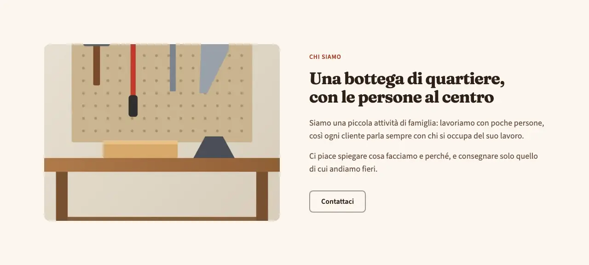
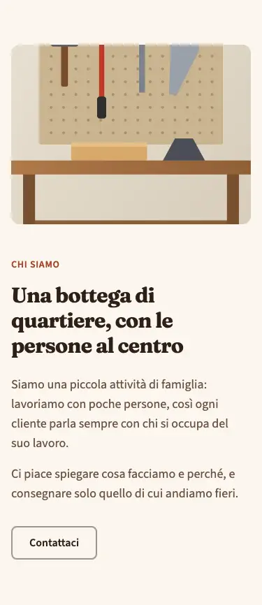
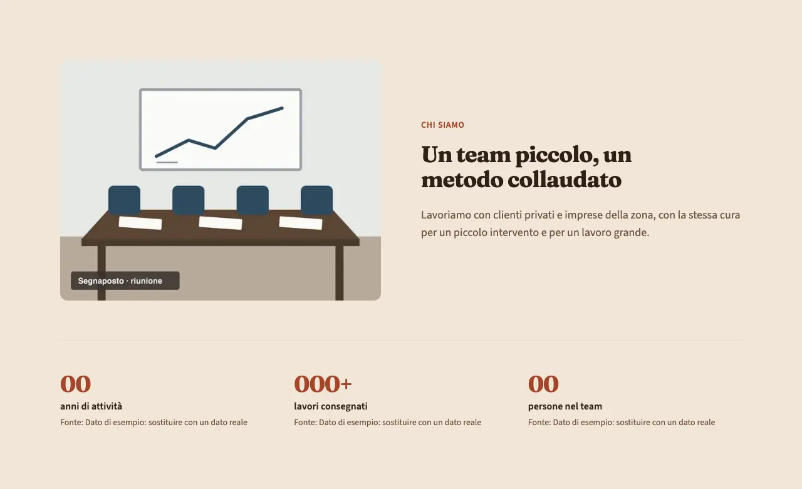
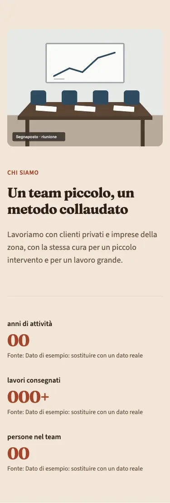

<!-- Generato da scripts/gen-catalog.ts (npm run gen:catalog): non modificare a mano. -->

# about — Chi siamo

[← Catalogo](../README.md) · sezione delle ricette (`page`) · v1.0.0 · contenuti · non interattivo · disegno originale · dal vivo `/catalogo/about/`

Presentazione dell’attività: titolo, da 1 a 3 paragrafi, foto e, se ci sono, numeri veri con la loro fonte.

**Quando usarlo:** Nella pagina «Chi siamo» o come sezione di presentazione in home. Con i numeri solo se il cliente li ha forniti e sa dire da dove vengono.

**Evitare quando:** Per elencare i servizi (services) o i punti di forza (features). Mai con numeri inventati o arrotondati per fare effetto: senza fonte il numero non va nel blocco.

**Varianti:**

- `immagine-testo` — Foto da una parte e racconto dall’altra, su due colonne; su mobile la foto sta sopra. **Quando usarla:** Quando c’è una foto vera del luogo, del titolare o del team. Fixture «Immagine e testo», dal vivo `/catalogo/about/immagine-testo/`.

  

  

- `con-numeri` — Racconto con foto facoltativa e, sotto, una fila di 2-4 numeri; ogni numero mostra la sua fonte. **Quando usarla:** Quando il cliente ha dati verificabili (anni di attività, lavori fatti) e indica la fonte di ciascuno. Fixture «Con numeri», dal vivo `/catalogo/about/con-numeri/`.

  

  

**Campi:**

| Campo | Tipo | Obbl. | Limiti | Note |
| --- | --- | --- | --- | --- |
| `variant` | scelta | sì | `immagine-testo` · `con-numeri` | «Variante» |
| `eyebrow` | testo | no | max 40 | «Occhiello» |
| `title` | testo | sì | max 70 | «Titolo» |
| `paragraphs` | elenco | sì | 1–3 voci | «Testo» |
| `image` | gruppo | per immagine-testo |  | «Foto» · Facoltativa in con-numeri. |
| `image.src` | immagine | sì, se c’è `image` | foto in src/assets/images | «File» |
| `image.alt` | testo | sì, se c’è `image` | min 5 | «Testo alternativo» |
| `cta` | gruppo | no |  | «Pulsante» |
| `cta.label` | testo | sì, se c’è `cta` | max 25 | «Testo del pulsante» |
| `cta.href` | testo | sì, se c’è `cta` | un link (/pagina/, #sezione, https://...) oppure @telefono, @whatsapp, @email, @mappa | «Link» |
| `cta.style` | scelta | no | `primary` · `secondary` · `ghost` · `link` | «Stile» |
| `cta.icon` | icona | no | [lista icone](../README.md#icone) | «Icona» |
| `stats` | elenco | per con-numeri | 2–4 voci | «Numeri» · La variante immagine-testo non li mostra. |
| `stats[].value` | testo | sì, se c’è `stats` | max 12 | «Numero» |
| `stats[].label` | testo | sì, se c’è `stats` | max 40 | «Cosa misura» |
| `stats[].fonte` | testo | sì, se c’è `stats` | 3–80 | «Fonte» · Obbligatoria per ogni numero; compare sotto il numero. |

Nelle note, tra «», l’etichetta del campo nel CMS. Ogni sezione ha anche `type` (`about`), `id` (ancora facoltativa, in kebab-case), `tone` (`default`, `muted`, `primary`) e `background`, l’effetto dello sfondo (`pieno`, `sfumato`, `alone`, `decoro`; [effetti di sfondo](../README.md#effetti-di-sfondo)): vedi `src/content/pages/README.md`.

**Regole:**

- La variante immagine-testo richiede la foto (image).
- La variante con-numeri richiede da 2 a 4 numeri (stats), ognuno con la sua fonte.

**Esempio pronto** (fixture «Immagine e testo», una sezione per `sections`; immagini relative a `src/content/pages`):

```json
{
	"type": "about",
	"variant": "immagine-testo",
	"eyebrow": "Chi siamo",
	"title": "Una bottega di quartiere, con le persone al centro",
	"paragraphs": [
		"Siamo una piccola attività di famiglia: lavoriamo con poche persone, così ogni cliente parla sempre con chi si occupa del suo lavoro.",
		"Ci piace spiegare cosa facciamo e perché, e consegnare solo quello di cui andiamo fieri."
	],
	"image": {
		"src": "../../assets/images/fixtures/artigiano-laboratorio.jpg",
		"alt": "Banco da lavoro in legno con martello, scalpello e sega appesi a un pannello forato"
	},
	"cta": {
		"label": "Contattaci",
		"href": "#contatti"
	}
}
```
