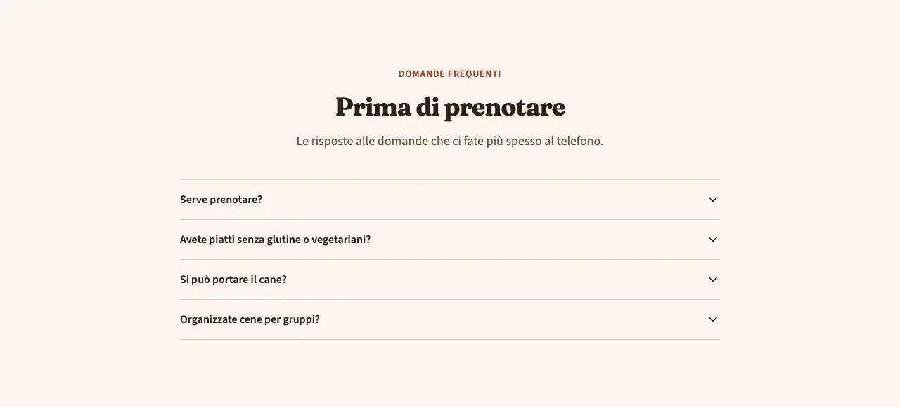
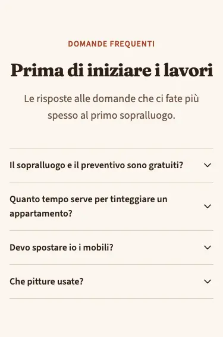
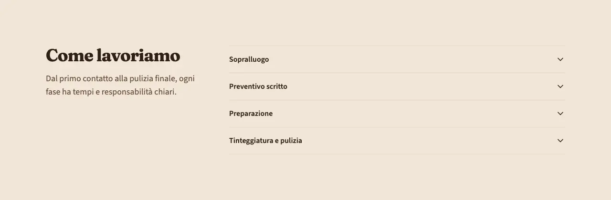
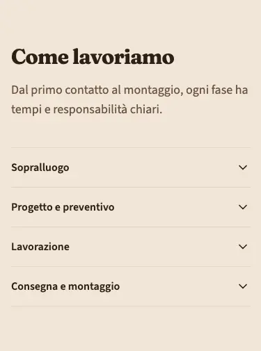

<!-- Generato da scripts/gen-catalog.ts (npm run gen:catalog): non modificare a mano. -->

# accordion — Accordion

[← Catalogo](../README.md) · sezione delle ricette (`page`) · v1.0.0 · contenuti · interattivo · disegno originale · dal vivo `/catalogo/accordion/`

Domande frequenti o sezioni di testo che si aprono una per una: tanti contenuti in poco spazio.

**Quando usarlo:** Per le domande frequenti (variante faq, che Google può mostrare nei risultati) o per informazioni di dettaglio che solo alcuni cercano: condizioni, tempi, cosa preparare prima di un appuntamento.

**Evitare quando:** Per informazioni che tutti devono leggere (prezzi, garanzie principali): nascoste in una voce chiusa le legge poca gente, meglio un testo aperto. Con una voce sola o più di 12: dividi in più blocchi.

**Varianti:**

- `faq` — Domande e risposte centrate, con i dati strutturati FAQPage per Google. **Quando usarla:** Per le domande frequenti: una sola faq per pagina. Fixture «FAQ», dal vivo `/catalogo/accordion/faq/`.

  

  

- `contenuti` — Titolo a sinistra e voci a destra (sotto su mobile). **Quando usarla:** Per testi di dettaglio da aprire: condizioni, tempi, fasi del lavoro. Fixture «Contenuti, una alla volta», dal vivo `/catalogo/accordion/contenuti/`.

  

  

**Campi:**

| Campo | Tipo | Obbl. | Limiti | Note |
| --- | --- | --- | --- | --- |
| `variant` | scelta | sì | `faq` · `contenuti` | «Variante» |
| `eyebrow` | testo | no |  | «Occhiello» |
| `title` | testo | sì | max 70 | «Titolo» |
| `intro` | testo | no | max 240 | «Introduzione» |
| `items` | elenco | sì | 2–12 voci | «Voci» |
| `items[].title` | testo | sì | max 120 | «Domanda o titolo» |
| `items[].text` | testo | sì | max 1200 | «Risposta o testo» |
| `single` | sì/no | no (predefinito `false`) |  | «Una alla volta» |

Nelle note, tra «», l’etichetta del campo nel CMS. Ogni sezione ha anche `type` (`accordion`), `id` (ancora facoltativa, in kebab-case), `tone` (`default`, `muted`, `primary`), `background`, l’effetto dello sfondo (`pieno`, `sfumato`; [effetti di sfondo](../README.md#effetti-di-sfondo)), ed `edge`, il bordo in alto ([bordi tra sezioni](../README.md#bordi-tra-sezioni)): vedi `src/content/pages/README.md`.

**Regole:**

- Al massimo un accordion faq per pagina: ognuno scrive i dati strutturati FAQPage, che Google vuole uno solo (il check recipes avvisa). Per altre sezioni da aprire si usa contenuti.

**Esempio pronto** (fixture «FAQ», una sezione per `sections`; immagini relative a `src/content/pages`):

```json
{
	"type": "accordion",
	"variant": "faq",
	"eyebrow": "Domande frequenti",
	"title": "Prima di prenotare",
	"intro": "Le risposte alle domande che ci fate più spesso al telefono.",
	"items": [
		{
			"title": "Serve prenotare?",
			"text": "A pranzo di solito no. A cena, il venerdì e il sabato, conviene prenotare: chiamaci o scrivici su WhatsApp."
		},
		{
			"title": "Avete piatti senza glutine o vegetariani?",
			"text": "Sì: ogni giorno in carta ci sono almeno due piatti vegetariani e la pasta senza glutine, cotta a parte.\n\nSe hai un’allergia, dillo quando prenoti: la cucina prepara il tuo piatto separatamente."
		},
		{
			"title": "Si può portare il cane?",
			"text": "Sì, i cani di piccola e media taglia sono i benvenuti in sala e in giardino. Una ciotola d’acqua la portiamo noi."
		},
		{
			"title": "Organizzate cene per gruppi?",
			"text": "Fino a quaranta persone, con un menu fisso concordato prima. Per le feste private possiamo riservare tutta la sala."
		}
	]
}
```
