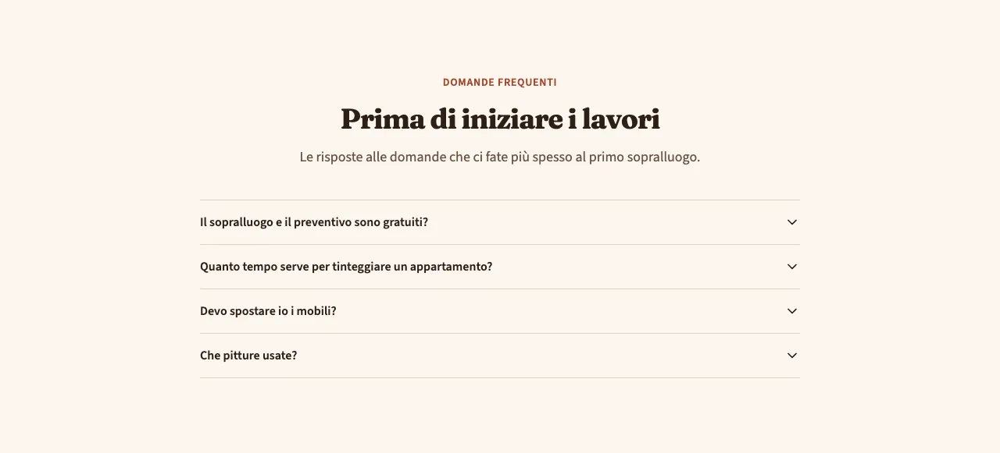
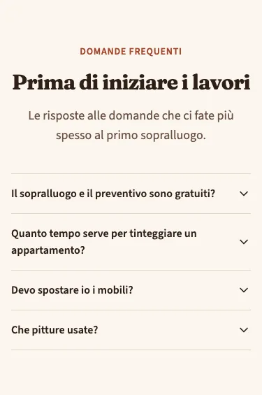
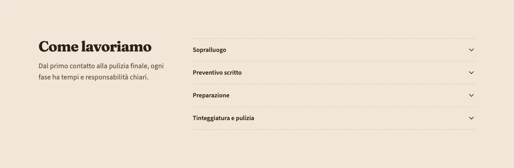
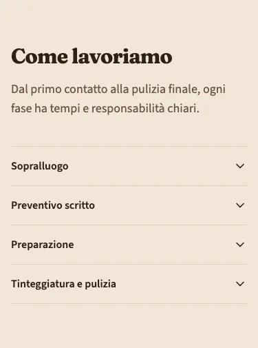

<!-- Generato da scripts/gen-catalog.ts (npm run gen:catalog): non modificare a mano. -->

# Accordion

[← Catalogo](../README.md) · dal vivo: `/catalogo/accordion/`

| Tipo | Scope | Versione | Interattivo | Categoria | Disegno |
| --- | --- | --- | --- | --- | --- |
| `accordion` | `page`: sezione delle ricette | 1.0.0 | sì | contenuti | originale |

Domande frequenti o sezioni di testo che si aprono una per una: tanti contenuti in poco spazio.

- **Quando usarlo.** Per le domande frequenti (variante faq, che Google può mostrare nei risultati) o per informazioni di dettaglio che solo alcuni cercano: condizioni, tempi, preparazione del cantiere.
- **Quando evitarlo.** Per informazioni che tutti devono leggere (prezzi, garanzie principali): nascoste in una voce chiusa le legge poca gente, meglio un testo aperto. Con una voce sola o più di 12: dividi in più blocchi.

## Varianti

### `faq`

Domande e risposte centrate, con i dati strutturati FAQPage per Google. Una sola faq per pagina.

Da sola: `/catalogo/accordion/faq/` · fixture «FAQ».





### `contenuti`

Titolo a sinistra e voci a destra (sotto su mobile). Per sezioni di testo da aprire.

Da sola: `/catalogo/accordion/contenuti/` · fixture «Contenuti, una alla volta».





## Campi

| Campo | Tipo | Obbligatorio | Limiti | Etichetta e aiuto (CMS) | Vincoli |
| --- | --- | --- | --- | --- | --- |
| `variant` | scelta | sì | `faq` · `contenuti` | **Variante** — faq: domande e risposte, segnalate anche a Google · contenuti: sezioni di testo da aprire, accanto al titolo |  |
| `eyebrow` | testo | no |  | **Occhiello** — Breve testo sopra il titolo |  |
| `title` | testo | sì | max 70 caratteri | **Titolo** — Al massimo 70 caratteri |  |
| `intro` | testo | no | max 240 caratteri | **Introduzione** — Al massimo 240 caratteri |  |
| `items` | elenco | sì | da 2 a 12 | **Voci** — Da 2 a 12 |  |
| `items[].title` | testo | sì | max 120 caratteri | **Domanda o titolo** — Al massimo 120 caratteri |  |
| `items[].text` | testo | sì | max 1200 caratteri | **Risposta o testo** — Al massimo 1200 caratteri; una riga vuota separa i paragrafi |  |
| `single` | sì/no | no (predefinito `false`) |  | **Una alla volta** — Aprendo una voce si chiudono le altre |  |

Ogni sezione ha anche `type` (`accordion`), `id` (ancora facoltativa, in kebab-case) e `tone` (`default`, `muted`, `primary`): vedi `src/content/pages/README.md`.

## Esempio

Dalla fixture «FAQ», una sezione da mettere in `sections` di una ricetta (le immagini sono percorsi relativi a `src/content/pages`):

```json
{
	"type": "accordion",
	"variant": "faq",
	"eyebrow": "Domande frequenti",
	"title": "Prima di iniziare i lavori",
	"intro": "Le risposte alle domande che ci fate più spesso al primo sopralluogo.",
	"items": [
		{
			"title": "Il sopralluogo e il preventivo sono gratuiti?",
			"text": "Sì. Veniamo a vedere le pareti, prendiamo le misure e ti lasciamo un preventivo scritto, senza costi e senza impegno."
		},
		{
			"title": "Quanto tempo serve per tinteggiare un appartamento?",
			"text": "Per un trilocale di solito bastano tre o quattro giorni lavorativi, compresa la stuccatura delle crepe.\n\nI tempi esatti sono scritti nel preventivo: se finiamo in ritardo per colpa nostra, ogni giorno in più è scalato dal totale."
		},
		{
			"title": "Devo spostare io i mobili?",
			"text": "No. Spostiamo noi i mobili al centro delle stanze e li copriamo con teli; proteggiamo anche pavimenti, porte e prese."
		},
		{
			"title": "Che pitture usate?",
			"text": "Pitture traspiranti o lavabili a basse emissioni, scelte in base alla stanza: antimuffa per bagni e cucine, lavabili per corridoi e camere dei bambini."
		}
	]
}
```
