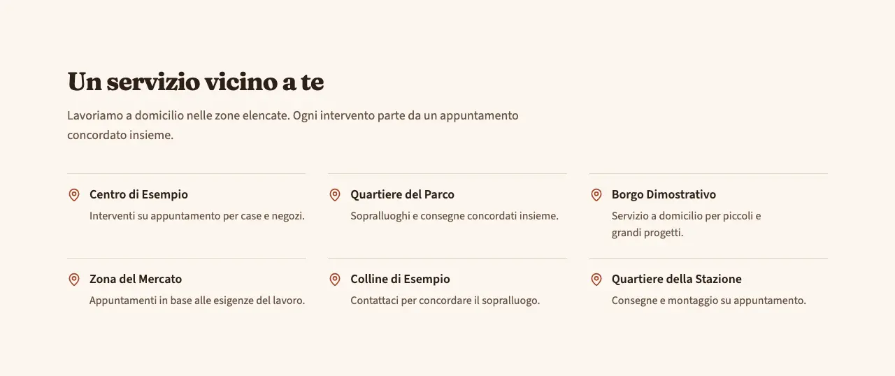
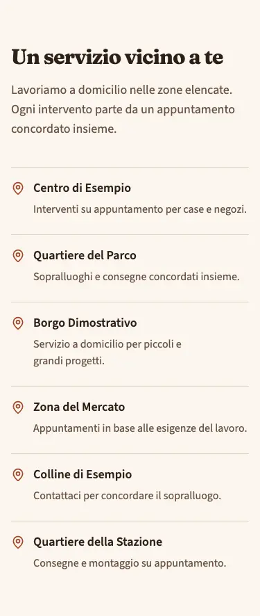
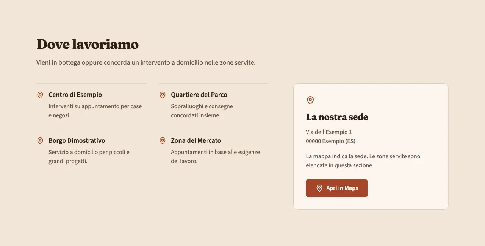
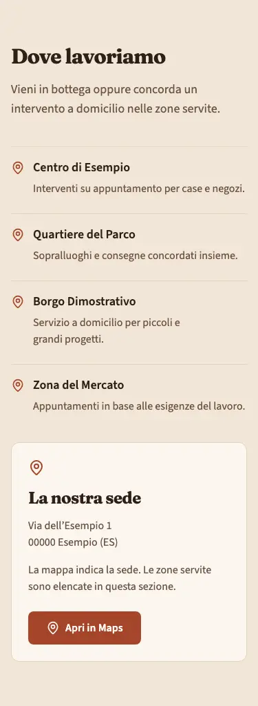

<!-- Generato da scripts/gen-catalog.ts (npm run gen:catalog): non modificare a mano. -->

# areas — Zone servite

[← Catalogo](../README.md) · sezione delle ricette (`page`) · v1.0.0 · contatti · non interattivo · disegno originale · dal vivo `/catalogo/areas/`

Elenco delle zone coperte dal servizio, con un eventuale link alla mappa della sede.

**Quando usarlo:** Per rendere chiara la copertura locale di un servizio a domicilio o di un’attività. Usa nomi di comuni e quartieri realmente serviti.

**Evitare quando:** Per recapiti e orari completi (usa contact), oppure per elencare servizi (usa services). Non aggiungere zone solo per posizionarsi sui motori di ricerca.

**Varianti:**

- `elenco-zone` — Titolo e introduzione seguiti da una lista di zone su una, due o tre colonne in base allo spazio disponibile. **Quando usarla:** Quando conta la copertura del servizio e non serve mostrare la sede. Fixture «Zone servite con dettagli», dal vivo `/catalogo/areas/elenco-zone/`.

  

  

- `mappa-link` — Elenco delle zone affiancato all’indirizzo della sede e al pulsante «Apri in Maps», senza mappe incorporate. **Quando usarla:** Quando vuoi indicare sia le zone servite sia la sede da raggiungere. La mappa mostra la sede, non i confini della copertura. Fixture «Zone servite e sede», dal vivo `/catalogo/areas/mappa-link/`.

  

  

**Campi:**

| Campo | Tipo | Obbl. | Limiti | Note |
| --- | --- | --- | --- | --- |
| `variant` | scelta | sì | `elenco-zone` · `mappa-link` | «Variante» · mappa-link legge l’indirizzo della sede da site.json; elenco-zone non mostra dati della sede. Nessuna richiesta a Google prima di aprire il link. |
| `title` | testo | sì | max 70 | «Titolo» |
| `intro` | testo | no | max 240 | «Introduzione» |
| `items` | elenco | sì | 1–18 voci | «Zone servite» |
| `items[].name` | testo | sì | max 70 | «Zona» |
| `items[].text` | testo | no | max 160 | «Dettaglio» |

Nelle note, tra «», l’etichetta del campo nel CMS. Ogni sezione ha anche `type` (`areas`), `id` (ancora facoltativa, in kebab-case), `tone` (`default`, `muted`, `primary`) e `background`, l’effetto dello sfondo (`pieno`, `sfumato`, `alone`, `decoro`; [effetti di sfondo](../README.md#effetti-di-sfondo)): vedi `src/content/pages/README.md`.

**Regole:**

- Nella variante mappa-link l’indirizzo e il link Maps della sede arrivano da site.json; la mappa non rappresenta i confini delle zone servite.

**Esempio pronto** (fixture «Zone servite con dettagli», una sezione per `sections`; immagini relative a `src/content/pages`):

```json
{
	"type": "areas",
	"variant": "elenco-zone",
	"title": "Un servizio vicino a te",
	"intro": "Lavoriamo a domicilio nelle zone elencate. Ogni intervento parte da un appuntamento concordato insieme.",
	"items": [
		{
			"name": "Centro di Esempio",
			"text": "Interventi su appuntamento per case e negozi."
		},
		{
			"name": "Quartiere del Parco",
			"text": "Sopralluoghi e consegne concordati insieme."
		},
		{
			"name": "Borgo Dimostrativo",
			"text": "Servizio a domicilio per piccoli e grandi progetti."
		},
		{
			"name": "Zona del Mercato",
			"text": "Appuntamenti in base alle esigenze del lavoro."
		},
		{
			"name": "Colline di Esempio",
			"text": "Contattaci per concordare il sopralluogo."
		},
		{
			"name": "Quartiere della Stazione",
			"text": "Consegne e montaggio su appuntamento."
		}
	]
}
```
