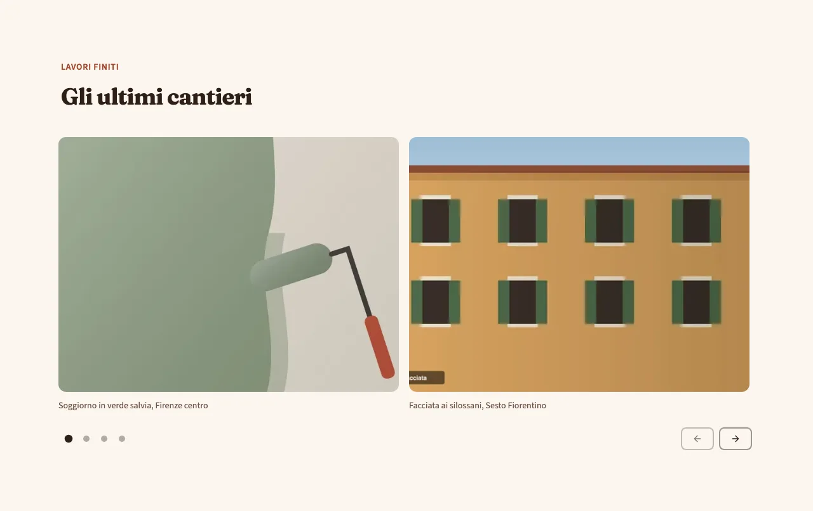
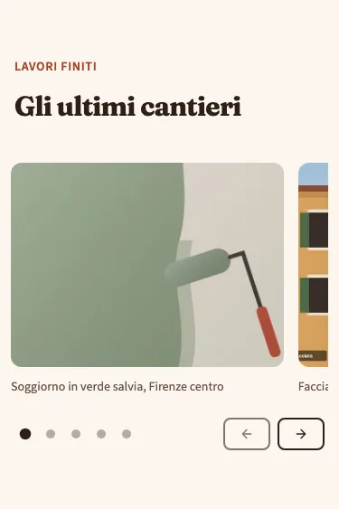
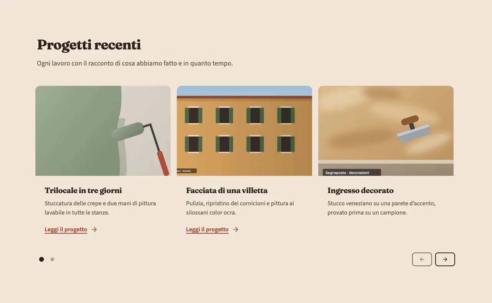
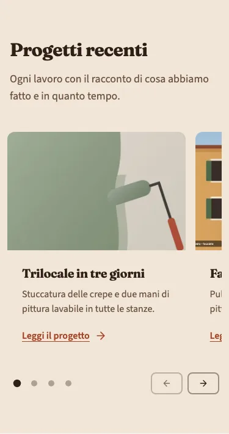

<!-- Generato da scripts/gen-catalog.ts (npm run gen:catalog): non modificare a mano. -->

# Carosello

[← Catalogo](../README.md) · dal vivo: `/catalogo/carousel/`

| Tipo | Scope | Versione | Interattivo | Categoria | Disegno |
| --- | --- | --- | --- | --- | --- |
| `carousel` | `page`: sezione delle ricette | 1.0.0 | sì | contenuti | originale |

Una fila di foto o di card che si scorre in orizzontale, col dito o con le frecce. Non scorre mai da sola.

- **Quando usarlo.** Per una serie di elementi dello stesso tipo che si sfogliano: foto dei lavori finiti, prima e dopo, progetti, recensioni con foto.
- **Quando evitarlo.** Per contenuti importanti: le slide dopo la prima le guarda poca gente, quindi un messaggio da far leggere a tutti va in un hero o in un testo aperto. Con meno di 3 elementi (usa una griglia, come services) o con testi lunghi. Mai come apertura della pagina al posto dell’hero, e mai a scorrimento automatico (non è previsto).

## Varianti

### `foto`

Foto grandi con didascalia breve, quasi una per volta (due da tablet). Per i lavori finiti.

Da sola: `/catalogo/carousel/foto/` · fixture «Foto».





### `card`

Card con foto, titolo, testo e link facoltativo; una e un pezzo su mobile, fino a tre da desktop.

Da sola: `/catalogo/carousel/card/` · fixture «Card».





## Campi

| Campo | Tipo | Obbligatorio | Limiti | Etichetta e aiuto (CMS) | Vincoli |
| --- | --- | --- | --- | --- | --- |
| `variant` | scelta | sì | `foto` · `card` | **Variante** — foto: foto grandi con didascalia · card: foto, titolo, testo e link per ogni elemento |  |
| `eyebrow` | testo | no |  | **Occhiello** — Breve testo sopra il titolo |  |
| `title` | testo | sì | max 70 caratteri | **Titolo** — Al massimo 70 caratteri |  |
| `intro` | testo | no | max 240 caratteri | **Introduzione** — Al massimo 240 caratteri |  |
| `items` | elenco | sì | da 3 a 12 | **Elementi** — Da 3 a 12 |  |
| `items[].image` | gruppo | sì |  | **Foto** — JPG, PNG o WebP |  |
| `items[].image.src` | immagine | sì | file in src/assets/images, percorso relativo al JSON | **File** — JPG, PNG o WebP; per le foto grandi almeno 1600 px di larghezza |  |
| `items[].image.alt` | testo | sì | almeno 5 caratteri | **Testo alternativo** — Descrive la foto a chi non la vede, es. «Soggiorno con pareti verde salvia» |  |
| `items[].title` | testo | no | max 60 caratteri | **Titolo** — Obbligatorio per la variante card; nelle foto è la didascalia | Obbligatorio per la variante card; in foto è la didascalia. |
| `items[].text` | testo | no | max 200 caratteri | **Testo** — Obbligatorio per la variante card, al massimo 200 caratteri | Obbligatorio per la variante card. |
| `items[].cta` | gruppo | no |  | **Link** — Facoltativo, solo nella variante card | Mostrato solo nella variante card. |
| `items[].cta.label` | testo | sì, se c’è `items[].cta` | max 25 caratteri | **Testo del pulsante** — Al massimo 25 caratteri |  |
| `items[].cta.href` | testo | sì, se c’è `items[].cta` | un link (/pagina/, #sezione, https://...) oppure @telefono, @whatsapp, @email, @mappa | **Link** — Una pagina del sito (/contatti/), una sezione (#preventivo), un indirizzo completo, oppure @telefono, @whatsapp, @email o @mappa per i recapiti di «Dati attività» |  |
| `items[].cta.style` | scelta | no | `primary` · `secondary` · `ghost` · `link` | **Stile** — primary: pieno · secondary: bordato · ghost: solo testo · link: sottolineato. Vuoto: quello previsto dal blocco |  |
| `items[].cta.icon` | icona | no | un alias di [icone.md](../icone.md) | **Icona** — Facoltativa, accanto al testo (le frecce vanno dopo il testo) |  |

Ogni sezione ha anche `type` (`carousel`), `id` (ancora facoltativa, in kebab-case) e `tone` (`default`, `muted`, `primary`): vedi `src/content/pages/README.md`.

## Esempio

Dalla fixture «Foto», una sezione da mettere in `sections` di una ricetta (le immagini sono percorsi relativi a `src/content/pages`):

```json
{
	"type": "carousel",
	"variant": "foto",
	"eyebrow": "Lavori finiti",
	"title": "Gli ultimi cantieri",
	"items": [
		{
			"image": {
				"src": "../../assets/images/fixtures/imbianchino-interno.jpg",
				"alt": "Parete tinteggiata a metà in verde salvia, con un rullo appoggiato"
			},
			"title": "Soggiorno in verde salvia, Firenze centro"
		},
		{
			"image": {
				"src": "../../assets/images/fixtures/imbianchino-facciata.jpg",
				"alt": "Facciata di una casa color ocra con persiane verdi"
			},
			"title": "Facciata ai silossani, Sesto Fiorentino"
		},
		{
			"image": {
				"src": "../../assets/images/fixtures/imbianchino-decorazioni.jpg",
				"alt": "Parete a stucco veneziano color ocra con una spatola appoggiata"
			},
			"title": "Stucco veneziano in un ingresso"
		},
		{
			"image": {
				"src": "../../assets/images/fixtures/imbianchino-cartongesso.jpg",
				"alt": "Lastre di cartongesso montate su una parete, con i giunti stuccati"
			},
			"title": "Controsoffitto con faretti in cucina"
		},
		{
			"image": {
				"src": "../../assets/images/fixtures/imbianchino-antimuffa.jpg",
				"alt": "Angolo di una stanza con macchie di muffa a sinistra e parete risanata a destra"
			},
			"title": "Bagno risanato dalla muffa"
		}
	]
}
```
