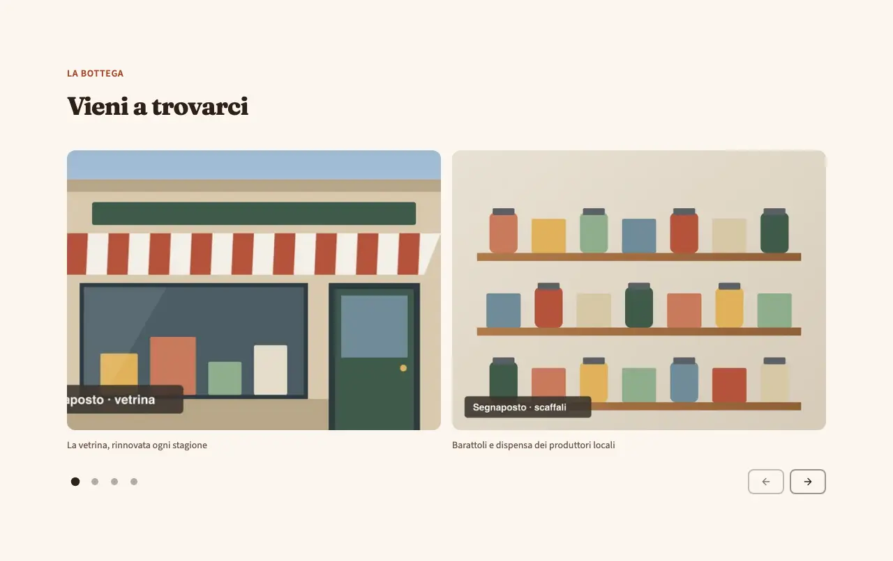
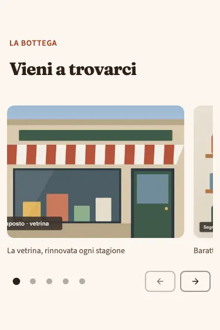
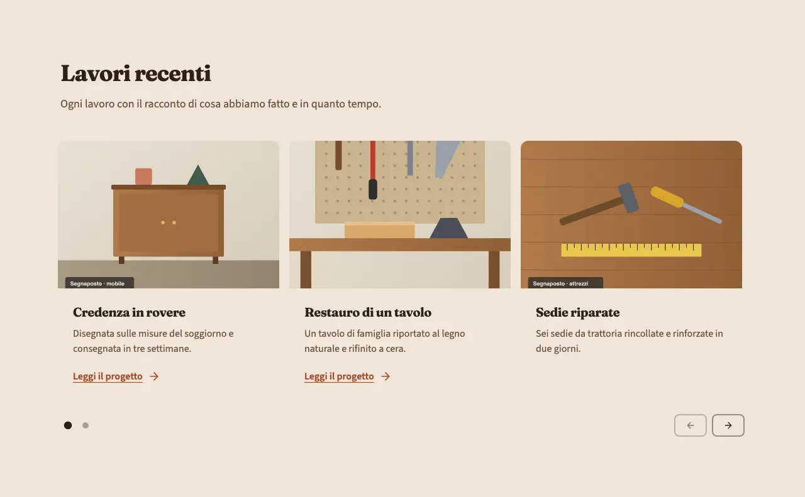
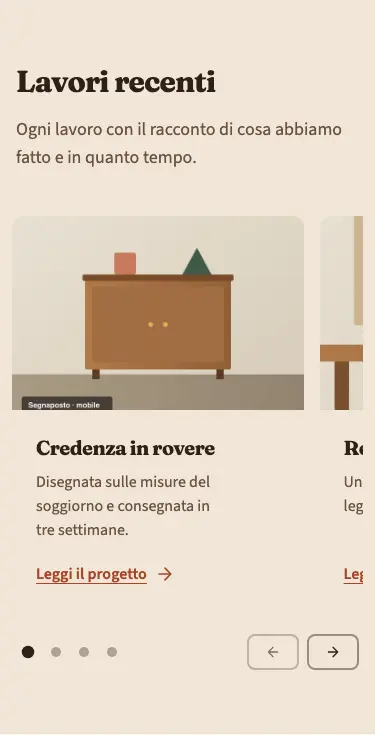

<!-- Generato da scripts/gen-catalog.ts (npm run gen:catalog): non modificare a mano. -->

# carousel — Carosello

[← Catalogo](../README.md) · sezione delle ricette (`page`) · v1.0.0 · contenuti · interattivo · disegno originale · dal vivo `/catalogo/carousel/`

Una fila di foto o di card che si scorre in orizzontale, col dito o con le frecce. Non scorre mai da sola.

**Quando usarlo:** Per una serie di elementi dello stesso tipo che si sfogliano: foto dei lavori finiti, prima e dopo, progetti, recensioni con foto.

**Evitare quando:** Per contenuti importanti: le slide dopo la prima le guarda poca gente, quindi un messaggio da far leggere a tutti va in un hero o in un testo aperto. Con meno di 3 elementi (usa una griglia, come services) o con testi lunghi. Mai come apertura della pagina al posto dell’hero, e mai a scorrimento automatico (non è previsto).

**Varianti:**

- `immagini` — Foto grandi con didascalia breve, quasi una per volta (due da tablet). **Quando usarla:** Per mostrare i lavori finiti, quando contano le immagini. Fixture «Immagini», dal vivo `/catalogo/carousel/immagini/`.

  

  

- `immagini-testo` — Card con foto, titolo, testo e link facoltativo: una e un pezzo su mobile, fino a tre da desktop. **Quando usarla:** Per progetti o casi da raccontare in breve, ciascuno con il suo testo. Fixture «Immagini e testo», dal vivo `/catalogo/carousel/immagini-testo/`.

  

  

**Campi:**

| Campo | Tipo | Obbl. | Limiti | Note |
| --- | --- | --- | --- | --- |
| `variant` | scelta | sì | `immagini` · `immagini-testo` | «Variante» |
| `eyebrow` | testo | no |  | «Occhiello» |
| `title` | testo | sì | max 70 | «Titolo» |
| `intro` | testo | no | max 240 | «Introduzione» |
| `items` | elenco | sì | 3–12 voci | «Elementi» |
| `items[].image` | gruppo | sì |  | «Foto» |
| `items[].image.src` | immagine | sì | foto in src/assets/images | «File» |
| `items[].image.alt` | testo | sì | min 5 | «Testo alternativo» |
| `items[].title` | testo | per immagini-testo | max 60 | «Titolo» · In immagini è la didascalia. |
| `items[].text` | testo | per immagini-testo | max 200 | «Testo» |
| `items[].cta` | gruppo | no |  | «Link» · Mostrato solo nella variante immagini-testo. |
| `items[].cta.label` | testo | sì, se c’è `items[].cta` | max 25 | «Testo del pulsante» |
| `items[].cta.href` | testo | sì, se c’è `items[].cta` | un link (/pagina/, #sezione, https://...) oppure @telefono, @whatsapp, @email, @mappa | «Link» |
| `items[].cta.style` | scelta | no | `primary` · `secondary` · `ghost` · `link` | «Stile» |
| `items[].cta.icon` | icona | no | [lista icone](../README.md#icone) | «Icona» |

Nelle note, tra «», l’etichetta del campo nel CMS. Ogni sezione ha anche `type` (`carousel`), `id` (ancora facoltativa, in kebab-case), `tone` (`default`, `muted`, `primary`), `background`, l’effetto dello sfondo (`pieno`, `sfumato`, `alone`, `decoro`; [effetti di sfondo](../README.md#effetti-di-sfondo)), ed `edge`, il bordo in alto ([bordi tra sezioni](../README.md#bordi-tra-sezioni)): vedi `src/content/pages/README.md`.

**Regole:**

- La variante immagini-testo richiede titolo e testo in ogni elemento.

**Esempio pronto** (fixture «Immagini», una sezione per `sections`; immagini relative a `src/content/pages`):

```json
{
	"type": "carousel",
	"variant": "immagini",
	"eyebrow": "La bottega",
	"title": "Vieni a trovarci",
	"items": [
		{
			"image": {
				"src": "../../assets/images/fixtures/negozio-vetrina.jpg",
				"alt": "Vetrina di una bottega con la tenda a righe bianche e rosse e la porta verde"
			},
			"title": "La vetrina, rinnovata ogni stagione"
		},
		{
			"image": {
				"src": "../../assets/images/fixtures/negozio-scaffali.jpg",
				"alt": "Scaffali di legno con barattoli e scatole colorate in fila"
			},
			"title": "Barattoli e dispensa dei produttori locali"
		},
		{
			"image": {
				"src": "../../assets/images/fixtures/negozio-regalo.jpg",
				"alt": "Pacco regalo rosso con il fiocco giallo appoggiato sul banco"
			},
			"title": "Confezioni regalo preparate al banco"
		},
		{
			"image": {
				"src": "../../assets/images/fixtures/artigiano-mobile.jpg",
				"alt": "Credenza in legno a due ante con maniglie dorate, in una stanza chiara"
			},
			"title": "Gli arredi del negozio, fatti su misura"
		},
		{
			"image": {
				"src": "../../assets/images/fixtures/artigiano-attrezzi.jpg",
				"alt": "Martello, cacciavite e metro giallo appoggiati su un piano di legno"
			},
			"title": "L’angolo della ferramenta"
		}
	]
}
```
