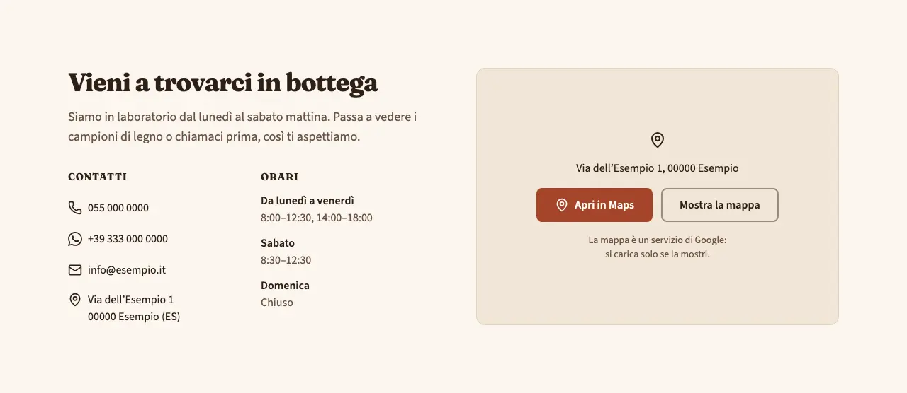
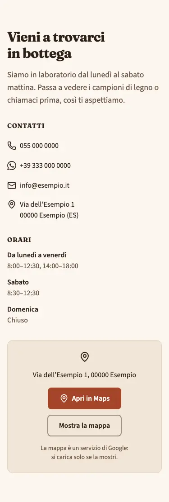
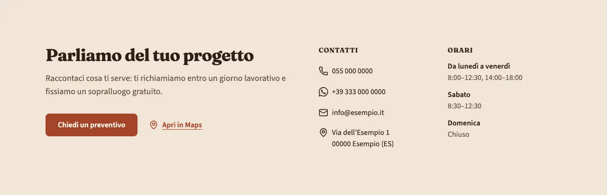
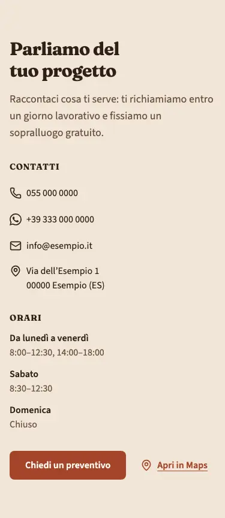

<!-- Generato da scripts/gen-catalog.ts (npm run gen:catalog): non modificare a mano. -->

# contact — Contatti

[← Catalogo](../README.md) · sezione delle ricette (`page`) · v1.0.1 · contatti · interattivo · disegno originale · dal vivo `/catalogo/contact/`

Recapiti, indirizzo e orari dell’attività, presi da «Dati attività», con la mappa o un invito all’azione.

**Quando usarlo:** Nella pagina contatti, o in fondo a una pagina che deve far trovare l’attività. Telefono, WhatsApp, email, indirizzo e orari non si scrivono nel blocco: arrivano da site.json.

**Evitare quando:** Per un semplice invito a chiamare o chiedere un preventivo (usa cta), oppure quando serve un modulo da compilare (usa form).

**Varianti:**

- `info-mappa` — Recapiti e orari da una parte, dall’altra un riquadro con «Apri in Maps» e il pulsante «Mostra la mappa», che carica la mappa solo al clic. **Quando usarla:** La pagina contatti di un’attività con una sede da raggiungere: negozio, studio, laboratorio. Fixture «Info e mappa, con orari», dal vivo `/catalogo/contact/info-mappa/`.

  

  

- `info-cta` — Recapiti e orari in due colonne, con un pulsante d’azione e il link «Apri in Maps». **Quando usarla:** Attività che lavora a domicilio o su appuntamento, dove la sede conta meno di un preventivo o di una prenotazione. Fixture «Info e pulsante, con orari», dal vivo `/catalogo/contact/info-cta/`.

  

  

**Campi:**

| Campo | Tipo | Obbl. | Limiti | Note |
| --- | --- | --- | --- | --- |
| `variant` | scelta | sì | `info-mappa` · `info-cta` | «Variante» |
| `title` | testo | sì | max 70 | «Titolo» |
| `text` | testo | no | max 200 | «Testo» |
| `showHours` | sì/no | sì |  | «Mostra gli orari» · Se è attivo, gli orari vengono da site.json. |
| `cta` | gruppo | per info-cta |  | «Pulsante» · Nella variante info-mappa non viene mostrato. |
| `cta.label` | testo | sì, se c’è `cta` | max 25 | «Testo del pulsante» |
| `cta.href` | testo | sì, se c’è `cta` | un link (/pagina/, #sezione, https://...) oppure @telefono, @whatsapp, @email, @mappa | «Link» |
| `cta.style` | scelta | no | `primary` · `secondary` · `ghost` · `link` | «Stile» |
| `cta.icon` | icona | no | [lista icone](../README.md#icone) | «Icona» |

Nelle note, tra «», l’etichetta del campo nel CMS. Ogni sezione ha anche `type` (`contact`), `id` (ancora facoltativa, in kebab-case) e `tone` (`default`, `muted`, `primary`): vedi `src/content/pages/README.md`.

**Regole:**

- La variante info-cta richiede il pulsante (cta).

**Esempio pronto** (fixture «Info e mappa, con orari», una sezione per `sections`; immagini relative a `src/content/pages`):

```json
{
	"type": "contact",
	"variant": "info-mappa",
	"title": "Vieni a trovarci in bottega",
	"text": "Siamo in laboratorio dal lunedì al sabato mattina. Passa a vedere i campioni di legno o chiamaci prima, così ti aspettiamo.",
	"showHours": true
}
```
