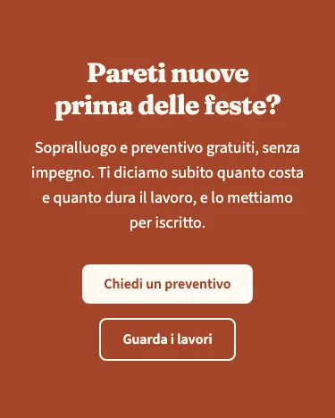
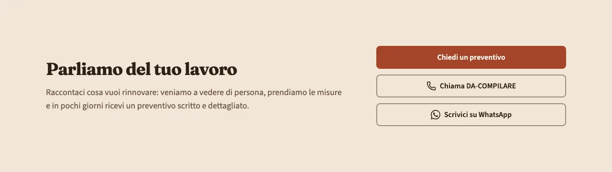
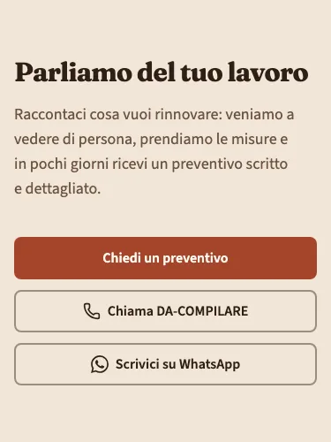

<!-- Generato da scripts/gen-catalog.ts (npm run gen:catalog): non modificare a mano. -->

# Invito all’azione

[← Catalogo](../README.md) · dal vivo: `/catalogo/cta/`

| Tipo | Scope | Versione | Interattivo | Categoria | Disegno |
| --- | --- | --- | --- | --- | --- |
| `cta` | `page`: sezione delle ricette | 1.1.0 | no | contatti | originale |

Fascia che chiede a chi visita di fare il passo successivo: chiedere un preventivo, chiamare, scrivere.

- **Quando usarlo.** Dopo i blocchi che convincono (servizi, lavori, recensioni) e in fondo alla pagina, prima del footer. Con showContacts mostra telefono e WhatsApp dell’attività presi da site.json.
- **Quando evitarlo.** In apertura di pagina (lì va l’hero) o più di due volte nella stessa pagina: troppi inviti si annullano a vicenda.

## Varianti

### `banner`

Testo centrato e 1-2 pulsanti; con tone primary diventa una fascia piena. Molto visibile: al massimo una per pagina.

Da sola: `/catalogo/cta/banner/` · fixture «Banner».




### `split-contatto`

Testo a sinistra e pulsanti a destra; con showContacts aggiunge Chiama e WhatsApp. Con tone muted è adatta a chiudere la pagina.

Da sola: `/catalogo/cta/split-contatto/` · fixture «Split con recapiti».





## Campi

| Campo | Tipo | Obbligatorio | Limiti | Etichetta e aiuto (CMS) | Vincoli |
| --- | --- | --- | --- | --- | --- |
| `variant` | scelta | sì | `banner` · `split-contatto` | **Variante** — banner: testo centrato e pulsanti · split-contatto: testo a sinistra, pulsanti a destra |  |
| `title` | testo | sì | max 70 caratteri | **Titolo** — Al massimo 70 caratteri |  |
| `text` | testo | no | max 200 caratteri | **Testo** — Una o due frasi, al massimo 200 caratteri |  |
| `primary` | gruppo | sì |  | **Pulsante principale** — L’azione che chiedi di fare |  |
| `primary.label` | testo | sì | max 25 caratteri | **Testo del pulsante** — Al massimo 25 caratteri |  |
| `primary.href` | testo | sì | un link (/pagina/, #sezione, https://...) oppure @telefono, @whatsapp, @email, @mappa | **Link** — Una pagina del sito (/contatti/), una sezione (#preventivo), un indirizzo completo, oppure @telefono, @whatsapp, @email o @mappa per i recapiti di «Dati attività» |  |
| `primary.style` | scelta | no | `primary` · `secondary` · `ghost` · `link` | **Stile** — primary: pieno · secondary: bordato · ghost: solo testo · link: sottolineato. Vuoto: quello previsto dal blocco |  |
| `primary.icon` | icona | no | un alias di [icone.md](../icone.md) | **Icona** — Facoltativa, accanto al testo (le frecce vanno dopo il testo) |  |
| `secondary` | gruppo | no |  | **Pulsante secondario** — Un’alternativa: compila testo e link, oppure nessuno dei due |  |
| `secondary.label` | testo | sì, se c’è `secondary` | max 25 caratteri | **Testo del pulsante** — Al massimo 25 caratteri |  |
| `secondary.href` | testo | sì, se c’è `secondary` | un link (/pagina/, #sezione, https://...) oppure @telefono, @whatsapp, @email, @mappa | **Link** — Una pagina del sito (/contatti/), una sezione (#preventivo), un indirizzo completo, oppure @telefono, @whatsapp, @email o @mappa per i recapiti di «Dati attività» |  |
| `secondary.style` | scelta | no | `primary` · `secondary` · `ghost` · `link` | **Stile** — primary: pieno · secondary: bordato · ghost: solo testo · link: sottolineato. Vuoto: quello previsto dal blocco |  |
| `secondary.icon` | icona | no | un alias di [icone.md](../icone.md) | **Icona** — Facoltativa, accanto al testo (le frecce vanno dopo il testo) |  |
| `showContacts` | sì/no | sì |  | **Mostra telefono e WhatsApp** — Aggiunge i pulsanti con i recapiti presi da «Dati attività» | Il pulsante WhatsApp compare solo se site.json ha il numero WhatsApp. |

Ogni sezione ha anche `type` (`cta`), `id` (ancora facoltativa, in kebab-case) e `tone` (`default`, `muted`, `primary`): vedi `src/content/pages/README.md`.

## Esempio

Dalla fixture «Banner», una sezione da mettere in `sections` di una ricetta (le immagini sono percorsi relativi a `src/content/pages`):

```json
{
	"type": "cta",
	"tone": "primary",
	"variant": "banner",
	"title": "Pareti nuove prima delle feste?",
	"text": "Sopralluogo e preventivo gratuiti, senza impegno. Ti diciamo subito quanto costa e quanto dura il lavoro, e lo mettiamo per iscritto.",
	"primary": {
		"label": "Chiedi un preventivo",
		"href": "#preventivo"
	},
	"secondary": {
		"label": "Guarda i lavori",
		"href": "#lavori"
	},
	"showContacts": false
}
```
