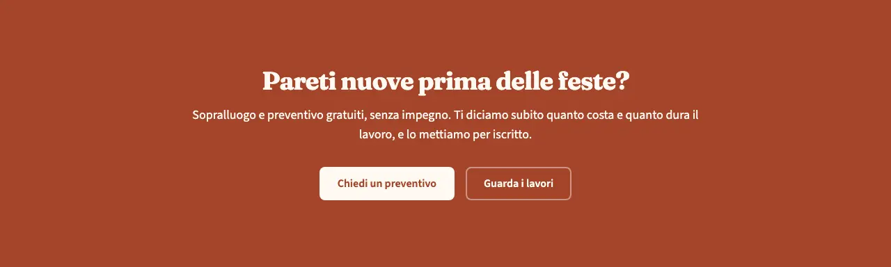
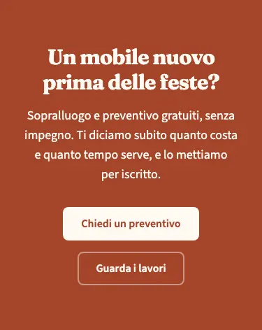
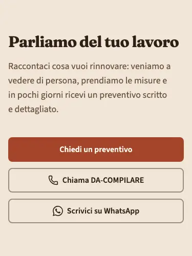

<!-- Generato da scripts/gen-catalog.ts (npm run gen:catalog): non modificare a mano. -->

# cta — Invito all’azione

[← Catalogo](../README.md) · sezione delle ricette (`page`) · v1.1.0 · contatti · non interattivo · disegno originale · dal vivo `/catalogo/cta/`

Fascia che chiede a chi visita di fare il passo successivo: chiedere un preventivo, chiamare, scrivere.

**Quando usarlo:** Dopo i blocchi che convincono (servizi, lavori, recensioni) e in fondo alla pagina, prima del footer. Con showContacts mostra telefono e WhatsApp dell’attività presi da site.json.

**Evitare quando:** In apertura di pagina (lì va l’hero) o più di due volte nella stessa pagina: troppi inviti si annullano a vicenda.

**Varianti:**

- `banner` — Testo centrato e uno o due pulsanti; con tone primary diventa una fascia piena. **Quando usarla:** L’invito principale della pagina, verso la fine: al massimo uno per pagina. Fixture «Banner», dal vivo `/catalogo/cta/banner/`.

  

  

- `split-contatto` — Testo a sinistra e pulsanti a destra; con showContacts aggiunge Chiama e WhatsApp. **Quando usarla:** Per chiudere la pagina con i recapiti, di solito con tone muted (contatti, fondo della home). Fixture «Split con recapiti», dal vivo `/catalogo/cta/split-contatto/`.

  

  

**Campi:**

| Campo | Tipo | Obbl. | Limiti | Note |
| --- | --- | --- | --- | --- |
| `variant` | scelta | sì | `banner` · `split-contatto` | «Variante» |
| `title` | testo | sì | max 70 | «Titolo» |
| `text` | testo | no | max 200 | «Testo» |
| `primary` | gruppo | sì |  | «Pulsante principale» |
| `primary.label` | testo | sì | max 25 | «Testo del pulsante» |
| `primary.href` | testo | sì | un link (/pagina/, #sezione, https://...) oppure @telefono, @whatsapp, @email, @mappa | «Link» |
| `primary.style` | scelta | no | `primary` · `secondary` · `ghost` · `link` | «Stile» |
| `primary.icon` | icona | no | [lista icone](../README.md#icone) | «Icona» |
| `secondary` | gruppo | no |  | «Pulsante secondario» |
| `secondary.label` | testo | sì, se c’è `secondary` | max 25 | «Testo del pulsante» |
| `secondary.href` | testo | sì, se c’è `secondary` | un link (/pagina/, #sezione, https://...) oppure @telefono, @whatsapp, @email, @mappa | «Link» |
| `secondary.style` | scelta | no | `primary` · `secondary` · `ghost` · `link` | «Stile» |
| `secondary.icon` | icona | no | [lista icone](../README.md#icone) | «Icona» |
| `showContacts` | sì/no | sì |  | «Mostra telefono e WhatsApp» · Il pulsante WhatsApp compare solo se site.json ha il numero WhatsApp. |

Nelle note, tra «», l’etichetta del campo nel CMS. Ogni sezione ha anche `type` (`cta`), `id` (ancora facoltativa, in kebab-case) e `tone` (`default`, `muted`, `primary`): vedi `src/content/pages/README.md`.

**Regole:**

- Con showContacts il pulsante WhatsApp compare solo se site.json ha il numero WhatsApp.

**Esempio pronto** (fixture «Banner», una sezione per `sections`; immagini relative a `src/content/pages`):

```json
{
	"type": "cta",
	"tone": "primary",
	"variant": "banner",
	"title": "Un mobile nuovo prima delle feste?",
	"text": "Sopralluogo e preventivo gratuiti, senza impegno. Ti diciamo subito quanto costa e quanto tempo serve, e lo mettiamo per iscritto.",
	"primary": {
		"label": "Chiedi un preventivo",
		"href": "#preventivo"
	},
	"secondary": {
		"label": "Guarda i lavori",
		"href": "#lavori"
	},
	"showContacts": false
}
```
