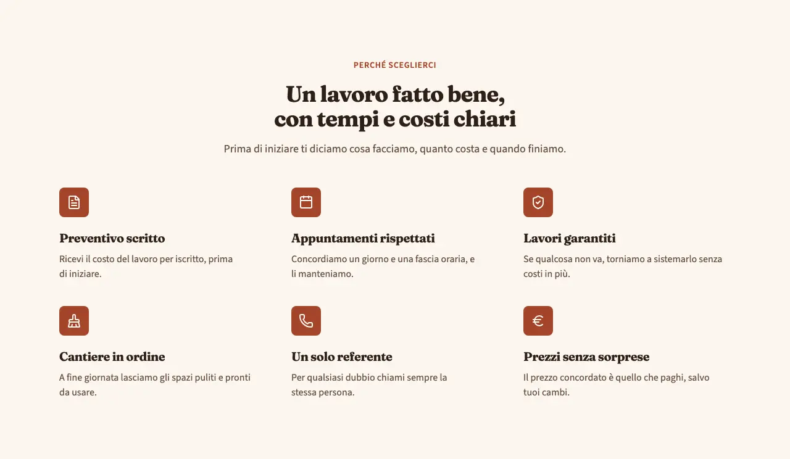
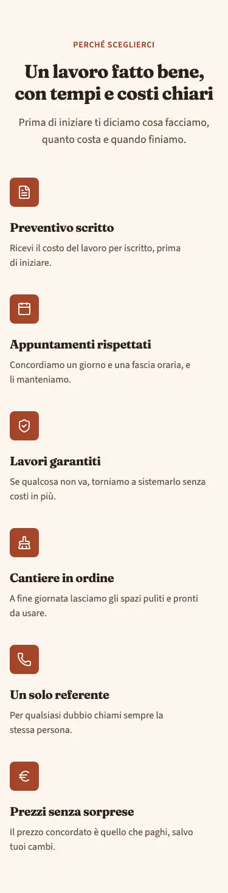
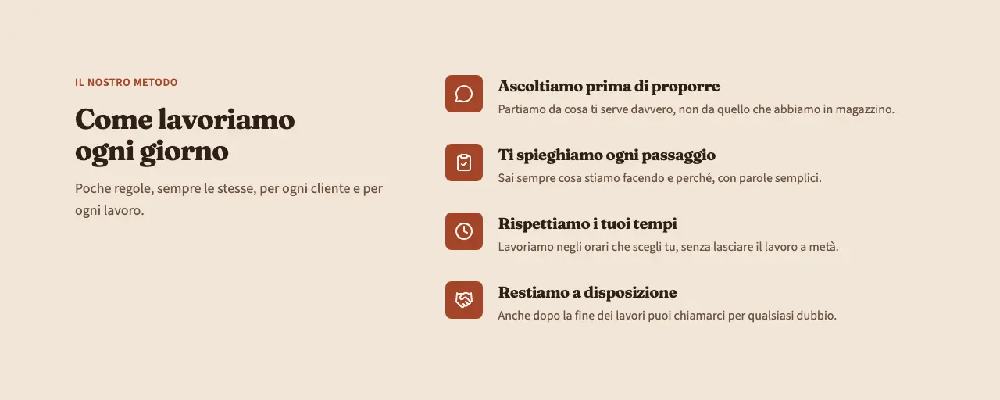
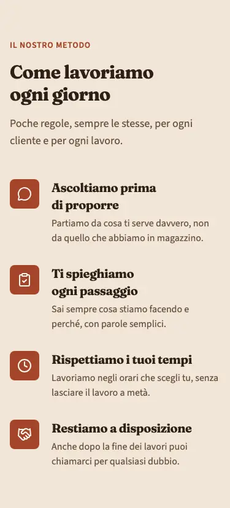

<!-- Generato da scripts/gen-catalog.ts (npm run gen:catalog): non modificare a mano. -->

# features — Punti di forza

[← Catalogo](../README.md) · sezione delle ricette (`page`) · v1.0.0 · contenuti · non interattivo · disegno originale · dal vivo `/catalogo/features/`

Da 3 a 6 vantaggi o punti di forza dell’attività, ognuno con icona, titolo e frase breve.

**Quando usarlo:** Per dire perché scegliere l’attività: garanzie, modo di lavorare, cosa la distingue. Di solito dopo i servizi o prima della cta.

**Evitare quando:** Per elencare i servizi (lì va services) o per dare numeri e risultati (lì va about con-numeri, con la fonte). Non per promesse che non si possono dimostrare.

**Varianti:**

- `3-colonne` — Griglia su 3 colonne (2 su tablet, 1 su mobile) con icona, titolo e testo centrati sul punto. **Quando usarla:** Punti brevi e di pari peso, da 3 o 6 (le righe restano piene). Fixture «3 colonne», dal vivo `/catalogo/features/3-colonne/`.

  

  

- `lista` — Titolo e introduzione a sinistra, a destra un elenco verticale di punti con icona. **Quando usarla:** Quando i punti sono 4 o 5, o hanno testi più lunghi e si leggono meglio uno sotto l’altro. Fixture «Lista», dal vivo `/catalogo/features/lista/`.

  

  

**Campi:**

| Campo | Tipo | Obbl. | Limiti | Note |
| --- | --- | --- | --- | --- |
| `variant` | scelta | sì | `3-colonne` · `lista` | «Variante» |
| `eyebrow` | testo | no | max 40 | «Occhiello» |
| `title` | testo | sì | max 70 | «Titolo» |
| `intro` | testo | no | max 240 | «Introduzione» |
| `items` | elenco | sì | 3–6 voci | «Punti di forza» |
| `items[].icon` | icona | sì | [lista icone](../README.md#icone) | «Icona» |
| `items[].title` | testo | sì | max 50 | «Titolo del punto» |
| `items[].text` | testo | sì | max 160 | «Descrizione» |

Nelle note, tra «», l’etichetta del campo nel CMS. Ogni sezione ha anche `type` (`features`), `id` (ancora facoltativa, in kebab-case), `tone` (`default`, `muted`, `primary`) e `background`, l’effetto dello sfondo (`pieno`, `sfumato`, `alone`, `decoro`; [effetti di sfondo](../README.md#effetti-di-sfondo)): vedi `src/content/pages/README.md`.

**Esempio pronto** (fixture «3 colonne», una sezione per `sections`; immagini relative a `src/content/pages`):

```json
{
	"type": "features",
	"variant": "3-colonne",
	"eyebrow": "Perché sceglierci",
	"title": "Un lavoro fatto bene, con tempi e costi chiari",
	"intro": "Prima di iniziare ti diciamo cosa facciamo, quanto costa e quando finiamo.",
	"items": [
		{
			"icon": "preventivo",
			"title": "Preventivo scritto",
			"text": "Ricevi il costo del lavoro per iscritto, prima di iniziare."
		},
		{
			"icon": "calendario",
			"title": "Appuntamenti rispettati",
			"text": "Concordiamo un giorno e una fascia oraria, e li manteniamo."
		},
		{
			"icon": "garanzia",
			"title": "Lavori garantiti",
			"text": "Se qualcosa non va, torniamo a sistemarlo senza costi in più."
		},
		{
			"icon": "pulizie",
			"title": "Cantiere in ordine",
			"text": "A fine giornata lasciamo gli spazi puliti e pronti da usare."
		},
		{
			"icon": "telefono",
			"title": "Un solo referente",
			"text": "Per qualsiasi dubbio chiami sempre la stessa persona."
		},
		{
			"icon": "euro",
			"title": "Prezzi senza sorprese",
			"text": "Il prezzo concordato è quello che paghi, salvo tuoi cambi."
		}
	]
}
```
