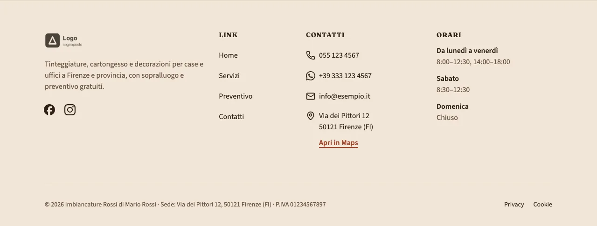
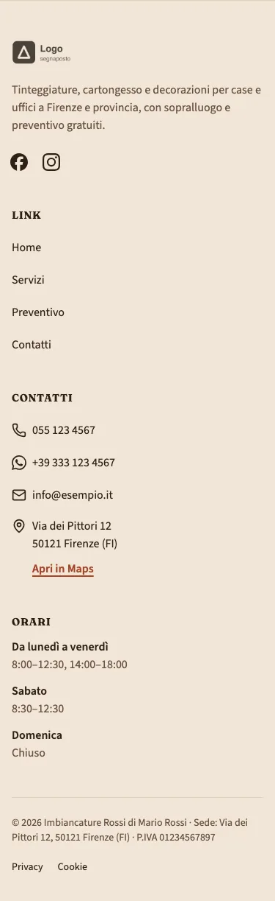

<!-- Generato da scripts/gen-catalog.ts (npm run gen:catalog): non modificare a mano. -->

# Footer

[← Catalogo](../README.md) · dal vivo: `/catalogo/footer/`

| Tipo | Scope | Versione | Interattivo | Categoria | Disegno |
| --- | --- | --- | --- | --- | --- |
| `footer` | `layout`: in layout.json | 1.0.0 | no | navigazione | originale |

Piede del sito: recapiti cliccabili, orari, social e i dati legali obbligatori (ragione sociale, sede, P.IVA, REA e capitale per le società), con i link a privacy e cookie. Tutto da site.json e navigation.json.

- **Quando usarlo.** Sempre: è il piede di tutte le pagine. Non è una sezione delle ricette: variante e fascia di contatto si scelgono in src/content/settings/layout.json (chiave footer) e BaseLayout lo disegna in fondo a ogni pagina.
- **Quando evitarlo.** Nelle sezioni di una ricetta (la build lo rifiuta). Per chiudere una pagina con un invito diverso da chiamare o scrivere usa cta, e lascia ctaBand spento per non ripeterlo.

## Varianti

### `colonne`

Logo e descrizione, link del footer, contatti con indirizzo e «Apri in Maps», orari e social; sotto, la riga legale con i link a privacy e cookie e il credito. Per la maggior parte dei siti.

Da sola: `/catalogo/footer/colonne/` · fixture «Colonne, ditta individuale».





### `minimale`

Una riga sola: nome, P.IVA (con REA e capitale per le società), link legali e social. Per siti di una o due pagine.

Da sola: `/catalogo/footer/minimale/` · fixture «Minimale, ditta individuale, con fascia (titolo predefinito, anche WhatsApp)».


## Campi

| Campo | Tipo | Obbligatorio | Limiti | Etichetta e aiuto (CMS) | Vincoli |
| --- | --- | --- | --- | --- | --- |
| `variant` | scelta | sì | `colonne` · `minimale` | **Variante** — colonne: logo, link, contatti, orari e social · minimale: una riga con nome, P.IVA, link legali e social |  |
| `ctaBand` | sì/no | sì |  | **Fascia di contatto** — Sopra il footer, un titolo con i pulsanti per chiamare e scrivere su WhatsApp |  |
| `ctaBandTitle` | testo | no | max 70 caratteri | **Titolo della fascia** — Al massimo 70 caratteri; vuoto: «Parliamo del tuo progetto» | Usato solo con ctaBand attivo. |

Blocco di layout: le props si scrivono in `src/content/settings/layout.json`, sotto la chiave `footer`; BaseLayout lo disegna su ogni pagina.

## Esempio

Dalla fixture «Colonne, ditta individuale», da mettere in `src/content/settings/layout.json`:

```json
{
	"footer": {
		"variant": "colonne",
		"ctaBand": false
	}
}
```
