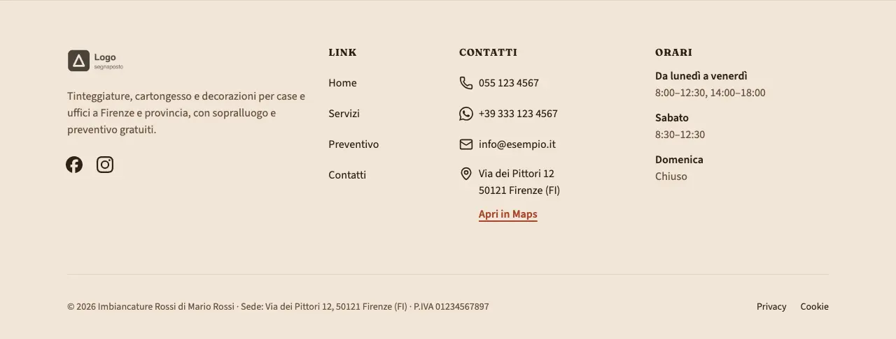
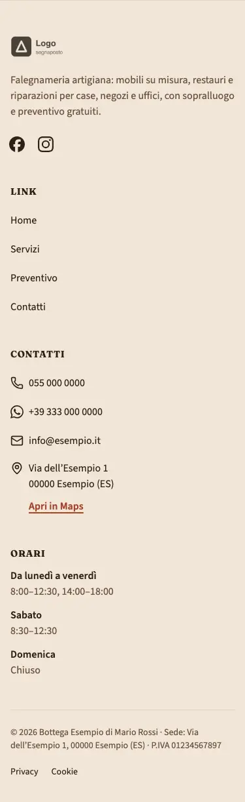
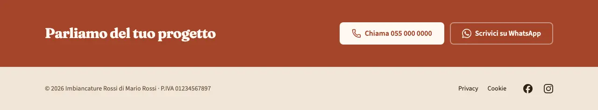

<!-- Generato da scripts/gen-catalog.ts (npm run gen:catalog): non modificare a mano. -->

# footer — Footer

[← Catalogo](../README.md) · blocco di layout (`layout`, in layout.json) · v1.0.0 · piè di pagina · non interattivo · disegno originale · dal vivo `/catalogo/footer/`

Piede del sito: recapiti cliccabili, orari, social e i dati legali obbligatori (ragione sociale, sede, P.IVA, REA e capitale per le società), con i link a privacy e cookie. Tutto da site.json e navigation.json.

**Quando usarlo:** Sempre: è il piede di tutte le pagine. Non è una sezione delle ricette: variante e fascia di contatto si scelgono in src/content/settings/layout.json (chiave footer) e BaseLayout lo disegna in fondo a ogni pagina.

**Evitare quando:** Nelle sezioni di una ricetta (la build lo rifiuta). Per chiudere una pagina con un invito diverso da chiamare o scrivere usa cta, e lascia ctaBand spento per non ripeterlo.

**Varianti:**

- `colonne` — Logo e descrizione, link, contatti con «Apri in Maps», orari e social; sotto, la riga legale con privacy, cookie e credito. **Quando usarla:** Per la maggior parte dei siti. Fixture «Colonne, ditta individuale», dal vivo `/catalogo/footer/colonne/`.

  

  

- `minimale` — Una riga sola: nome, P.IVA (con REA e capitale per le società), link legali e social. **Quando usarla:** Siti di una o due pagine, o quando contatti e orari sono già nelle pagine. Fixture «Minimale, ditta individuale, con fascia (titolo predefinito, anche WhatsApp)», dal vivo `/catalogo/footer/minimale/`.

  

  

**Campi:**

| Campo | Tipo | Obbl. | Limiti | Note |
| --- | --- | --- | --- | --- |
| `variant` | scelta | sì | `colonne` · `minimale` | «Variante» |
| `ctaBand` | sì/no | sì |  | «Fascia di contatto» |
| `ctaBandTitle` | testo | no | max 70 | «Titolo della fascia» · Usato solo con ctaBand attivo. |

Nelle note, tra «», l’etichetta del campo nel CMS. Le props si scrivono in `src/content/settings/layout.json`, sotto la chiave `footer`; BaseLayout disegna il blocco su ogni pagina.

**Regole:**

- Il titolo della fascia (ctaBandTitle) conta solo con ctaBand attivo.
- Il pulsante WhatsApp della fascia compare solo se site.json ha il numero WhatsApp.

**Esempio pronto** (fixture «Colonne, ditta individuale», in `src/content/settings/layout.json`):

```json
{
	"footer": {
		"variant": "colonne",
		"ctaBand": false
	}
}
```
