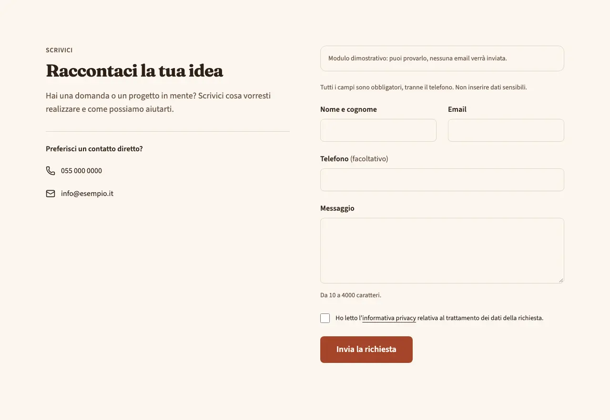
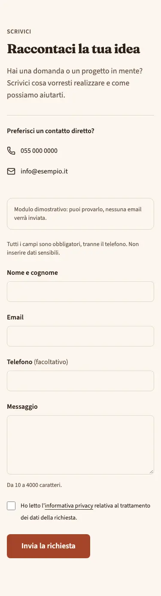
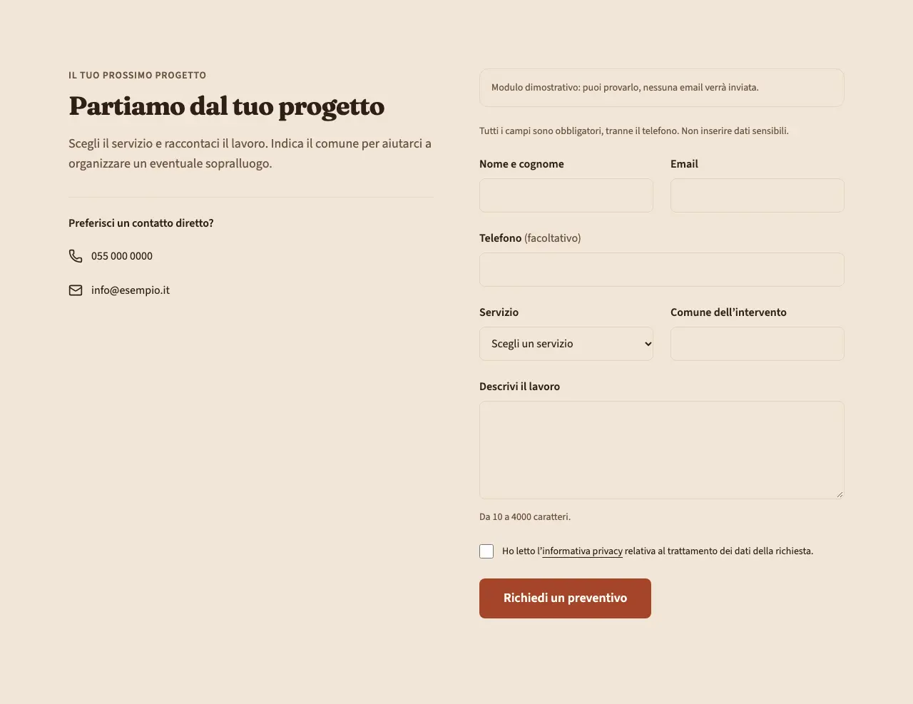
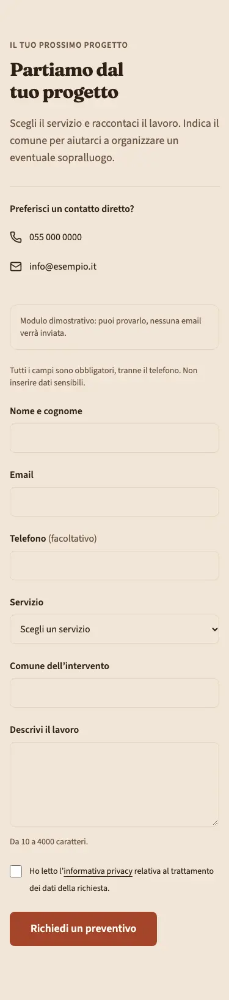

<!-- Generato da scripts/gen-catalog.ts (npm run gen:catalog): non modificare a mano. -->

# form — Modulo di contatto

[← Catalogo](../README.md) · sezione delle ricette (`page`) · v1.0.1 · contatti · interattivo · disegno originale · dal vivo `/catalogo/form/`

Modulo di contatto o richiesta di preventivo, con invio tramite Resend su Vercel e collegamento all’informativa privacy.

**Quando usarlo:** Quando chi visita deve inviare una richiesta scritta. Configura Resend secondo docs/form.md; il destinatario è l’email di site.json. Il catalogo simula l’invio senza spedire email.

**Evitare quando:** Per un semplice invito a chiamare (usa cta o contact), prenotazioni con calendario, pagamenti, allegati o raccolta di dati sensibili.

**Varianti:**

- `contatto` — Introduzione e recapiti affiancati a nome, email, telefono facoltativo e messaggio; su mobile tutto in colonna. **Quando usarla:** Per domande generiche, disponibilità e richieste di informazioni. Fixture «Richiesta di informazioni», dal vivo `/catalogo/form/contatto/`.

  

  

- `preventivo` — Modulo con scelta del servizio e comune dell’intervento, oltre ai dati di contatto e alla descrizione della richiesta. **Quando usarla:** Per raccogliere le prime informazioni utili a preparare un preventivo o un sopralluogo. Fixture «Richiesta di preventivo», dal vivo `/catalogo/form/preventivo/`.

  

  

**Campi:**

| Campo | Tipo | Obbl. | Limiti | Note |
| --- | --- | --- | --- | --- |
| `variant` | scelta | sì | `contatto` · `preventivo` | «Variante» |
| `title` | testo | sì | max 70 | «Titolo» |
| `text` | testo | no | max 240 | «Introduzione» |
| `services` | elenco | per preventivo | 1–12 voci | «Servizi richiesti» · Ignorato nella variante contatto. |
| `privacyHref` | testo | sì | max 200; percorso interno dell’informativa, es. /privacy/ | «Informativa privacy» · Pagina interna esistente. La presa visione è obbligatoria e separata da eventuali consensi marketing, che il blocco non raccoglie. |
| `submitLabel` | testo | no (predefinito `"Invia la richiesta"`) | max 25 | «Testo del pulsante» |

Nelle note, tra «», l’etichetta del campo nel CMS. Ogni sezione ha anche `type` (`form`), `id` (ancora facoltativa, in kebab-case) e `tone` (`default`, `muted`, `primary`): vedi `src/content/pages/README.md`.

**Regole:**

- La variante preventivo richiede un elenco di servizi (services).
- L’informativa privacy deve esistere ed essere approvata per il trattamento e il servizio di invio utilizzati.
- Il destinatario arriva solo dall’email di site.json; chiave API e mittente Resend sono variabili server, mai campi del blocco.

**Esempio pronto** (fixture «Richiesta di informazioni», una sezione per `sections`; immagini relative a `src/content/pages`):

```json
{
	"type": "form",
	"variant": "contatto",
	"title": "Raccontaci la tua idea",
	"text": "Hai una domanda o un progetto in mente? Scrivici cosa vorresti realizzare e come possiamo aiutarti.",
	"privacyHref": "/privacy/"
}
```
