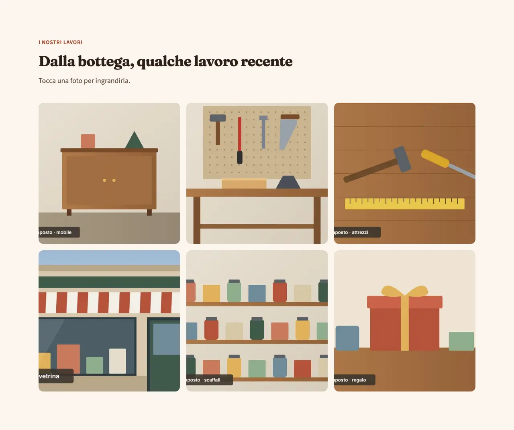
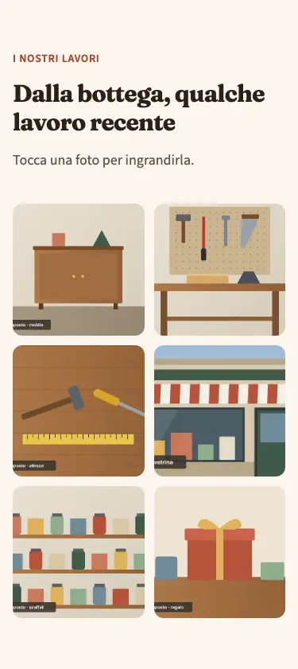
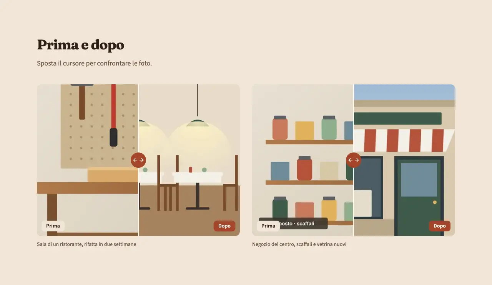
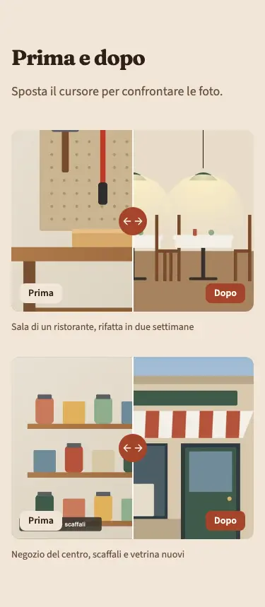
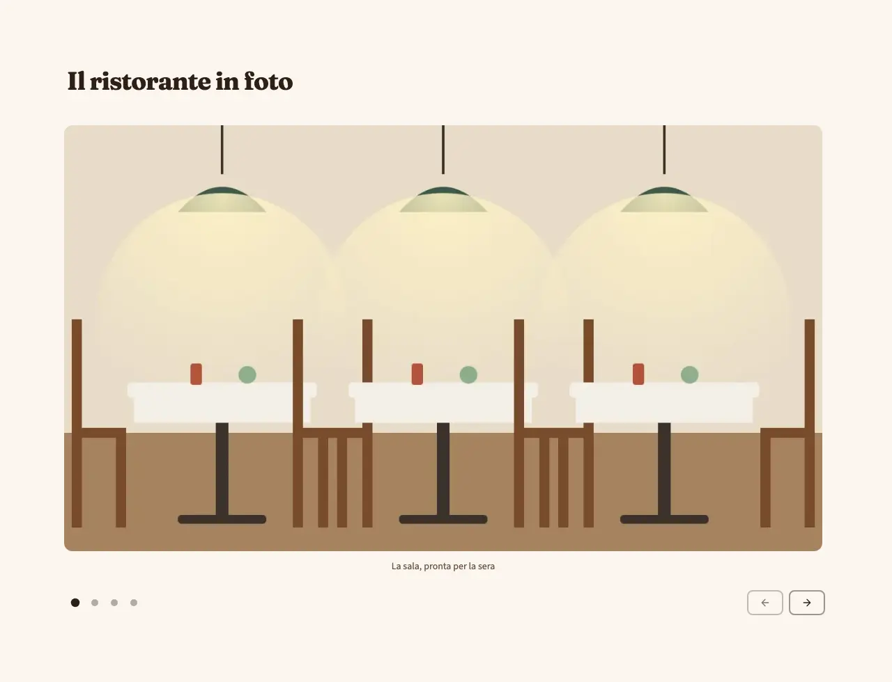
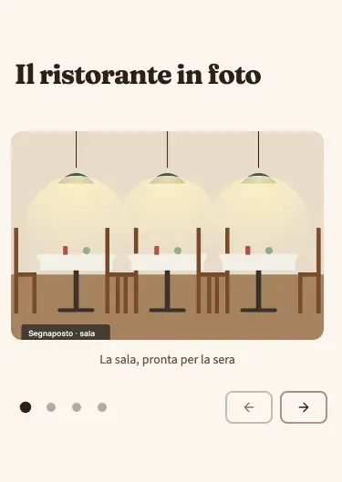

<!-- Generato da scripts/gen-catalog.ts (npm run gen:catalog): non modificare a mano. -->

# gallery — Galleria

[← Catalogo](../README.md) · sezione delle ricette (`page`) · v1.1.0 · contenuti · interattivo · disegno originale · dal vivo `/catalogo/gallery/`

Le foto dei lavori svolti: una griglia che si ingrandisce al clic, coppie prima e dopo, oppure una foto grande alla volta.

**Quando usarlo:** Per mostrare lavori, locali o prodotti veri, quando le foto parlano da sole. Solo foto reali fornite dal cliente.

**Evitare quando:** Senza foto vere: non si riempie con immagini d’archivio o inventate, si usa un altro blocco. Con meno di 2 foto. Per foto che accompagnano un testo (about, services). Per una serie da sfogliare con testo e link (carousel).

**Varianti:**

- `griglia-popup` — Griglia di miniature; al clic la foto si apre grande in una finestra, con frecce e didascalia. Senza JavaScript la miniatura apre il file della foto. **Quando usarla:** Per tante foto di lavori diversi (da 4 a 12) da guardare nel dettaglio. Fixture «Griglia con popup», dal vivo `/catalogo/gallery/griglia-popup/`.

  

  

- `prima-dopo` — Coppie di foto «prima» e «dopo» con un cursore per confrontarle. Senza JavaScript le due foto stanno affiancate con la loro etichetta. **Quando usarla:** Per ristrutturazioni, restauri, pulizie, trasformazioni: ogni coppia con la stessa inquadratura. Fixture «Prima e dopo», dal vivo `/catalogo/gallery/prima-dopo/`.

  

  

- `slider` — Una foto grande alla volta, con frecce, pallini e didascalia; scorre solo su comando. **Quando usarla:** Per poche foto di qualità (da 3 a 8) che meritano tutto lo spazio. Fixture «Slider», dal vivo `/catalogo/gallery/slider/`.

  

  

**Campi:**

| Campo | Tipo | Obbl. | Limiti | Note |
| --- | --- | --- | --- | --- |
| `variant` | scelta | sì | `griglia-popup` · `prima-dopo` · `slider` | «Variante» |
| `eyebrow` | testo | no | max 40 | «Occhiello» |
| `title` | testo | sì | max 70 | «Titolo» |
| `intro` | testo | no | max 240 | «Introduzione» |
| `items` | elenco | sì | 2–12 voci | «Foto» · Prima-dopo: al massimo 6 coppie. |
| `items[].image` | gruppo | sì |  | «Foto» |
| `items[].image.src` | immagine | sì | foto in src/assets/images | «File» |
| `items[].image.alt` | testo | sì | min 5 | «Testo alternativo» |
| `items[].before` | gruppo | per prima-dopo |  | «Foto «prima»» · Le altre varianti non la mostrano. Stessa inquadratura del «dopo». |
| `items[].before.src` | immagine | sì, se c’è `items[].before` | foto in src/assets/images | «File» |
| `items[].before.alt` | testo | sì, se c’è `items[].before` | min 5 | «Testo alternativo» |
| `items[].caption` | testo | no | max 100 | «Didascalia» |
| `showCaptions` | sì/no | no (predefinito `false`) |  | «Didascalie in vista» · Solo per la variante griglia-popup; nelle altre la didascalia si vede già. |

Nelle note, tra «», l’etichetta del campo nel CMS. Ogni sezione ha anche `type` (`gallery`), `id` (ancora facoltativa, in kebab-case), `tone` (`default`, `muted`, `primary`), `background`, l’effetto dello sfondo (`pieno`, `sfumato`, `alone`, `decoro`; [effetti di sfondo](../README.md#effetti-di-sfondo)), ed `edge`, il bordo in alto ([bordi tra sezioni](../README.md#bordi-tra-sezioni)): vedi `src/content/pages/README.md`.

**Regole:**

- La variante prima-dopo richiede la foto «prima» (before) in ogni elemento e al massimo 6 coppie.

**Esempio pronto** (fixture «Griglia con popup», una sezione per `sections`; immagini relative a `src/content/pages`):

```json
{
	"type": "gallery",
	"variant": "griglia-popup",
	"eyebrow": "I nostri lavori",
	"title": "Dalla bottega, qualche lavoro recente",
	"intro": "Tocca una foto per ingrandirla.",
	"items": [
		{
			"image": {
				"src": "../../assets/images/fixtures/artigiano-mobile.jpg",
				"alt": "Credenza in legno a due ante con maniglie dorate, in una stanza chiara"
			},
			"caption": "Credenza in rovere, consegnata a Firenze"
		},
		{
			"image": {
				"src": "../../assets/images/fixtures/artigiano-laboratorio.jpg",
				"alt": "Banco da lavoro in legno con martello, scalpello e sega appesi a un pannello forato"
			},
			"caption": "Il banco da lavoro in laboratorio"
		},
		{
			"image": {
				"src": "../../assets/images/fixtures/artigiano-attrezzi.jpg",
				"alt": "Martello, cacciavite e metro giallo appoggiati su un piano di legno"
			},
			"caption": "Gli attrezzi di tutti i giorni"
		},
		{
			"image": {
				"src": "../../assets/images/fixtures/negozio-vetrina.jpg",
				"alt": "Vetrina di una bottega con la tenda a righe bianche e rosse e la porta verde"
			},
			"caption": "Vetrina rinnovata per un negozio del centro"
		},
		{
			"image": {
				"src": "../../assets/images/fixtures/negozio-scaffali.jpg",
				"alt": "Scaffali di legno con barattoli e scatole colorate in fila"
			},
			"caption": "Scaffali su misura"
		},
		{
			"image": {
				"src": "../../assets/images/fixtures/negozio-regalo.jpg",
				"alt": "Pacco regalo rosso con il fiocco giallo appoggiato sul banco"
			},
			"caption": "Confezioni regalo"
		}
	]
}
```
