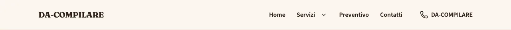
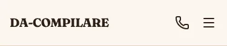
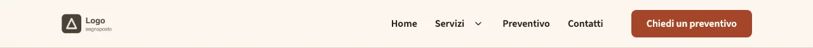
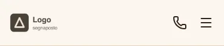

<!-- Generato da scripts/gen-catalog.ts (npm run gen:catalog): non modificare a mano. -->

# Header

[← Catalogo](../README.md) · dal vivo: `/catalogo/header/`

| Tipo | Scope | Versione | Interattivo | Categoria | Disegno |
| --- | --- | --- | --- | --- | --- |
| `header` | `layout`: in layout.json | 2.0.0 | sì | intestazione | originale |

Intestazione del sito: logo o nome, menu con sottomenu e, su mobile, un pannello a tutta altezza. Voci e recapiti arrivano da navigation.json e site.json.

- **Quando usarlo.** Sempre: è l’intestazione di tutte le pagine. Non è una sezione delle ricette: variante, sticky e logo si scelgono in src/content/settings/layout.json (chiave header) e BaseLayout la disegna in cima a ogni pagina.
- **Quando evitarlo.** Nelle sezioni di una ricetta (la build lo rifiuta). Per un invito all’azione a metà pagina usa cta.

## Varianti

### `semplice`

Logo e menu; su desktop a destra c’è il telefono. Per siti con poche pagine o senza un’azione principale.

Da sola: `/catalogo/header/semplice/` · fixture «Semplice, logo testo».





### `con-cta`

Logo, menu e un pulsante in evidenza a destra (la cta di navigation.json), ripetuto nel menu mobile. Per spingere preventivi o prenotazioni.

Da sola: `/catalogo/header/con-cta/` · fixture «Con CTA, logo immagine».





## Campi

| Campo | Tipo | Obbligatorio | Limiti | Etichetta e aiuto (CMS) | Vincoli |
| --- | --- | --- | --- | --- | --- |
| `variant` | scelta | sì | `semplice` · `con-cta` | **Variante** — semplice: logo e menu · con-cta: aggiunge il pulsante in evidenza del «Menu» | con-cta richiede la cta in navigation.json. |
| `sticky` | sì/no | sì |  | **Resta in cima** — L’intestazione resta visibile mentre si scorre la pagina |  |
| `logo` | scelta | no | `testo` · `immagine` | **Logo** — testo: il nome dell’attività · immagine: il logo caricato in «Dati attività». Vuoto: il logo se c’è, altrimenti il nome | immagine richiede il logo in site.json; vuoto: immagine se il logo c’è, altrimenti il nome. |

Blocco di layout: le props si scrivono in `src/content/settings/layout.json`, sotto la chiave `header`; BaseLayout lo disegna su ogni pagina.

## Esempio

Dalla fixture «Semplice, logo testo», da mettere in `src/content/settings/layout.json`:

```json
{
	"header": {
		"variant": "semplice",
		"sticky": false,
		"logo": "testo"
	}
}
```
