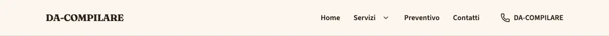
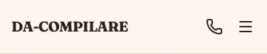
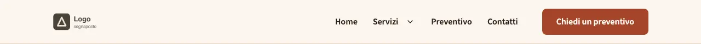
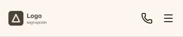

<!-- Generato da scripts/gen-catalog.ts (npm run gen:catalog): non modificare a mano. -->

# header — Header

[← Catalogo](../README.md) · blocco di layout (`layout`, in layout.json) · v2.0.0 · intestazione · interattivo · disegno originale · dal vivo `/catalogo/header/`

Intestazione del sito: logo o nome, menu con sottomenu e, su mobile, un pannello a tutta altezza. Voci e recapiti arrivano da navigation.json e site.json.

**Quando usarlo:** Sempre: è l’intestazione di tutte le pagine. Non è una sezione delle ricette: variante, sticky e logo si scelgono in src/content/settings/layout.json (chiave header) e BaseLayout la disegna in cima a ogni pagina.

**Evitare quando:** Nelle sezioni di una ricetta (la build lo rifiuta). Per un invito all’azione a metà pagina usa cta.

**Varianti:**

- `semplice` — Logo e menu; su desktop a destra c’è il telefono. **Quando usarla:** Siti con poche pagine o senza un’azione principale da spingere. Fixture «Semplice, logo testo», dal vivo `/catalogo/header/semplice/`.

  

  

- `con-cta` — Logo, menu e un pulsante in evidenza a destra (la cta di navigation.json), ripetuto nel menu mobile. **Quando usarla:** Per spingere preventivi o prenotazioni da ogni pagina. Fixture «Con CTA, logo immagine», dal vivo `/catalogo/header/con-cta/`.

  

  

**Campi:**

| Campo | Tipo | Obbl. | Limiti | Note |
| --- | --- | --- | --- | --- |
| `variant` | scelta | sì | `semplice` · `con-cta` | «Variante» · con-cta richiede la cta in navigation.json. |
| `sticky` | sì/no | sì |  | «Resta in cima» |
| `logo` | scelta | no | `testo` · `immagine` | «Logo» · immagine richiede il logo in site.json. |

Nelle note, tra «», l’etichetta del campo nel CMS. Le props si scrivono in `src/content/settings/layout.json`, sotto la chiave `header`; BaseLayout disegna il blocco su ogni pagina.

**Regole:**

- La variante con-cta richiede la cta in navigation.json.
- Il logo immagine richiede il logo in site.json.

**Esempio pronto** (fixture «Semplice, logo testo», in `src/content/settings/layout.json`):

```json
{
	"header": {
		"variant": "semplice",
		"sticky": false,
		"logo": "testo"
	}
}
```
