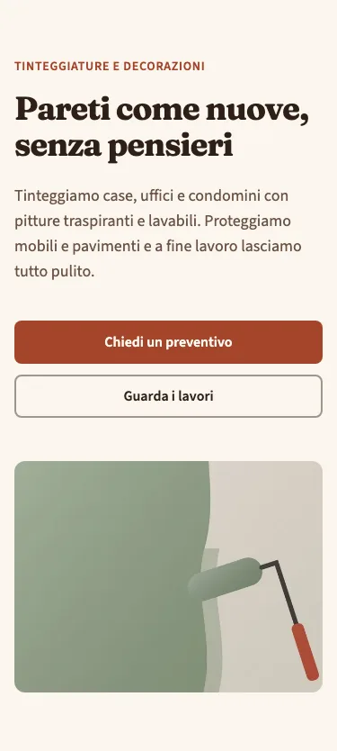
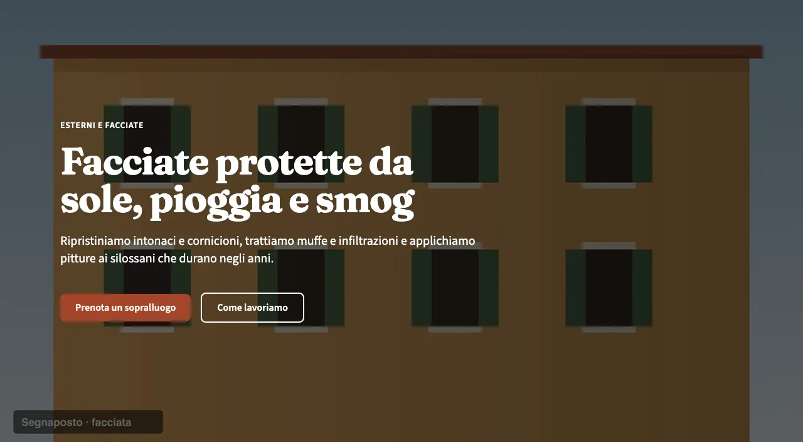
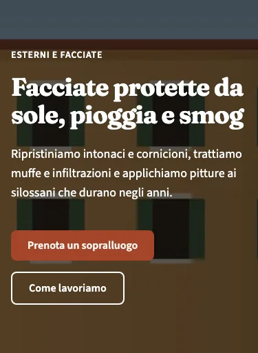
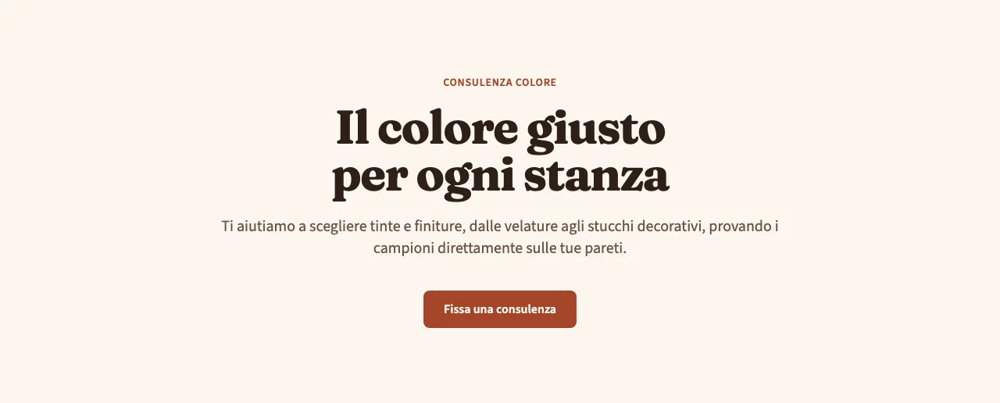
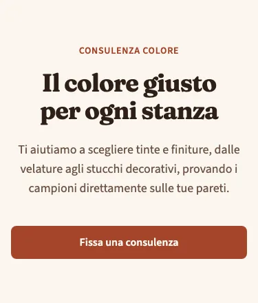

<!-- Generato da scripts/gen-catalog.ts (npm run gen:catalog): non modificare a mano. -->

# Hero

[← Catalogo](../README.md) · dal vivo: `/catalogo/hero/`

| Tipo | Scope | Versione | Interattivo | Categoria | Disegno |
| --- | --- | --- | --- | --- | --- |
| `hero` | `page`: sezione delle ricette | 1.1.1 | no | apertura | originale |

Apertura della pagina: titolo principale, sottotitolo e invito all’azione.

- **Quando usarlo.** Come primo blocco di una pagina, per dire subito cosa fa l’attività e cosa può fare chi visita (chiedere un preventivo, prenotare, chiamare).
- **Quando evitarlo.** A metà pagina o più di una volta nella stessa pagina: contiene l’unico h1. Per inviti all’azione intermedi serve un blocco dedicato.

## Varianti

### `split`

Testo a sinistra e immagine a destra (sotto su mobile). Equilibrata, va bene per quasi tutte le attività.

Da sola: `/catalogo/hero/split/` · fixture «Split».




### `full`

Immagine a tutta larghezza con velatura scura e testo chiaro sopra. Di grande impatto, richiede una foto di qualità.

Da sola: `/catalogo/hero/full/` · fixture «Full».





### `centered`

Solo testo, centrato, senza immagine. Per pagine interne o quando manca una foto adatta.

Da sola: `/catalogo/hero/centered/` · fixture «Centered».





## Campi

| Campo | Tipo | Obbligatorio | Limiti | Etichetta e aiuto (CMS) | Vincoli |
| --- | --- | --- | --- | --- | --- |
| `variant` | scelta | sì | `split` · `full` · `centered` | **Variante** — split: testo e foto affiancati · full: foto a tutta larghezza · centered: solo testo |  |
| `eyebrow` | testo | no |  | **Occhiello** — Breve testo sopra il titolo, es. il settore |  |
| `title` | testo | sì | max 70 caratteri | **Titolo** — Il titolo principale della pagina, al massimo 70 caratteri |  |
| `subtitle` | testo | no | max 200 caratteri | **Sottotitolo** — Una o due frasi su cosa offri, al massimo 200 caratteri |  |
| `primaryCta` | gruppo | sì |  | **Pulsante principale** — L’azione più importante, es. «Chiedi un preventivo» |  |
| `primaryCta.label` | testo | sì | max 25 caratteri | **Testo del pulsante** — Al massimo 25 caratteri |  |
| `primaryCta.href` | testo | sì | un link (/pagina/, #sezione, https://...) oppure @telefono, @whatsapp, @email, @mappa | **Link** — Una pagina del sito (/contatti/), una sezione (#preventivo), un indirizzo completo, oppure @telefono, @whatsapp, @email o @mappa per i recapiti di «Dati attività» |  |
| `primaryCta.style` | scelta | no | `primary` · `secondary` · `ghost` · `link` | **Stile** — primary: pieno · secondary: bordato · ghost: solo testo · link: sottolineato. Vuoto: quello previsto dal blocco |  |
| `primaryCta.icon` | icona | no | un alias di [icone.md](../icone.md) | **Icona** — Facoltativa, accanto al testo (le frecce vanno dopo il testo) |  |
| `secondaryCta` | gruppo | no |  | **Pulsante secondario** — Un’alternativa meno importante: compila testo e link, oppure nessuno dei due |  |
| `secondaryCta.label` | testo | sì, se c’è `secondaryCta` | max 25 caratteri | **Testo del pulsante** — Al massimo 25 caratteri |  |
| `secondaryCta.href` | testo | sì, se c’è `secondaryCta` | un link (/pagina/, #sezione, https://...) oppure @telefono, @whatsapp, @email, @mappa | **Link** — Una pagina del sito (/contatti/), una sezione (#preventivo), un indirizzo completo, oppure @telefono, @whatsapp, @email o @mappa per i recapiti di «Dati attività» |  |
| `secondaryCta.style` | scelta | no | `primary` · `secondary` · `ghost` · `link` | **Stile** — primary: pieno · secondary: bordato · ghost: solo testo · link: sottolineato. Vuoto: quello previsto dal blocco |  |
| `secondaryCta.icon` | icona | no | un alias di [icone.md](../icone.md) | **Icona** — Facoltativa, accanto al testo (le frecce vanno dopo il testo) |  |
| `image` | gruppo | no |  | **Foto** — Obbligatoria per le varianti split e full | Obbligatoria per le varianti split e full; centered non la mostra. |
| `image.src` | immagine | sì, se c’è `image` | file in src/assets/images, percorso relativo al JSON | **File** — JPG, PNG o WebP; per le foto grandi almeno 1600 px di larghezza |  |
| `image.alt` | testo | sì, se c’è `image` | almeno 5 caratteri | **Testo alternativo** — Descrive la foto a chi non la vede, es. «Soggiorno con pareti verde salvia» |  |

Ogni sezione ha anche `type` (`hero`), `id` (ancora facoltativa, in kebab-case) e `tone` (`default`, `muted`, `primary`): vedi `src/content/pages/README.md`.

## Esempio

Dalla fixture «Split», una sezione da mettere in `sections` di una ricetta (le immagini sono percorsi relativi a `src/content/pages`):

```json
{
	"type": "hero",
	"variant": "split",
	"eyebrow": "Tinteggiature e decorazioni",
	"title": "Pareti come nuove, senza pensieri",
	"subtitle": "Tinteggiamo case, uffici e condomini con pitture traspiranti e lavabili. Proteggiamo mobili e pavimenti e a fine lavoro lasciamo tutto pulito.",
	"primaryCta": {
		"label": "Chiedi un preventivo",
		"href": "#preventivo"
	},
	"secondaryCta": {
		"label": "Guarda i lavori",
		"href": "#lavori"
	},
	"image": {
		"src": "../../assets/images/fixtures/imbianchino-interno.jpg",
		"alt": "Parete tinteggiata a metà in verde salvia, con un rullo appoggiato"
	}
}
```
