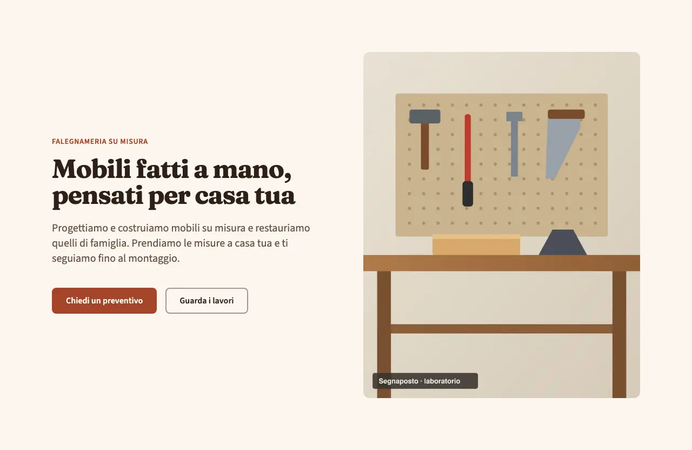
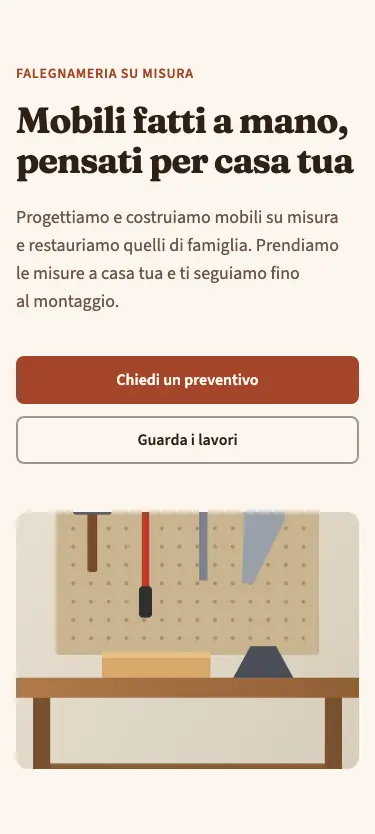
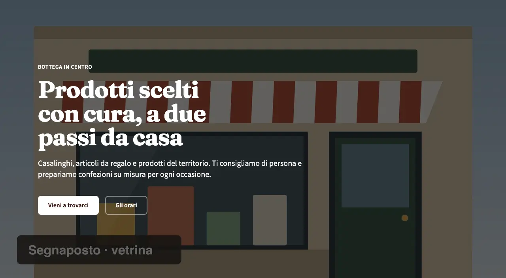
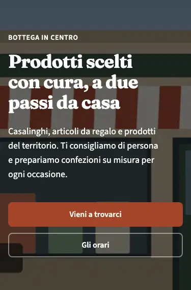
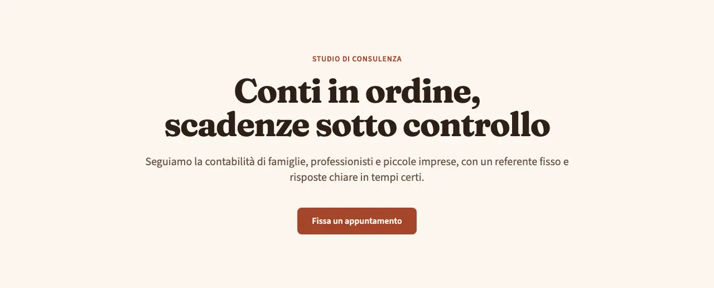
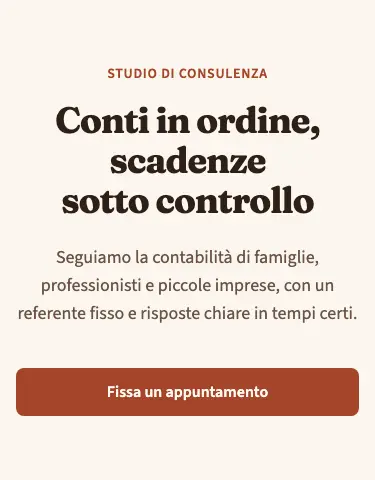

<!-- Generato da scripts/gen-catalog.ts (npm run gen:catalog): non modificare a mano. -->

# hero — Hero

[← Catalogo](../README.md) · sezione delle ricette (`page`) · v1.3.0 · apertura · non interattivo · disegno originale · dal vivo `/catalogo/hero/`

Apertura della pagina: titolo principale, sottotitolo e invito all’azione.

**Quando usarlo:** Come primo blocco di una pagina, per dire subito cosa fa l’attività e cosa può fare chi visita (chiedere un preventivo, prenotare, chiamare).

**Evitare quando:** A metà pagina o più di una volta nella stessa pagina: contiene l’unico h1. Per inviti all’azione intermedi serve un blocco dedicato.

**Varianti:**

- `split` — Testo a sinistra e foto a destra (sotto su mobile). **Quando usarla:** Quasi sempre: equilibrata, va bene per la home di qualsiasi attività che ha una buona foto. Fixture «Split», dal vivo `/catalogo/hero/split/`.

  

  

- `full` — Foto a tutta larghezza con velatura (scura o colorata, campo overlay) e testo chiaro sopra. **Quando usarla:** Quando c’è una foto di grande qualità e si vuole impatto; non con foto piccole o confuse. Fixture «Full», dal vivo `/catalogo/hero/full/`.

  

  

- `centered` — Solo testo, centrato, senza foto. **Quando usarla:** Pagine interne (servizi, contatti, note legali) o quando manca una foto adatta. Fixture «Centered», dal vivo `/catalogo/hero/centered/`.

  

  

**Campi:**

| Campo | Tipo | Obbl. | Limiti | Note |
| --- | --- | --- | --- | --- |
| `variant` | scelta | sì | `split` · `full` · `centered` | «Variante» |
| `eyebrow` | testo | no |  | «Occhiello» |
| `title` | testo | sì | max 70 | «Titolo» |
| `subtitle` | testo | no | max 200 | «Sottotitolo» |
| `primaryCta` | gruppo | sì |  | «Pulsante principale» |
| `primaryCta.label` | testo | sì | max 25 | «Testo del pulsante» |
| `primaryCta.href` | testo | sì | un link (/pagina/, #sezione, https://...) oppure @telefono, @whatsapp, @email, @mappa | «Link» |
| `primaryCta.style` | scelta | no | `primary` · `secondary` · `ghost` · `link` | «Stile» |
| `primaryCta.icon` | icona | no | [lista icone](../README.md#icone) | «Icona» |
| `secondaryCta` | gruppo | no |  | «Pulsante secondario» |
| `secondaryCta.label` | testo | sì, se c’è `secondaryCta` | max 25 | «Testo del pulsante» |
| `secondaryCta.href` | testo | sì, se c’è `secondaryCta` | un link (/pagina/, #sezione, https://...) oppure @telefono, @whatsapp, @email, @mappa | «Link» |
| `secondaryCta.style` | scelta | no | `primary` · `secondary` · `ghost` · `link` | «Stile» |
| `secondaryCta.icon` | icona | no | [lista icone](../README.md#icone) | «Icona» |
| `image` | gruppo | per split, full |  | «Foto» · centered non la mostra. |
| `image.src` | immagine | sì, se c’è `image` | foto in src/assets/images | «File» |
| `image.alt` | testo | sì, se c’è `image` | min 5 | «Testo alternativo» |
| `imageShape` | scelta | no (predefinito `"verticale"`) | `verticale` · `orizzontale` | «Formato della foto» · Solo per la variante split; nelle altre non ha effetto. |
| `overlay` | scelta | no (predefinito `"scura"`) | `scura` · `colorata` | «Velatura» · Solo per la variante full; nelle altre non ha effetto. |

Nelle note, tra «», l’etichetta del campo nel CMS. Ogni sezione ha anche `type` (`hero`), `id` (ancora facoltativa, in kebab-case), `tone` (`default`, `muted`, `primary`), `background`, l’effetto dello sfondo (`pieno`, `sfumato`, `alone`, `aurora`, `decoro`; [effetti di sfondo](../README.md#effetti-di-sfondo)), ed `edge`, il bordo in alto ([bordi tra sezioni](../README.md#bordi-tra-sezioni)): vedi `src/content/pages/README.md`.

**Regole:**

- Le varianti split e full richiedono la foto (image).

**Esempio pronto** (fixture «Split», una sezione per `sections`; immagini relative a `src/content/pages`):

```json
{
	"type": "hero",
	"variant": "split",
	"eyebrow": "Falegnameria su misura",
	"title": "Mobili fatti a mano, pensati per casa tua",
	"subtitle": "Progettiamo e costruiamo mobili su misura e restauriamo quelli di famiglia. Prendiamo le misure a casa tua e ti seguiamo fino al montaggio.",
	"primaryCta": {
		"label": "Chiedi un preventivo",
		"href": "#preventivo"
	},
	"secondaryCta": {
		"label": "Guarda i lavori",
		"href": "#lavori"
	},
	"image": {
		"src": "../../assets/images/fixtures/artigiano-laboratorio.jpg",
		"alt": "Banco da lavoro in legno con martello, scalpello e sega appesi a un pannello forato"
	}
}
```
