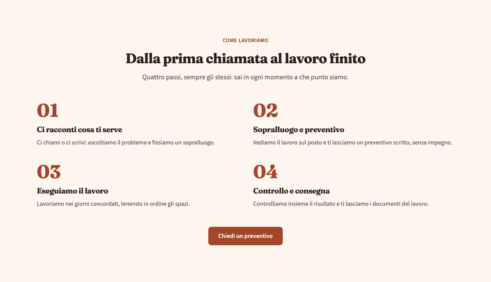
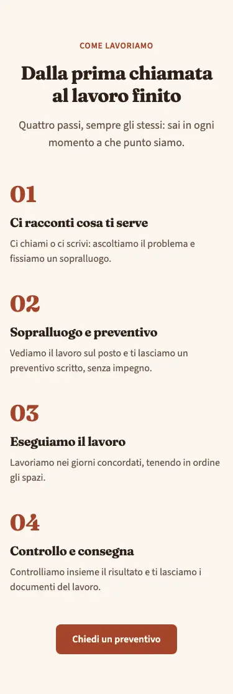
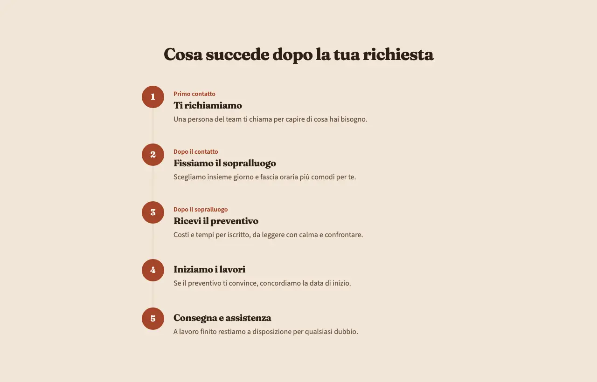
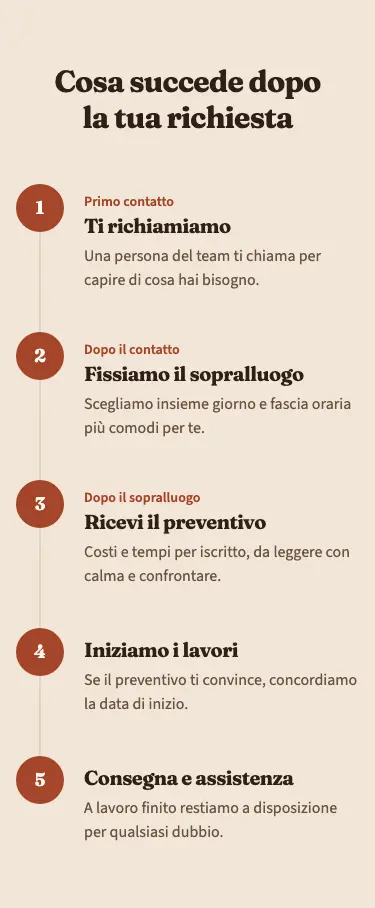

<!-- Generato da scripts/gen-catalog.ts (npm run gen:catalog): non modificare a mano. -->

# process — Come lavoriamo

[← Catalogo](../README.md) · sezione delle ricette (`page`) · v1.0.0 · contenuti · non interattivo · disegno originale · dal vivo `/catalogo/process/`

Il percorso dal primo contatto al lavoro finito, in 3-6 passi numerati, con tempi facoltativi.

**Quando usarlo:** Quando il cliente deve sapere cosa succede dopo averti contattato: preventivo, sopralluogo, lavoro, consegna.

**Evitare quando:** Per un elenco di vantaggi senza ordine (lì va features) o per la storia dell’attività (about). Non inventare tempi: se non sono garantiti, lascia vuoto il campo.

**Varianti:**

- `passi-numerati` — Griglia di passi (3 colonne su desktop), ognuno con un grande numero, titolo e testo. **Quando usarla:** Percorsi di 3, 4 o 6 passi brevi, da vedere tutti insieme a colpo d’occhio. Fixture «Passi numerati», dal vivo `/catalogo/process/passi-numerati/`.

  

  

- `timeline` — Passi in colonna lungo una linea verticale con i numeri, uno sotto l’altro. **Quando usarla:** Percorsi con testi più lunghi o tempi da mostrare, o di 5 passi. Fixture «Timeline», dal vivo `/catalogo/process/timeline/`.

  

  

**Campi:**

| Campo | Tipo | Obbl. | Limiti | Note |
| --- | --- | --- | --- | --- |
| `variant` | scelta | sì | `passi-numerati` · `timeline` | «Variante» |
| `eyebrow` | testo | no | max 40 | «Occhiello» |
| `title` | testo | sì | max 70 | «Titolo» |
| `intro` | testo | no | max 240 | «Introduzione» |
| `steps` | elenco | sì | 3–6 voci | «Passi» |
| `steps[].title` | testo | sì | max 50 | «Titolo del passo» |
| `steps[].text` | testo | sì | max 200 | «Descrizione» |
| `steps[].timing` | testo | no | max 30 | «Tempi» |
| `cta` | gruppo | no |  | «Pulsante» |
| `cta.label` | testo | sì, se c’è `cta` | max 25 | «Testo del pulsante» |
| `cta.href` | testo | sì, se c’è `cta` | un link (/pagina/, #sezione, https://...) oppure @telefono, @whatsapp, @email, @mappa | «Link» |
| `cta.style` | scelta | no | `primary` · `secondary` · `ghost` · `link` | «Stile» |
| `cta.icon` | icona | no | [lista icone](../README.md#icone) | «Icona» |

Nelle note, tra «», l’etichetta del campo nel CMS. Ogni sezione ha anche `type` (`process`), `id` (ancora facoltativa, in kebab-case), `tone` (`default`, `muted`, `primary`) e `background`, l’effetto dello sfondo (`pieno`, `sfumato`, `alone`; [effetti di sfondo](../README.md#effetti-di-sfondo)): vedi `src/content/pages/README.md`.

**Esempio pronto** (fixture «Passi numerati», una sezione per `sections`; immagini relative a `src/content/pages`):

```json
{
	"type": "process",
	"variant": "passi-numerati",
	"eyebrow": "Come lavoriamo",
	"title": "Dalla prima chiamata al lavoro finito",
	"intro": "Quattro passi, sempre gli stessi: sai in ogni momento a che punto siamo.",
	"steps": [
		{
			"title": "Ci racconti cosa ti serve",
			"text": "Ci chiami o ci scrivi: ascoltiamo il problema e fissiamo un sopralluogo."
		},
		{
			"title": "Sopralluogo e preventivo",
			"text": "Vediamo il lavoro sul posto e ti lasciamo un preventivo scritto, senza impegno."
		},
		{
			"title": "Eseguiamo il lavoro",
			"text": "Lavoriamo nei giorni concordati, tenendo in ordine gli spazi."
		},
		{
			"title": "Controllo e consegna",
			"text": "Controlliamo insieme il risultato e ti lasciamo i documenti del lavoro."
		}
	],
	"cta": {
		"label": "Chiedi un preventivo",
		"href": "@telefono"
	}
}
```
