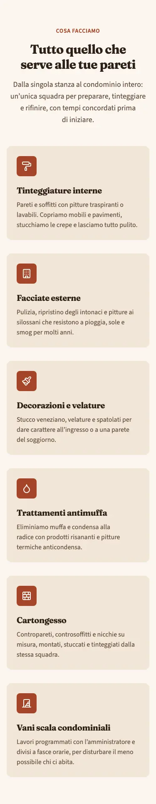
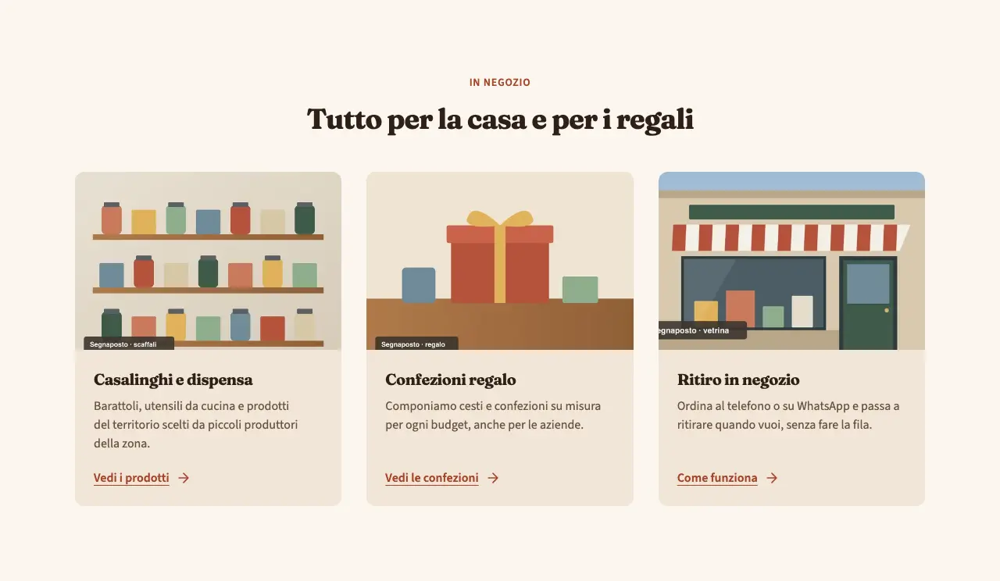
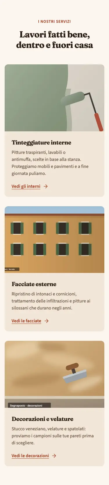
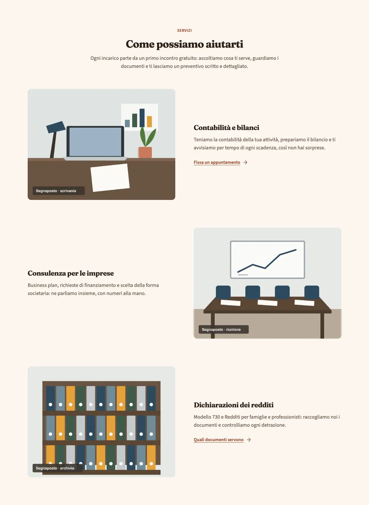
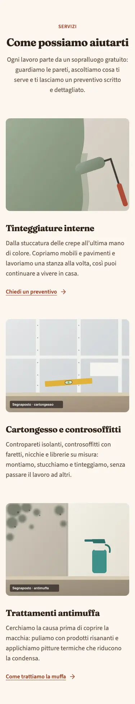
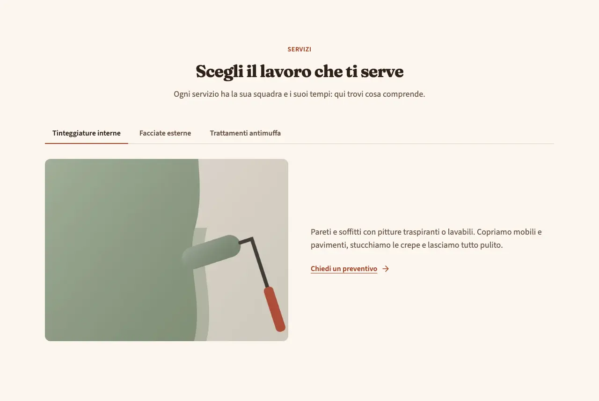
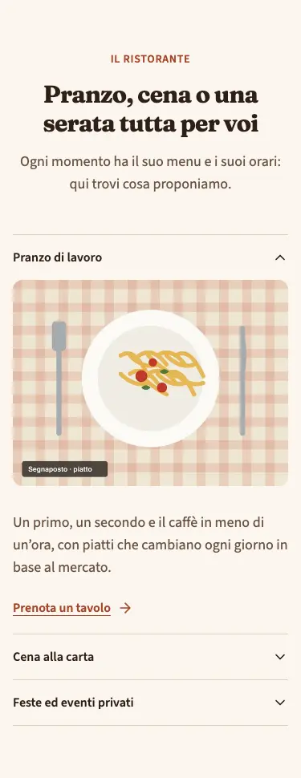

<!-- Generato da scripts/gen-catalog.ts (npm run gen:catalog): non modificare a mano. -->

# services — Servizi

[← Catalogo](../README.md) · sezione delle ricette (`page`) · v1.1.0 · contenuti · non interattivo · disegno originale · dal vivo `/catalogo/services/`

Elenco dei servizi dell’attività, da 2 a 6, ognuno con titolo, descrizione breve e link facoltativo.

**Quando usarlo:** Per dire cosa fa l’attività, di solito subito dopo l’hero. Nella pagina dei servizi, con la variante alternato, per dare più spazio a ciascuno.

**Evitare quando:** Per un solo servizio (basta un blocco di testo) o per più di 6 (meglio dividerli in più blocchi con un titolo ciascuno). Non per mostrare i lavori svolti: lì servono le foto dei lavori, non un elenco.

**Varianti:**

- `cards-icone` — Griglia di card con icona, titolo e testo, su 2 o 3 colonne. **Quando usarla:** Servizi brevi e simili tra loro, quando non c’è una foto per ognuno. Fixture «Card con icona», dal vivo `/catalogo/services/cards-icone/`.

  

  

- `cards-immagine` — Griglia di card con una foto in alto. **Quando usarla:** Quando c’è una foto adatta per ogni servizio: più concreta delle icone. Fixture «Card con immagine», dal vivo `/catalogo/services/cards-immagine/`.

  

  

- `alternato` — Righe di foto e testo che si alternano a destra e a sinistra. **Quando usarla:** Da 2 a 4 servizi da raccontare con calma, di solito nella pagina dei servizi. Fixture «Alternato», dal vivo `/catalogo/services/alternato/`.

  

  

- `schede` — Un servizio per scheda, con testo, foto facoltativa e link; su mobile un elenco da aprire. **Quando usarla:** Servizi alternativi tra cui scegliere; non per servizi che tutti devono vedere. Fixture «Schede», dal vivo `/catalogo/services/schede/`.

  

  

**Campi:**

| Campo | Tipo | Obbl. | Limiti | Note |
| --- | --- | --- | --- | --- |
| `variant` | scelta | sì | `cards-icone` · `cards-immagine` · `alternato` · `schede` | «Variante» |
| `eyebrow` | testo | no |  | «Occhiello» |
| `title` | testo | sì | max 70 | «Titolo» |
| `intro` | testo | no | max 240 | «Introduzione» |
| `items` | elenco | sì | 2–6 voci | «Servizi» |
| `items[].icon` | icona | per cards-icone | [lista icone](../README.md#icone) | «Icona» · Le altre varianti non la mostrano. |
| `items[].image` | gruppo | per cards-immagine, alternato |  | «Foto» · Facoltativa in schede; cards-icone non la mostra. |
| `items[].image.src` | immagine | sì, se c’è `items[].image` | foto in src/assets/images | «File» |
| `items[].image.alt` | testo | sì, se c’è `items[].image` | min 5 | «Testo alternativo» |
| `items[].title` | testo | sì | max 50 | «Nome del servizio» |
| `items[].text` | testo | sì | max 180 | «Descrizione» |
| `items[].link` | gruppo | no |  | «Link» |
| `items[].link.label` | testo | sì, se c’è `items[].link` | max 25 | «Testo del pulsante» |
| `items[].link.href` | testo | sì, se c’è `items[].link` | un link (/pagina/, #sezione, https://...) oppure @telefono, @whatsapp, @email, @mappa | «Link» |
| `items[].link.style` | scelta | no | `primary` · `secondary` · `ghost` · `link` | «Stile» |
| `items[].link.icon` | icona | no | [lista icone](../README.md#icone) | «Icona» |

Nelle note, tra «», l’etichetta del campo nel CMS. Ogni sezione ha anche `type` (`services`), `id` (ancora facoltativa, in kebab-case), `tone` (`default`, `muted`, `primary`) e `background`, l’effetto dello sfondo (`pieno`, `sfumato`, `alone`, `decoro`; [effetti di sfondo](../README.md#effetti-di-sfondo)): vedi `src/content/pages/README.md`.

**Regole:**

- La variante cards-icone richiede l’icona in ogni servizio.
- Le varianti cards-immagine e alternato richiedono la foto in ogni servizio.

**Esempio pronto** (fixture «Card con icona», una sezione per `sections`; immagini relative a `src/content/pages`):

```json
{
	"type": "services",
	"variant": "cards-icone",
	"eyebrow": "Cosa facciamo",
	"title": "Manutenzioni e impianti per la casa",
	"intro": "Dal rubinetto che perde al nuovo condizionatore: un’unica squadra di tecnici per gli impianti di casa, con appuntamenti in giornata per le urgenze.",
	"items": [
		{
			"icon": "rubinetto",
			"title": "Impianti idraulici",
			"text": "Riparazioni, sostituzione di sanitari e rubinetti, ricerca delle perdite senza rompere i muri."
		},
		{
			"icon": "lampadina",
			"title": "Impianti elettrici",
			"text": "Nuove prese e punti luce, quadri elettrici a norma e certificazione degli impianti."
		},
		{
			"icon": "aria-condizionata",
			"title": "Clima e riscaldamento",
			"text": "Installazione e pulizia di condizionatori, manutenzione delle caldaie e dei termosifoni."
		},
		{
			"icon": "fiamma",
			"title": "Impianti a gas",
			"text": "Allacci, prove di tenuta e controlli periodici fatti da tecnici abilitati."
		},
		{
			"icon": "porta",
			"title": "Porte e serramenti",
			"text": "Regolazione di porte e finestre, sostituzione di serrature e maniglie."
		},
		{
			"icon": "scale",
			"title": "Parti comuni dei condomini",
			"text": "Manutenzioni programmate con l’amministratore, a fasce orarie per disturbare il meno possibile."
		}
	]
}
```
