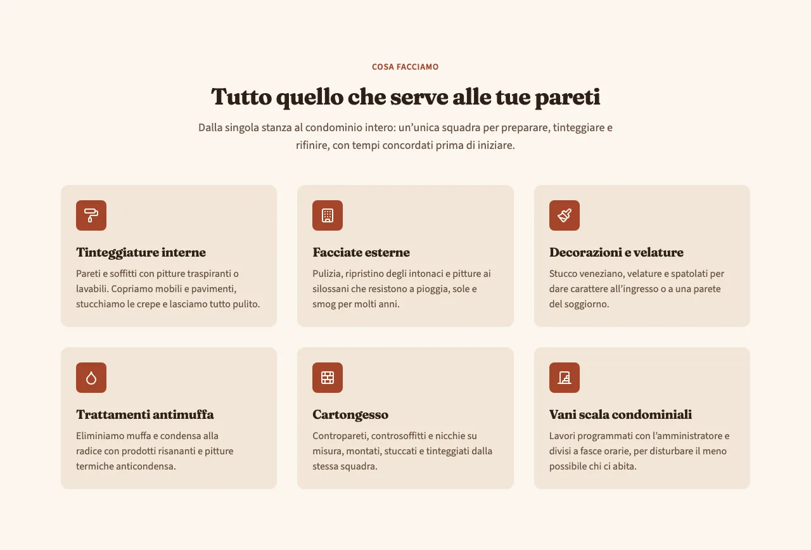
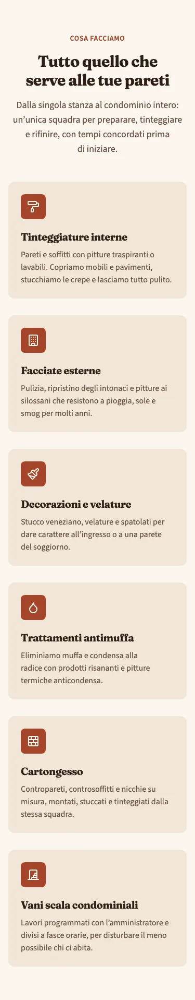
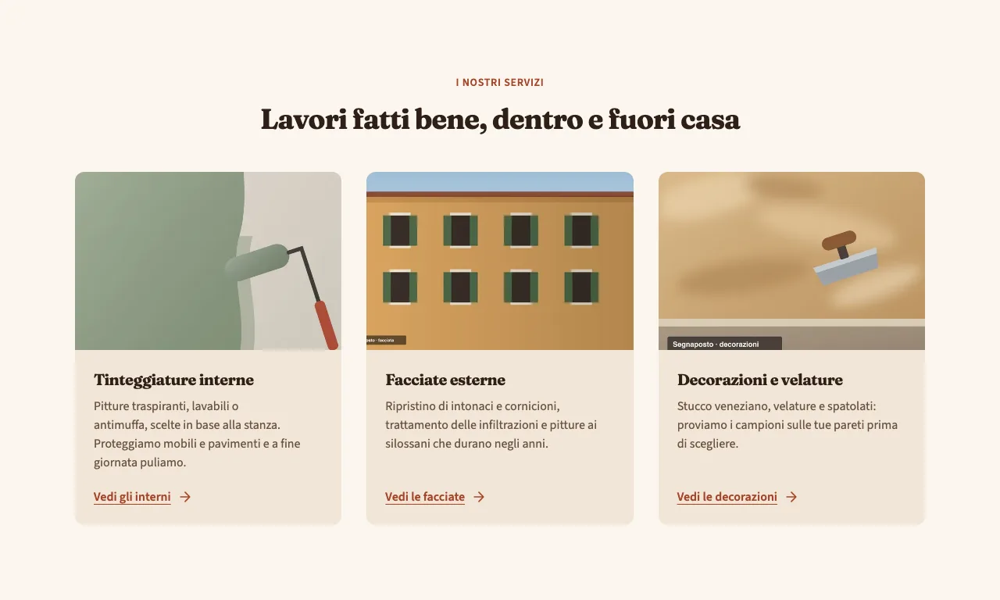
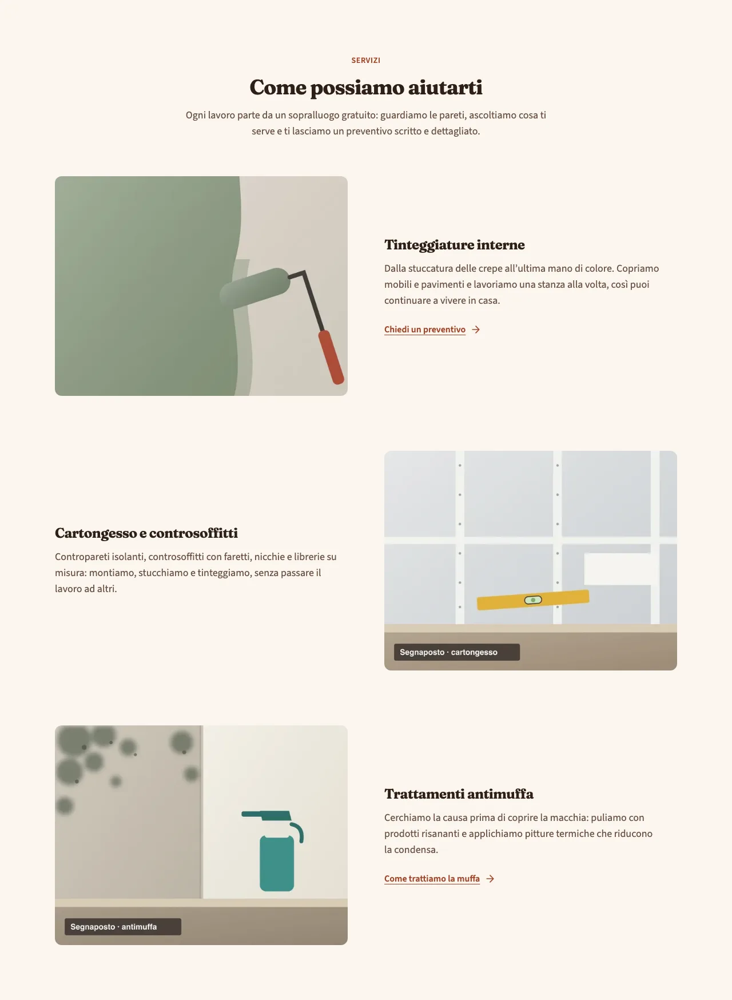
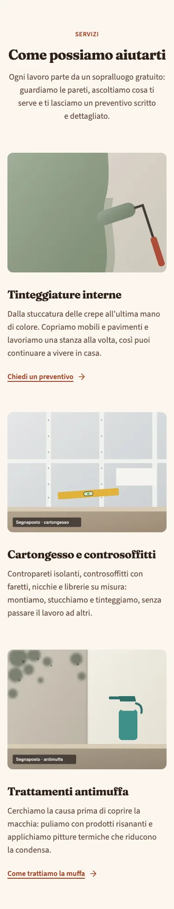
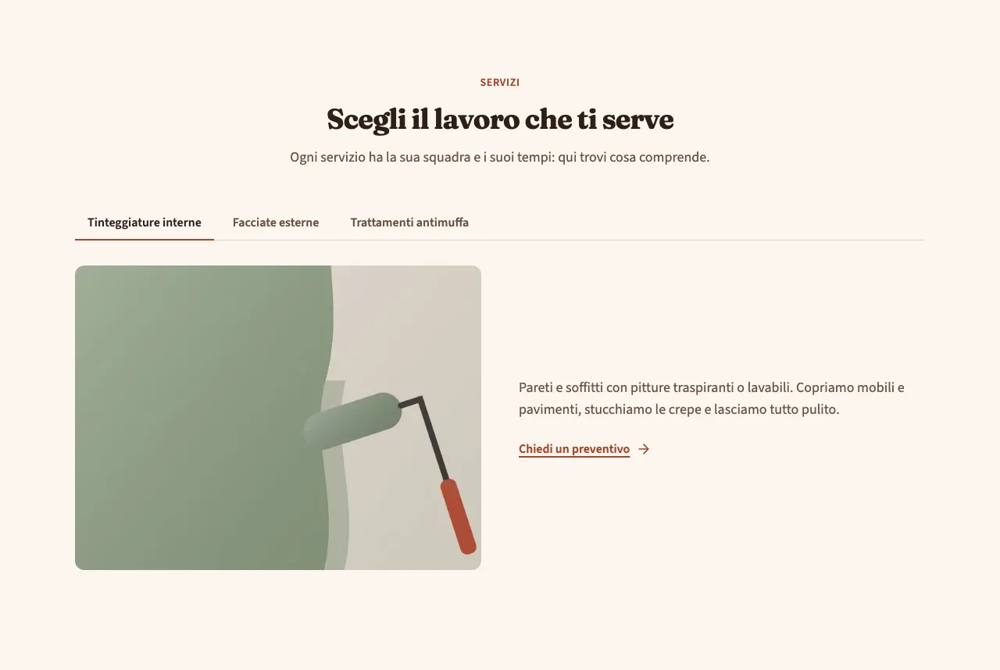
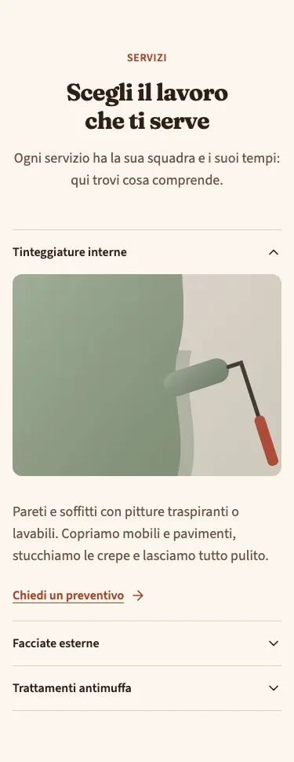

<!-- Generato da scripts/gen-catalog.ts (npm run gen:catalog): non modificare a mano. -->

# Servizi

[← Catalogo](../README.md) · dal vivo: `/catalogo/services/`

| Tipo | Scope | Versione | Interattivo | Categoria | Disegno |
| --- | --- | --- | --- | --- | --- |
| `services` | `page`: sezione delle ricette | 1.1.0 | no | contenuti | originale |

Elenco dei servizi dell’attività, da 2 a 6, ognuno con titolo, descrizione breve e link facoltativo.

- **Quando usarlo.** Per dire cosa fa l’attività, di solito subito dopo l’hero. Nella pagina dei servizi, con la variante alternato, per dare più spazio a ciascuno.
- **Quando evitarlo.** Per un solo servizio (basta un blocco di testo) o per più di 6 (meglio dividerli in più blocchi con un titolo ciascuno). Non per mostrare i lavori svolti: lì servono le foto dei cantieri, non un elenco.

## Varianti

### `cards-icone`

Griglia di card con icona, titolo e testo, su 2 o 3 colonne. Compatta e ordinata, non richiede foto.

Da sola: `/catalogo/services/cards-icone/` · fixture «Card con icona».





### `cards-immagine`

Griglia di card con una foto in alto. Più concreta, richiede una foto adatta per ogni servizio.

Da sola: `/catalogo/services/cards-immagine/` · fixture «Card con immagine».




### `alternato`

Righe con foto e testo che si alternano a destra e a sinistra. Occupa più spazio: adatta alla pagina dei servizi.

Da sola: `/catalogo/services/alternato/` · fixture «Alternato».





### `schede`

Un servizio per scheda (su mobile elenco da aprire), con testo, foto facoltativa e link. Per servizi alternativi tra cui scegliere; non per servizi che tutti devono vedere.

Da sola: `/catalogo/services/schede/` · fixture «Schede».





## Campi

| Campo | Tipo | Obbligatorio | Limiti | Etichetta e aiuto (CMS) | Vincoli |
| --- | --- | --- | --- | --- | --- |
| `variant` | scelta | sì | `cards-icone` · `cards-immagine` · `alternato` · `schede` | **Variante** — cards-icone: card con icona · cards-immagine: card con foto · alternato: righe di foto e testo · schede: un servizio per scheda |  |
| `eyebrow` | testo | no |  | **Occhiello** — Breve testo sopra il titolo |  |
| `title` | testo | sì | max 70 caratteri | **Titolo** — Titolo della sezione, al massimo 70 caratteri |  |
| `intro` | testo | no | max 240 caratteri | **Introduzione** — Una frase che presenta i servizi, al massimo 240 caratteri |  |
| `items` | elenco | sì | da 2 a 6 | **Servizi** — Da 2 a 6 servizi |  |
| `items[].icon` | icona | no | un alias di [icone.md](../icone.md) | **Icona** — Obbligatoria per la variante cards-icone | Obbligatoria per la variante cards-icone; le altre non la mostrano. |
| `items[].image` | gruppo | no |  | **Foto** — Obbligatoria per le varianti cards-immagine e alternato; facoltativa nelle schede | Obbligatoria per le varianti cards-immagine e alternato; facoltativa in schede; cards-icone non la mostra. |
| `items[].image.src` | immagine | sì, se c’è `items[].image` | file in src/assets/images, percorso relativo al JSON | **File** — JPG, PNG o WebP; per le foto grandi almeno 1600 px di larghezza |  |
| `items[].image.alt` | testo | sì, se c’è `items[].image` | almeno 5 caratteri | **Testo alternativo** — Descrive la foto a chi non la vede, es. «Soggiorno con pareti verde salvia» |  |
| `items[].title` | testo | sì | max 50 caratteri | **Nome del servizio** — Al massimo 50 caratteri |  |
| `items[].text` | testo | sì | max 180 caratteri | **Descrizione** — Cosa comprende il servizio, al massimo 180 caratteri |  |
| `items[].link` | gruppo | no |  | **Link** — Porta alla pagina o alla sezione del servizio: compila testo e link, oppure nessuno dei due |  |
| `items[].link.label` | testo | sì, se c’è `items[].link` | max 25 caratteri | **Testo del pulsante** — Al massimo 25 caratteri |  |
| `items[].link.href` | testo | sì, se c’è `items[].link` | un link (/pagina/, #sezione, https://...) oppure @telefono, @whatsapp, @email, @mappa | **Link** — Una pagina del sito (/contatti/), una sezione (#preventivo), un indirizzo completo, oppure @telefono, @whatsapp, @email o @mappa per i recapiti di «Dati attività» |  |
| `items[].link.style` | scelta | no | `primary` · `secondary` · `ghost` · `link` | **Stile** — primary: pieno · secondary: bordato · ghost: solo testo · link: sottolineato. Vuoto: quello previsto dal blocco |  |
| `items[].link.icon` | icona | no | un alias di [icone.md](../icone.md) | **Icona** — Facoltativa, accanto al testo (le frecce vanno dopo il testo) |  |

Ogni sezione ha anche `type` (`services`), `id` (ancora facoltativa, in kebab-case) e `tone` (`default`, `muted`, `primary`): vedi `src/content/pages/README.md`.

## Esempio

Dalla fixture «Schede», una sezione da mettere in `sections` di una ricetta (le immagini sono percorsi relativi a `src/content/pages`):

```json
{
	"type": "services",
	"variant": "schede",
	"eyebrow": "Servizi",
	"title": "Scegli il lavoro che ti serve",
	"intro": "Ogni servizio ha la sua squadra e i suoi tempi: qui trovi cosa comprende.",
	"items": [
		{
			"image": {
				"src": "../../assets/images/fixtures/imbianchino-interno.jpg",
				"alt": "Parete tinteggiata a metà in verde salvia, con un rullo appoggiato"
			},
			"title": "Tinteggiature interne",
			"text": "Pareti e soffitti con pitture traspiranti o lavabili. Copriamo mobili e pavimenti, stucchiamo le crepe e lasciamo tutto pulito.",
			"link": {
				"label": "Chiedi un preventivo",
				"href": "#preventivo"
			}
		},
		{
			"image": {
				"src": "../../assets/images/fixtures/imbianchino-facciata.jpg",
				"alt": "Facciata di una casa color ocra con persiane verdi"
			},
			"title": "Facciate esterne",
			"text": "Pulizia, ripristino degli intonaci e pitture ai silossani che resistono a pioggia, sole e smog per molti anni."
		},
		{
			"title": "Trattamenti antimuffa",
			"text": "Eliminiamo muffa e condensa alla radice con prodotti risananti e pitture termiche anticondensa.",
			"link": {
				"label": "Scrivici su WhatsApp",
				"href": "@whatsapp",
				"icon": "whatsapp",
				"style": "secondary"
			}
		}
	]
}
```
