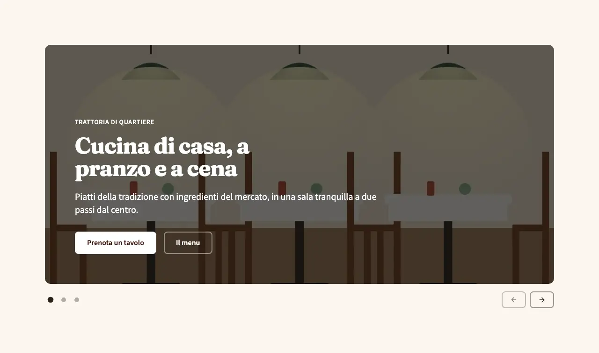
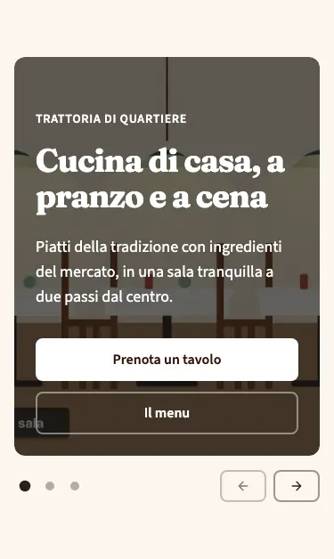
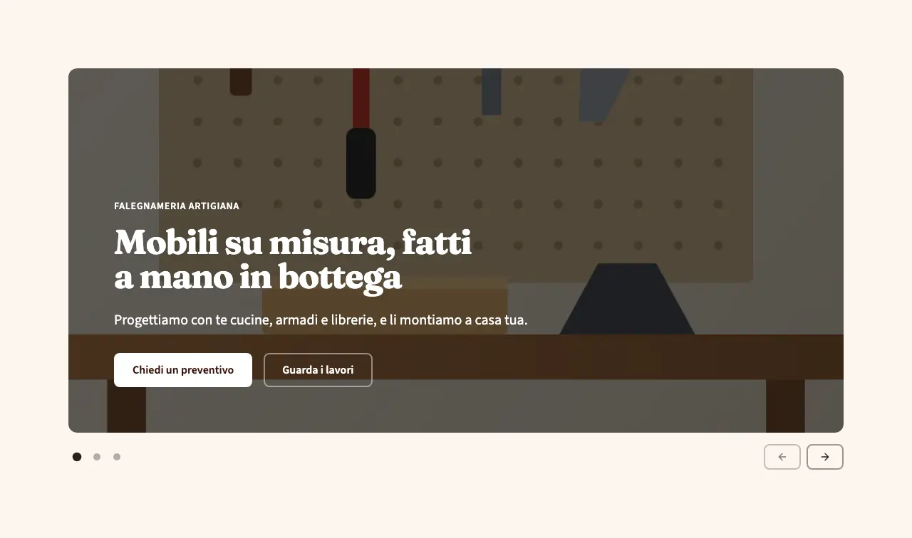

<!-- Generato da scripts/gen-catalog.ts (npm run gen:catalog): non modificare a mano. -->

# slider — Slider

[← Catalogo](../README.md) · sezione delle ricette (`page`) · v1.0.0 · apertura · interattivo · disegno originale · dal vivo `/catalogo/slider/`

Apertura con da 2 a 5 foto a tutta larghezza, velatura e testo bianco, una alla volta: si sfogliano con frecce, pallini, dito o tastiera e non scorrono mai da sole. Il titolo della prima slide è l’h1.

**Quando usarlo:** Come primo blocco della home, al posto della hero, quando l’attività ha più servizi o ambienti da mettere in evidenza subito e una foto di qualità per ognuno.

**Evitare quando:** Con una foto sola (hero full), con foto piccole o confuse, o a metà pagina: contiene l’h1. Per mostrare lavori o locali più in basso usa gallery.

**Varianti:**

- `scorrimento` — Le slide scorrono di lato, come un carosello: si trascinano col dito o col trackpad. **Quando usarla:** Quasi sempre: chi visita capisce subito che ci sono altre foto e le sfoglia col dito. Fixture «Scorrimento», dal vivo `/catalogo/slider/scorrimento/`.

  

  

- `dissolvenza` — Le slide restano ferme e una sfuma nell’altra; col dito si passa alla successiva con uno swipe. **Quando usarla:** Per attività dal tono calmo o elegante (ristoranti, benessere, studi), con foto simili per luce e inquadratura. Fixture «Dissolvenza», dal vivo `/catalogo/slider/dissolvenza/`.

  

  

**Campi:**

| Campo | Tipo | Obbl. | Limiti | Note |
| --- | --- | --- | --- | --- |
| `variant` | scelta | sì | `scorrimento` · `dissolvenza` | «Variante» |
| `slides` | elenco | sì | 2–5 voci | «Slide» |
| `slides[].eyebrow` | testo | no |  | «Occhiello» |
| `slides[].title` | testo | sì | max 70 | «Titolo» |
| `slides[].subtitle` | testo | no | max 200 | «Sottotitolo» |
| `slides[].primaryCta` | gruppo | no |  | «Pulsante principale» |
| `slides[].primaryCta.label` | testo | sì, se c’è `slides[].primaryCta` | max 25 | «Testo del pulsante» |
| `slides[].primaryCta.href` | testo | sì, se c’è `slides[].primaryCta` | un link (/pagina/, #sezione, https://...) oppure @telefono, @whatsapp, @email, @mappa | «Link» |
| `slides[].primaryCta.style` | scelta | no | `primary` · `secondary` · `ghost` · `link` | «Stile» |
| `slides[].primaryCta.icon` | icona | no | [lista icone](../README.md#icone) | «Icona» |
| `slides[].secondaryCta` | gruppo | no |  | «Pulsante secondario» · Solo insieme a slides[].primaryCta. |
| `slides[].secondaryCta.label` | testo | sì, se c’è `slides[].secondaryCta` | max 25 | «Testo del pulsante» |
| `slides[].secondaryCta.href` | testo | sì, se c’è `slides[].secondaryCta` | un link (/pagina/, #sezione, https://...) oppure @telefono, @whatsapp, @email, @mappa | «Link» |
| `slides[].secondaryCta.style` | scelta | no | `primary` · `secondary` · `ghost` · `link` | «Stile» |
| `slides[].secondaryCta.icon` | icona | no | [lista icone](../README.md#icone) | «Icona» |
| `slides[].image` | gruppo | sì |  | «Foto» |
| `slides[].image.src` | immagine | sì | foto in src/assets/images | «File» |
| `slides[].image.alt` | testo | sì | min 5 | «Testo alternativo» |
| `arrows` | scelta | no (predefinito `"sotto"`) | `sotto` · `lati` · `nessuna` | «Frecce» · Con lati, sotto i 768 px le frecce vanno sotto la foto, per non coprire il testo. |
| `animation` | scelta | no (predefinito `"sale"`) | `sale` · `dissolvenza` · `nessuna` | «Animazione dei testi» · Con il movimento ridotto i testi compaiono subito, senza animazione. |
| `overlay` | scelta | no (predefinito `"scura"`) | `scura` · `colorata` | «Velatura» |

Nelle note, tra «», l’etichetta del campo nel CMS. Ogni sezione ha anche `type` (`slider`), `id` (ancora facoltativa, in kebab-case), `tone` (`default`, `muted`, `primary`), `background`, l’effetto dello sfondo (`pieno`, `sfumato`, `alone`, `aurora`, `decoro`; [effetti di sfondo](../README.md#effetti-di-sfondo)), ed `edge`, il bordo in alto ([bordi tra sezioni](../README.md#bordi-tra-sezioni)): vedi `src/content/pages/README.md`.

**Regole:**

- Il pulsante secondario di una slide va solo insieme al principale (primaryCta).

**Esempio pronto** (fixture «Scorrimento», una sezione per `sections`; immagini relative a `src/content/pages`):

```json
{
	"type": "slider",
	"variant": "scorrimento",
	"slides": [
		{
			"eyebrow": "Trattoria di quartiere",
			"title": "Cucina di casa, a pranzo e a cena",
			"subtitle": "Piatti della tradizione con ingredienti del mercato, in una sala tranquilla a due passi dal centro.",
			"primaryCta": {
				"label": "Prenota un tavolo",
				"href": "#prenota"
			},
			"secondaryCta": {
				"label": "Il menu",
				"href": "#menu"
			},
			"image": {
				"src": "../../assets/images/fixtures/ristorante-sala.jpg",
				"alt": "Sala della trattoria con tavoli apparecchiati e luci calde"
			}
		},
		{
			"eyebrow": "La cucina",
			"title": "La pasta la tiriamo a mano ogni mattina",
			"subtitle": "Tagliatelle, ravioli e gnocchi preparati in cucina, con i sughi della stagione.",
			"primaryCta": {
				"label": "Guarda il menu",
				"href": "#menu"
			},
			"image": {
				"src": "../../assets/images/fixtures/ristorante-cucina.jpg",
				"alt": "Cucina della trattoria con pentole sui fornelli"
			}
		},
		{
			"title": "Feste e cene private su prenotazione",
			"image": {
				"src": "../../assets/images/fixtures/ristorante-piatto.jpg",
				"alt": "Piatto di pasta al pomodoro servito su una tovaglia a quadri"
			}
		}
	]
}
```
