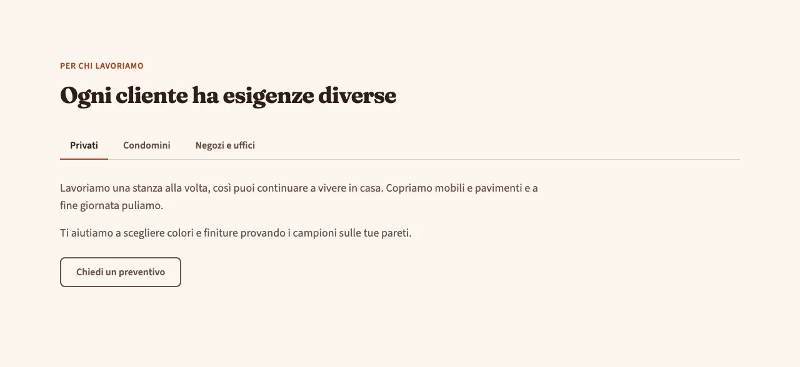
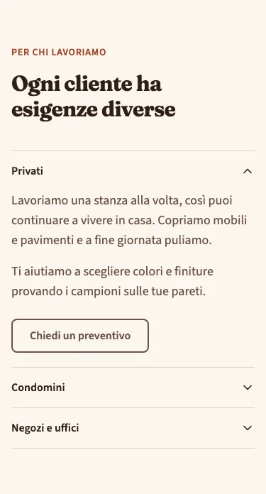
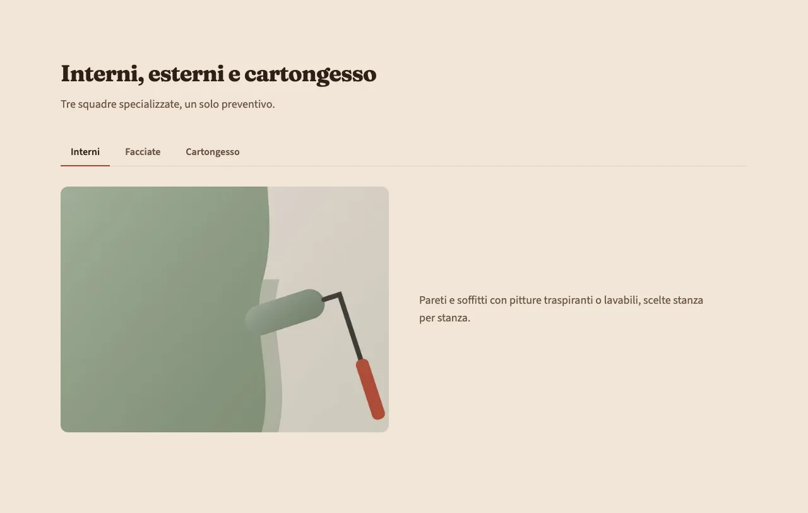
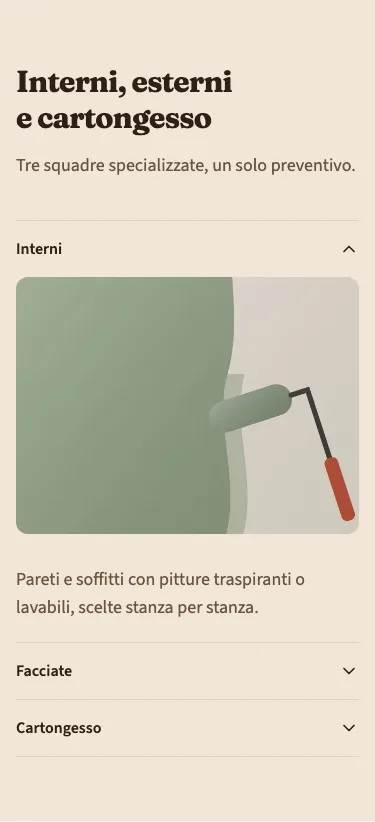

<!-- Generato da scripts/gen-catalog.ts (npm run gen:catalog): non modificare a mano. -->

# Schede

[← Catalogo](../README.md) · dal vivo: `/catalogo/tabs/`

| Tipo | Scope | Versione | Interattivo | Categoria | Disegno |
| --- | --- | --- | --- | --- | --- |
| `tabs` | `page`: sezione delle ricette | 1.0.0 | sì | contenuti | originale |

Contenuti alternativi in schede: se ne vede uno alla volta, da desktop con le linguette, su mobile come elenco da aprire.

- **Quando usarlo.** Quando chi visita sceglie una strada tra poche alternative parallele dello stesso tipo: interni o esterni, privati o condomini, tipi di finitura.
- **Quando evitarlo.** Per informazioni che tutti devono leggere (prezzi, condizioni, garanzie): nelle schede chiuse non le vede quasi nessuno, meglio un testo aperto o services. Per più di 6 voci o etichette lunghe, per confrontare elementi fianco a fianco (servono card o una tabella) e per passaggi in sequenza (meglio accordion o un elenco numerato).

## Varianti

### `testo`

Solo testo, eventualmente con un pulsante. Compatta.

Da sola: `/catalogo/tabs/testo/` · fixture «Testo».





### `testo-immagine`

Testo e foto affiancati in ogni scheda (foto sopra su mobile). Richiede una foto per scheda.

Da sola: `/catalogo/tabs/testo-immagine/` · fixture «Testo e immagine».





## Campi

| Campo | Tipo | Obbligatorio | Limiti | Etichetta e aiuto (CMS) | Vincoli |
| --- | --- | --- | --- | --- | --- |
| `variant` | scelta | sì | `testo` · `testo-immagine` | **Variante** — testo: solo testo nelle schede · testo-immagine: testo e foto affiancati in ogni scheda |  |
| `eyebrow` | testo | no |  | **Occhiello** — Breve testo sopra il titolo |  |
| `title` | testo | sì | max 70 caratteri | **Titolo** — Al massimo 70 caratteri |  |
| `intro` | testo | no | max 240 caratteri | **Introduzione** — Al massimo 240 caratteri |  |
| `items` | elenco | sì | da 2 a 6 | **Schede** — Da 2 a 6 |  |
| `items[].label` | testo | sì | max 30 caratteri | **Nome della scheda** — Corto, al massimo 30 caratteri |  |
| `items[].text` | testo | sì | max 600 caratteri | **Testo** — Al massimo 600 caratteri; una riga vuota separa i paragrafi |  |
| `items[].image` | gruppo | no |  | **Foto** — Obbligatoria per la variante testo-immagine | Obbligatoria per la variante testo-immagine; testo non la mostra. |
| `items[].image.src` | immagine | sì, se c’è `items[].image` | file in src/assets/images, percorso relativo al JSON | **File** — JPG, PNG o WebP; per le foto grandi almeno 1600 px di larghezza |  |
| `items[].image.alt` | testo | sì, se c’è `items[].image` | almeno 5 caratteri | **Testo alternativo** — Descrive la foto a chi non la vede, es. «Soggiorno con pareti verde salvia» |  |
| `items[].cta` | gruppo | no |  | **Pulsante** — Facoltativo, sotto il testo |  |
| `items[].cta.label` | testo | sì, se c’è `items[].cta` | max 25 caratteri | **Testo del pulsante** — Al massimo 25 caratteri |  |
| `items[].cta.href` | testo | sì, se c’è `items[].cta` | un link (/pagina/, #sezione, https://...) oppure @telefono, @whatsapp, @email, @mappa | **Link** — Una pagina del sito (/contatti/), una sezione (#preventivo), un indirizzo completo, oppure @telefono, @whatsapp, @email o @mappa per i recapiti di «Dati attività» |  |
| `items[].cta.style` | scelta | no | `primary` · `secondary` · `ghost` · `link` | **Stile** — primary: pieno · secondary: bordato · ghost: solo testo · link: sottolineato. Vuoto: quello previsto dal blocco |  |
| `items[].cta.icon` | icona | no | un alias di [icone.md](../icone.md) | **Icona** — Facoltativa, accanto al testo (le frecce vanno dopo il testo) |  |

Ogni sezione ha anche `type` (`tabs`), `id` (ancora facoltativa, in kebab-case) e `tone` (`default`, `muted`, `primary`): vedi `src/content/pages/README.md`.

## Esempio

Dalla fixture «Testo», una sezione da mettere in `sections` di una ricetta (le immagini sono percorsi relativi a `src/content/pages`):

```json
{
	"type": "tabs",
	"variant": "testo",
	"eyebrow": "Per chi lavoriamo",
	"title": "Ogni cliente ha esigenze diverse",
	"items": [
		{
			"label": "Privati",
			"text": "Lavoriamo una stanza alla volta, così puoi continuare a vivere in casa. Copriamo mobili e pavimenti e a fine giornata puliamo.\n\nTi aiutiamo a scegliere colori e finiture provando i campioni sulle tue pareti.",
			"cta": {
				"label": "Chiedi un preventivo",
				"href": "#preventivo"
			}
		},
		{
			"label": "Condomini",
			"text": "Concordiamo i lavori con l’amministratore e li dividiamo a fasce orarie, per disturbare il meno possibile chi ci abita. Vani scala, androni e facciate con un unico referente."
		},
		{
			"label": "Negozi e uffici",
			"text": "Interveniamo la sera o nel fine settimana, per non fermare la tua attività. Pitture lavabili e resistenti, adatte agli ambienti di passaggio."
		}
	]
}
```
