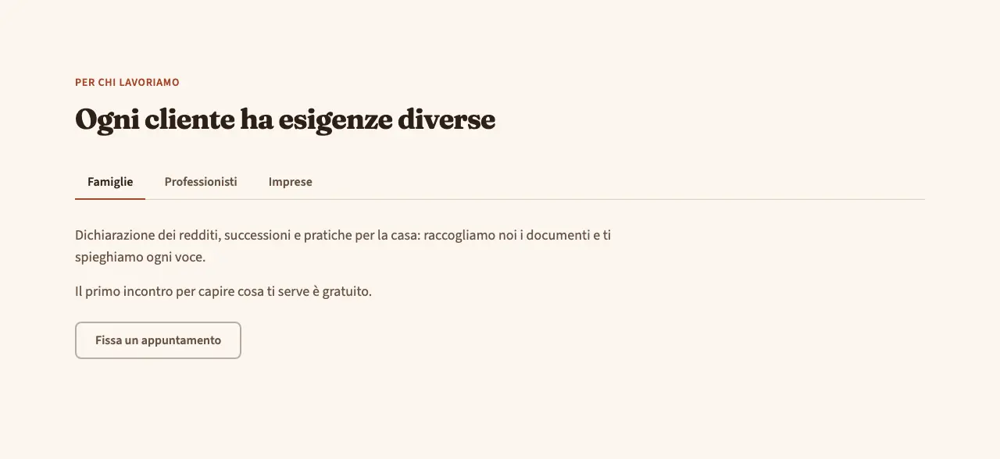
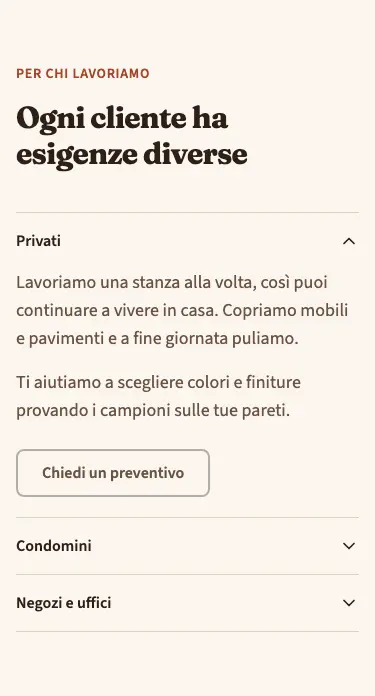
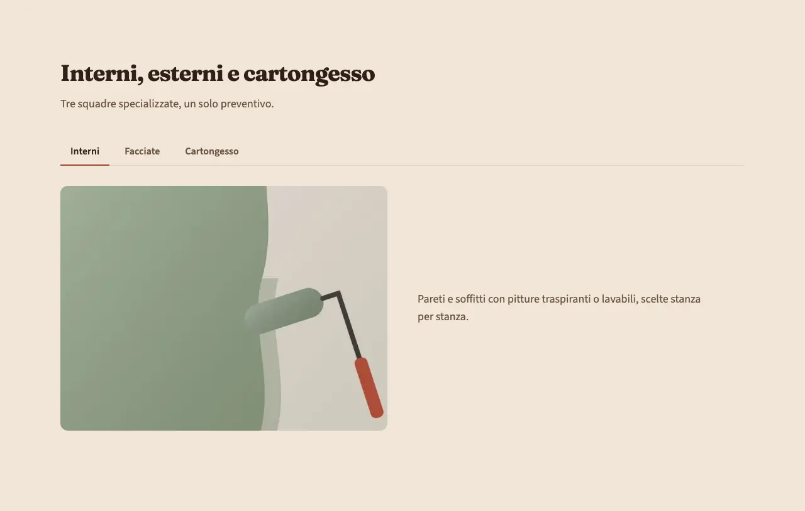

<!-- Generato da scripts/gen-catalog.ts (npm run gen:catalog): non modificare a mano. -->

# tabs — Schede

[← Catalogo](../README.md) · sezione delle ricette (`page`) · v1.0.0 · contenuti · interattivo · disegno originale · dal vivo `/catalogo/tabs/`

Contenuti alternativi in schede: se ne vede uno alla volta, da desktop con le linguette, su mobile come elenco da aprire.

**Quando usarlo:** Quando chi visita sceglie una strada tra poche alternative parallele dello stesso tipo: interni o esterni, privati o condomini, tipi di finitura.

**Evitare quando:** Per informazioni che tutti devono leggere (prezzi, condizioni, garanzie): nelle schede chiuse non le vede quasi nessuno, meglio un testo aperto o services. Per più di 6 voci o etichette lunghe, per confrontare elementi fianco a fianco (servono card o una tabella) e per passaggi in sequenza (meglio accordion o un elenco numerato).

**Varianti:**

- `testo` — Solo testo in ogni scheda, eventualmente con un pulsante. **Quando usarla:** Per informazioni parallele e brevi, senza foto: fasi del lavoro, tipi di intervento. Fixture «Testo», dal vivo `/catalogo/tabs/testo/`.

  

  

- `testo-immagine` — Testo e foto affiancati in ogni scheda (foto sopra su mobile). **Quando usarla:** Quando ogni scheda ha una sua foto: storia, metodo, squadra. Fixture «Testo e immagine», dal vivo `/catalogo/tabs/testo-immagine/`.

  

  

**Campi:**

| Campo | Tipo | Obbl. | Limiti | Note |
| --- | --- | --- | --- | --- |
| `variant` | scelta | sì | `testo` · `testo-immagine` | «Variante» |
| `eyebrow` | testo | no |  | «Occhiello» |
| `title` | testo | sì | max 70 | «Titolo» |
| `intro` | testo | no | max 240 | «Introduzione» |
| `items` | elenco | sì | 2–6 voci | «Schede» |
| `items[].label` | testo | sì | max 30 | «Nome della scheda» |
| `items[].text` | testo | sì | max 600 | «Testo» |
| `items[].image` | gruppo | per testo-immagine |  | «Foto» · testo non la mostra. |
| `items[].image.src` | immagine | sì, se c’è `items[].image` | foto in src/assets/images | «File» |
| `items[].image.alt` | testo | sì, se c’è `items[].image` | min 5 | «Testo alternativo» |
| `items[].cta` | gruppo | no |  | «Pulsante» |
| `items[].cta.label` | testo | sì, se c’è `items[].cta` | max 25 | «Testo del pulsante» |
| `items[].cta.href` | testo | sì, se c’è `items[].cta` | un link (/pagina/, #sezione, https://...) oppure @telefono, @whatsapp, @email, @mappa | «Link» |
| `items[].cta.style` | scelta | no | `primary` · `secondary` · `ghost` · `link` | «Stile» |
| `items[].cta.icon` | icona | no | [lista icone](../README.md#icone) | «Icona» |

Nelle note, tra «», l’etichetta del campo nel CMS. Ogni sezione ha anche `type` (`tabs`), `id` (ancora facoltativa, in kebab-case) e `tone` (`default`, `muted`, `primary`): vedi `src/content/pages/README.md`.

**Regole:**

- La variante testo-immagine richiede la foto in ogni scheda.

**Esempio pronto** (fixture «Testo», una sezione per `sections`; immagini relative a `src/content/pages`):

```json
{
	"type": "tabs",
	"variant": "testo",
	"eyebrow": "Per chi lavoriamo",
	"title": "Ogni cliente ha esigenze diverse",
	"items": [
		{
			"label": "Privati",
			"text": "Lavoriamo una stanza alla volta, così puoi continuare a vivere in casa. Copriamo mobili e pavimenti e a fine giornata puliamo.\n\nTi aiutiamo a scegliere colori e finiture provando i campioni sulle tue pareti.",
			"cta": {
				"label": "Chiedi un preventivo",
				"href": "#preventivo"
			}
		},
		{
			"label": "Condomini",
			"text": "Concordiamo i lavori con l’amministratore e li dividiamo a fasce orarie, per disturbare il meno possibile chi ci abita. Vani scala, androni e facciate con un unico referente."
		},
		{
			"label": "Negozi e uffici",
			"text": "Interveniamo la sera o nel fine settimana, per non fermare la tua attività. Pitture lavabili e resistenti, adatte agli ambienti di passaggio."
		}
	]
}
```
