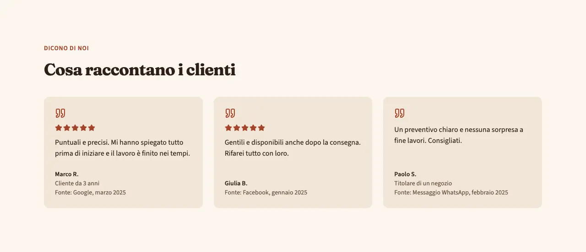
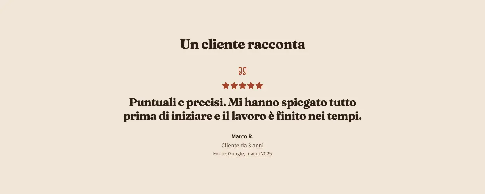
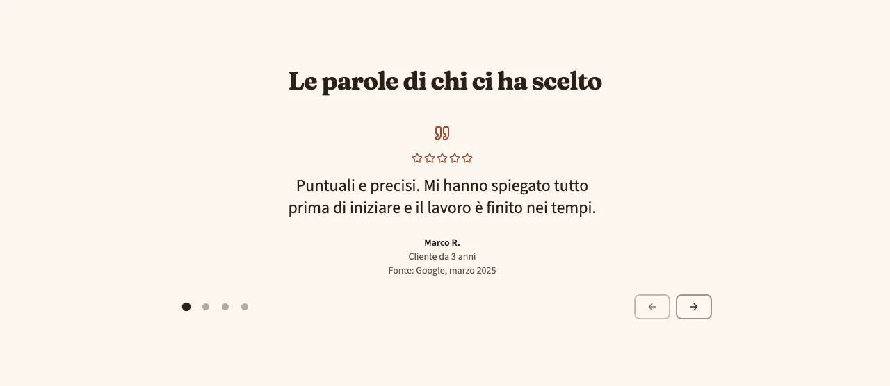

<!-- Generato da scripts/gen-catalog.ts (npm run gen:catalog): non modificare a mano. -->

# testimonials — Recensioni

[← Catalogo](../README.md) · sezione delle ricette (`page`) · v1.0.0 · contenuti · interattivo · disegno originale · dal vivo `/catalogo/testimonials/`

Le parole dei clienti: recensioni vere con autore e fonte, in griglia, una sola in evidenza o da sfogliare.

**Quando usarlo:** Quando il cliente ha recensioni reali (Google, Facebook, messaggi) e può dire dove sono state scritte.

**Evitare quando:** Senza recensioni reali: non si inventano né si riassumono. Senza la fonte di ognuna. Per numeri e statistiche (about, con-numeri). Per voti medi o conteggi complessivi, che non sono nel blocco.

**Varianti:**

- `cards` — Recensioni in card, su una, due o tre colonne; ognuna con autore e fonte. **Quando usarla:** Con 2-6 recensioni brevi da leggere tutte insieme. Fixture «Cards», dal vivo `/catalogo/testimonials/cards/`.

  

  

- `singola` — Una sola recensione in grande, centrata, con autore e fonte. **Quando usarla:** Quando una recensione è particolarmente forte, ad esempio sopra a una richiesta di contatto. Fixture «Singola», dal vivo `/catalogo/testimonials/singola/`.

  

  

- `slider` — Una recensione alla volta, con frecce e pallini; scorre solo su comando. **Quando usarla:** Con 3-10 recensioni, quando non c’è spazio per mostrarle tutte. Fixture «Slider», dal vivo `/catalogo/testimonials/slider/`.

  

  

**Campi:**

| Campo | Tipo | Obbl. | Limiti | Note |
| --- | --- | --- | --- | --- |
| `variant` | scelta | sì | `cards` · `singola` · `slider` | «Variante» |
| `eyebrow` | testo | no | max 40 | «Occhiello» |
| `title` | testo | sì | max 70 | «Titolo» |
| `items` | elenco | sì | 1–10 voci | «Recensioni» · Singola: 1 recensione · cards: da 2 a 6 · slider: da 3 a 10. |
| `items[].quote` | testo | sì | 10–400 | «Recensione» |
| `items[].author` | testo | sì | max 60 | «Autore» |
| `items[].role` | testo | no | max 60 | «Chi è» |
| `items[].rating` | numero | no |  | «Stelle» |
| `items[].fonte` | testo | sì | 2–60 | «Fonte» · Obbligatoria per ogni recensione; compare sotto l’autore. |
| `items[].href` | testo | no | https://… | «Link alla recensione» · Se c’è, la fonte diventa un link alla recensione originale. |

Nelle note, tra «», l’etichetta del campo nel CMS. Ogni sezione ha anche `type` (`testimonials`), `id` (ancora facoltativa, in kebab-case) e `tone` (`default`, `muted`, `primary`): vedi `src/content/pages/README.md`.

**Regole:**

- La variante singola vuole una sola recensione, cards da 2 a 6, slider da 3 a 10.

**Esempio pronto** (fixture «Cards», una sezione per `sections`; immagini relative a `src/content/pages`):

```json
{
	"type": "testimonials",
	"variant": "cards",
	"eyebrow": "Dicono di noi",
	"title": "Cosa raccontano i clienti",
	"items": [
		{
			"quote": "Puntuali e precisi. Mi hanno spiegato tutto prima di iniziare e il lavoro è finito nei tempi.",
			"author": "Marco R.",
			"role": "Cliente da 3 anni",
			"rating": 5,
			"fonte": "Google, marzo 2025"
		},
		{
			"quote": "Gentili e disponibili anche dopo la consegna. Rifarei tutto con loro.",
			"author": "Giulia B.",
			"rating": 5,
			"fonte": "Facebook, gennaio 2025"
		},
		{
			"quote": "Un preventivo chiaro e nessuna sorpresa a fine lavori. Consigliati.",
			"author": "Paolo S.",
			"role": "Titolare di un negozio",
			"fonte": "Messaggio WhatsApp, febbraio 2025"
		}
	]
}
```
