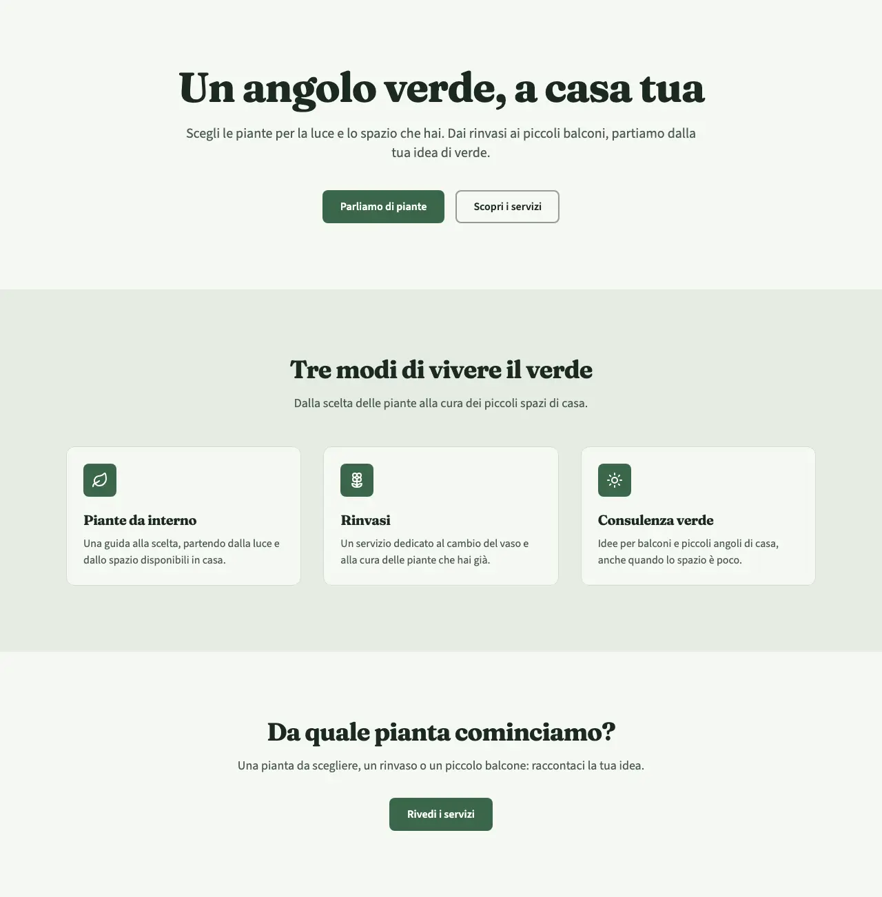
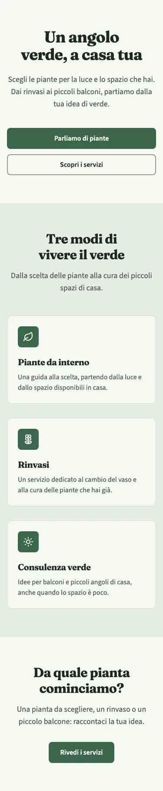
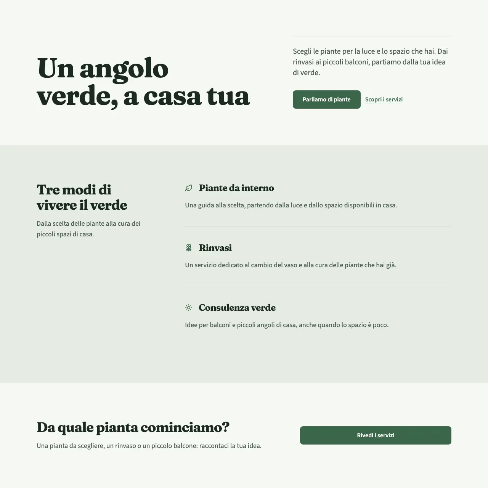
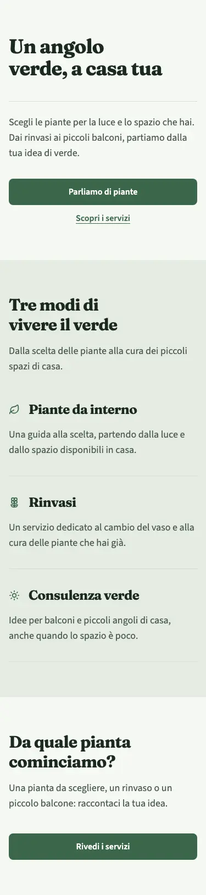
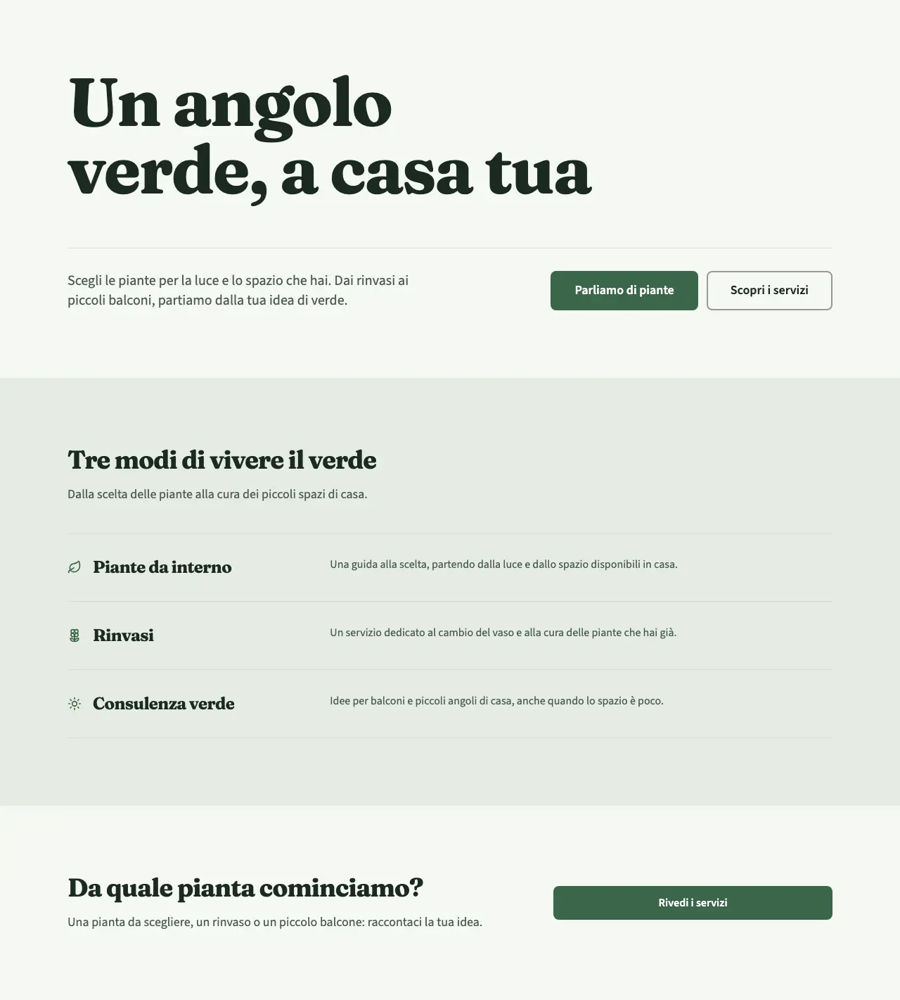
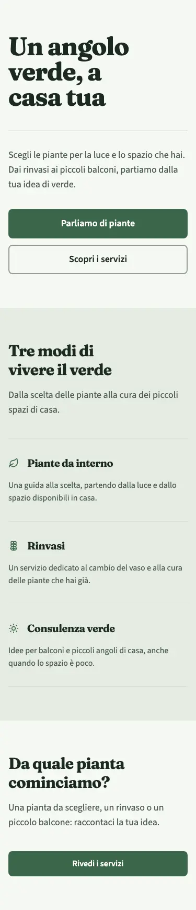

<!-- Generato da scripts/gen-catalog.ts (npm run gen:catalog): non modificare a mano. -->

# Composizioni a confronto

Testi, toni e cinque preset uguali (salvia, classico, morbido, nessuno, liscia). Cambiano gerarchia e disposizione, senza foto. Dal vivo: `/catalogo/composizioni/`.

## Centrata

Un messaggio raccolto, servizi di pari peso.

Apertura al centro, griglia di card, chiusura centrata.

Ricetta di esempio: [bottega-centrata-home.json](ricette-tipo/bottega-centrata-home.json).

## Editoriale

Titolo e spiegazione hanno ruoli distinti.

Apertura su colonne, introduzione laterale, servizi in lettura verticale.

Ricetta di esempio: [bottega-editoriale-home.json](ricette-tipo/bottega-editoriale-home.json).

## Manifesto

Il messaggio guida la pagina prima dei dettagli.

Titolo dominante, servizi in righe aperte, invito a colonne.

Ricetta di esempio: [bottega-manifesto-home.json](ricette-tipo/bottega-manifesto-home.json).

Gli esempi non sono home complete da duplicare: contenuti e priorità del brief guidano la composizione. Le anteprime sono generate da npm run catalog, non disegnate separatamente dal sito.
