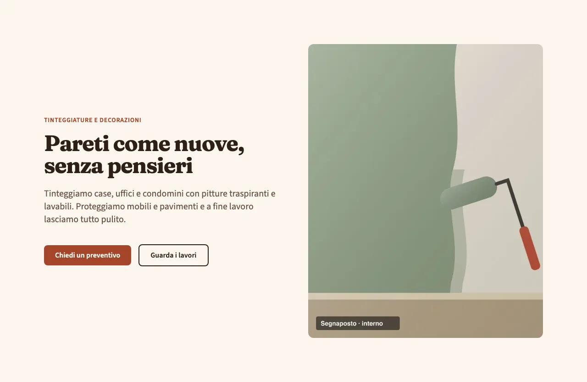
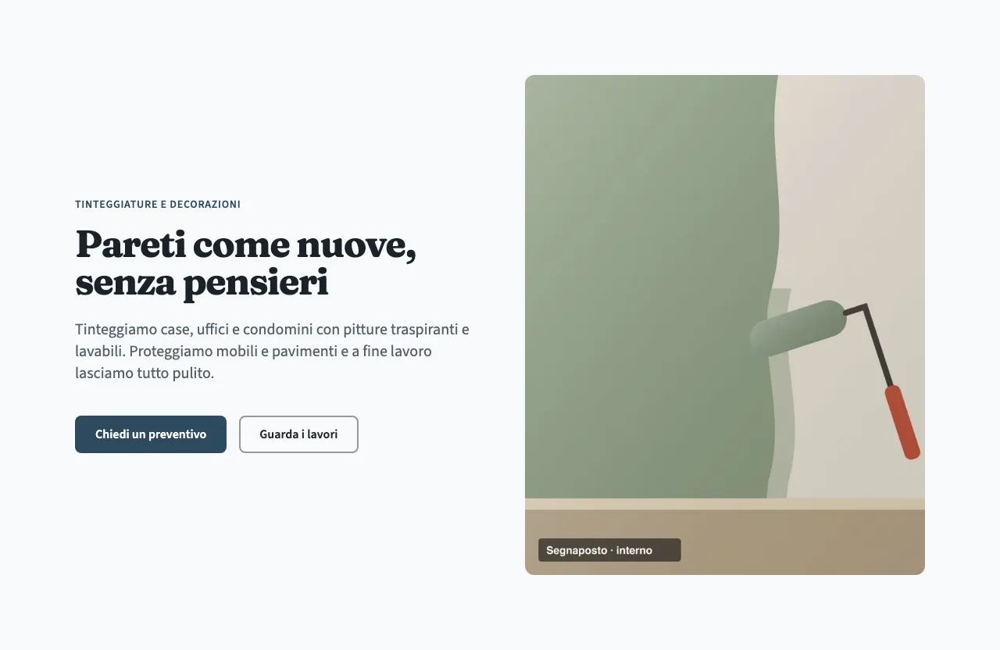

<!-- Generato da scripts/gen-catalog.ts (npm run gen:catalog): non modificare a mano. -->

# Temi

[← Catalogo](README.md)

L’aspetto del sito si sceglie in `src/content/settings/theme.json` con tre preset: `palette`, `fonts` e `shape`. Ogni preset è un CSS in `src/themes/<palettes|fonts|shapes>/` con accanto la sua scheda `<nome>.meta.ts`. Nel catalogo dal vivo si provano con i selettori in alto; una variante da sola accetta `?palette=…&fonts=…&shape=…` (es. `/catalogo/hero/split/?palette=ardesia&fonts=moderno&shape=arrotondato`).

## Palette

Ogni palette passa il controllo di contrasto WCAG AA (`npm run check:contrast`). Sotto, i colori principali e l’hero con quella palette.

### Terracotta · `terracotta`

Calda e accogliente: cotto, pietra serena e oliva, con un sapore artigianale e toscano.

**Adatta a:** imbianchini e decoratori, edilizia e finiture, ristoranti e trattorie, agriturismi, botteghe artigiane.

| Token | Valore |
| --- | --- |
| `bg` | `#fbf6ef` |
| `surface` | `#f2e6d7` |
| `fg` | `#2e1f17` |
| `primary` | `#a5452a` |
| `accent` | `#56652b` |

### Ardesia · `ardesia`

Neutra e moderna: grigi freddi e blu ardesia con un accento ambra; ordinata e professionale.

**Adatta a:** impiantisti ed elettricisti, studi tecnici e professionali, officine e carrozzerie, pulizie e manutenzioni, servizi alle imprese.

| Token | Valore |
| --- | --- |
| `bg` | `#f8fafb` |
| `surface` | `#eaeef1` |
| `fg` | `#1b2228` |
| `primary` | `#2d4a5e` |
| `accent` | `#e5a13a` |

## Font

### Moderno · `moderno`

Bastoni geometrici per titoli e testo: pulito, tecnico, contemporaneo.

**Adatta a:** impiantisti e servizi tecnici, studi professionali, officine, attività giovani.

**Titoli:** Manrope · **Testo:** Inter

### Classico · `classico`

Titoli graziati dal carattere caldo e un po’ tradizionale, testo senza grazie chiaro e leggibile.

**Adatta a:** artigiani e botteghe, ristorazione, turismo e ospitalità, attività di tradizione.

**Titoli:** Fraunces · **Testo:** Source Sans 3

## Forme

### Squadrato · `squadrato`

Angoli vivi su card e pulsanti: rigoroso, tecnico, essenziale.

**Adatta a:** studi tecnici e professionali, edilizia e impianti, officine e carrozzerie.

**Raggi:** card e riquadri `0` · pulsanti `0`

### Morbido · `morbido`

Angoli appena arrotondati: equilibrato e cordiale senza perdere serietà.

**Adatta a:** artigiani e imprese di servizi, negozi e botteghe, la maggior parte delle attività.

**Raggi:** card e riquadri `0.75rem` · pulsanti `0.5rem`

### Arrotondato · `arrotondato`

Card molto arrotondate e pulsanti a pillola: amichevole e informale.

**Adatta a:** bar e pasticcerie, servizi alla persona (parrucchieri, estetica), attività per famiglie e bambini.

**Raggi:** card e riquadri `1.5rem` · pulsanti `9999px`
